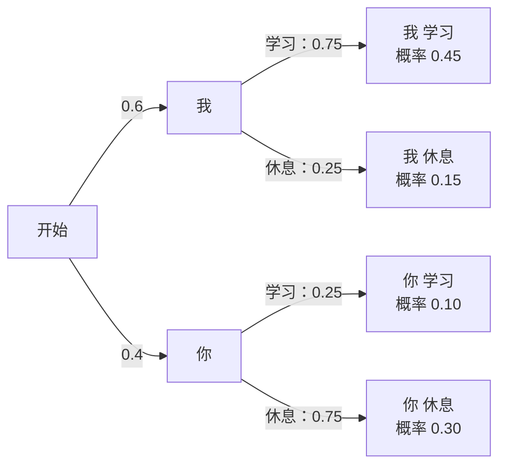
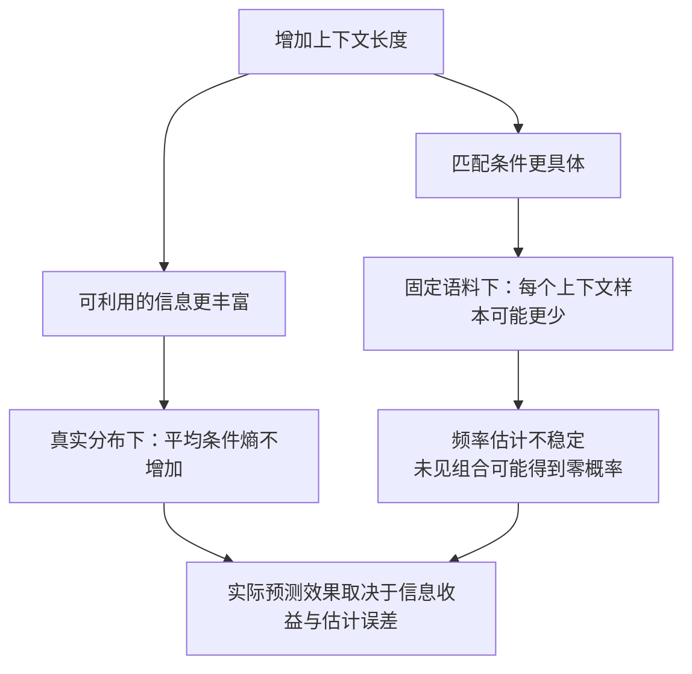
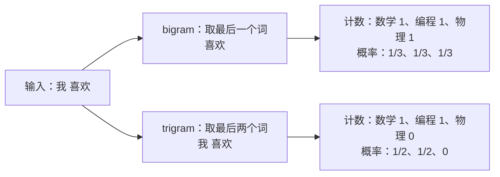

# 第一章：语言模型究竟在建模什么

从一句话的概率，到预测下一个 token。

更新日期：2026-10-21。状态：核心内容与实验已完成。

| 小节 | 主题 | 状态 |
| --- | --- | --- |
| 1.1 | 序列概率、链式分解与生成 | 已讨论，已整理 |
| 1.2 | 长上下文的信息收益与估计困难 | 已讨论，已整理 |
| 1.3 | 插值平滑与虚拟计数 | 已讨论，已整理 |
| 1.4 | 最大似然、交叉熵与困惑度 | 已讨论，已整理 |
| 1.5 | 小语料计数模型实验 | 已完成，可用 Notebook 复现 |

配套 [交互演示](visuals/01-language-modeling.html)：概率树、插值平滑与交叉熵。

## 1.1 序列概率、链式分解与生成

早期语言模型的一个出发点是：自然语言有规律，因此已有文本能帮助预测后续文本。Shannon 关于语言预测与信息量的研究是这条历史线的重要起点。我们先把这个问题写成概率模型，再讨论如何从数据估计它。

把文本切分成 token，得到序列 $x_1,\ldots,x_T$，其中 $x_t\in\mathcal V$，$\mathcal V$ 是词表。token 可以是字、词、子词或字节。本章以词为例。

语言模型为序列分配概率，也为给定上下文的各种延续分配概率。以下模型生成两个词，然后结束。



例如：

$$
P(\text{我 学习})=P(\text{我})P(\text{学习}\mid\text{我})=0.6\times0.75=0.45.
$$

四条完整路径的概率之和为 1。评价一个序列时，把对应路径上的条件概率相乘；生成一个序列时，按照每一步的条件分布采样。

对一般序列，概率链式法则给出：

$$
P(x_1,\ldots,x_T)=\prod_{t=1}^{T}P(x_t\mid x_{<t}).
$$

这是概率恒等式，不要求 token 相互独立。各条件分布都可以依赖完整历史。对于可变长度文本，还需要描述何时结束：

$$
P(x_1,\ldots,x_T,\mathrm{EOS})
=\left[\prod_{t=1}^{T}P(x_t\mid x_{<t})\right]
P(\mathrm{EOS}\mid x_{1:T}).
$$

实际生成通过 EOS 或长度上限结束。

“下一 token 预测”由此连接到完整序列建模。后续的核心问题是怎样估计条件概率。

## 1.2 长上下文：信息更多，样本更稀疏

更长的上下文提供更多信息，可能改善预测。其信息收益可以用条件熵描述。

令 $Y$ 是下一词，$C_1$ 是最近一个词，$C_9$ 是更早的九个词。对真实联合分布，有：

$$
H(Y\mid C_1,C_9)\le H(Y\mid C_1),
$$

$$
H(Y\mid C_1)-H(Y\mid C_1,C_9)=I(Y;C_9\mid C_1)\ge0.
$$

这里比较的是在真实分布下取平均的条件熵，不保证每个具体上下文的熵都下降，也不保证有限语料估计出的模型损失下降。

计数模型需要将观测分配到各个上下文。上下文越具体，匹配样本通常越少。例如：

| 上下文 | 出现次数 | 后接“提供”的次数 | 最大似然频率估计 |
| --- | ---: | ---: | ---: |
| 前一个词“银行” | 100 | 60 | 0.6 |
| 完整前十个词 | 1 | 0 | 0 |

完整十词上下文唯一一次后接“拒绝”。如果测试时真实下一词是“提供”，两种预测的负对数损失分别为 $-\ln0.6\approx0.511$ 和 $-\ln0=+\infty$。



在词表大小为 $V$ 的情况下，长度为 $k$ 的历史潜在组合数为 $V^k$。实际语言不会均匀占满所有组合，但长历史仍然会迅速产生大量罕见或未见的上下文。这同时带来统计估计和存储查询问题。

预测困难有两个来源：

- **同分布下的稀疏性**：训练和测试来自相同类型的文本，测试仍可能包含未见的长词组。
- **分布偏移**：例如训练使用新闻、测试使用医学病历，表达方式和条件概率本身可能变化。

即使没有分布偏移，长上下文的计数估计也可能泛化得更差。在 1.5 中，我们将比较训练与验证损失随上下文长度的变化。

## 1.3 插值平滑：让稀少观测借用更广泛的统计规律

长上下文更具体，短上下文通常有更多匹配样本。插值平滑将两种预测加权，兼顾上下文信息与统计稳定性。

令 $h$ 是十词上下文，$s$ 是它的最后两个词。将两种预测混合：

$$
P_{\mathrm{mix}}(w\mid h)
=\lambda(h)\widehat P(w\mid h)
+[1-\lambda(h)]\widehat P(w\mid s).
$$

当 $0\le\lambda(h)\le1$，且两个分量都是正规化的概率分布时，混合后仍是概率分布。

一个便于分析的权重选择是：

$$
\lambda(h)=\frac{n(h)}{n(h)+\alpha},\qquad \alpha>0.
$$

$n(h)$ 是长上下文出现次数，$\alpha$ 控制短上下文参考分布的强度。

| $n(h)$ | 长上下文权重，$\alpha=10$ | 短上下文权重 |
| ---: | ---: | ---: |
| 0 | 0 | 1 |
| 1 | 0.091 | 0.909 |
| 10 | 0.5 | 0.5 |
| 100 | 0.909 | 0.091 |

当 $n(h)=0$ 时，直接采用短上下文分布，不需要计算未定义的长上下文频率。

将下一词的概率按“提供”“拒绝”和“其余词合计”三组展示：

| 预测分布 | 提供 | 拒绝 | 其余词合计 |
| --- | ---: | ---: | ---: |
| 短上下文 | 0.6 | 0.1 | 0.3 |
| 长上下文，仅出现一次，后接“拒绝” | 0 | 1 | 0 |
| 混合，$n=1,\alpha=10$ | 0.545 | 0.182 | 0.273 |

权重公式还可以改写成：

$$
P_{\mathrm{mix}}(w\mid h)
=\frac{n(h,w)+\alpha\widehat P(w\mid s)}{n(h)+\alpha}.
$$

它相当于加入总量为 $\alpha$、按短上下文概率分配的虚拟计数。例如 $\alpha=10$、$\widehat P(\text{提供}\mid s)=0.6$，就贡献 6 次“提供”的虚拟观测。

将严格为正的短上下文分布作为固定参考，可构造参数为 $\alpha\widehat P(w\mid s)$ 的 Dirichlet 先验，上式就是后验预测。

平滑参数与零概率：

- 通过验证集选择平滑强度 $\alpha$，测试集用于最终评估。
- 如果两个分量都给某个 token 零概率，混合后仍为零；可以递归回退到经过平滑的更短上下文，并明确词表外 token 的处理。

交互演示中，长上下文的 $n$ 次观测都后接“拒绝”，短上下文分布固定；调整 $n$ 和 $\alpha$，观察混合分布的变化。

## 1.4 从最大似然到交叉熵与困惑度

### 1.4.1 为什么取对数

把训练语料看成若干序列。采用各序列样本独立的似然模型，并在每个序列内部使用链式分解：

$$
\operatorname{Lik}(\theta)
=\prod_d\prod_{t=1}^{T_d}
P_\theta(x_t^{(d)}\mid x_{<t}^{(d)}).
$$

这里的 $T_d$ 包含我们约定参与预测的结束符；不把 padding 计入有效 token。序列内部的 token 没有被假设为独立。

最大似然选择让观测语料获得更高概率的参数。对数严格递增，因此最大化似然等价于最大化对数似然。再乘以负号并除以有效 token 数 $N=\sum_d T_d$，得到平均负对数似然：

$$
\mathcal L(\theta)
=-\frac1N\sum_d\sum_{t=1}^{T_d}
\ln P_\theta(x_t^{(d)}\mid x_{<t}^{(d)}).
$$

在数据与分词固定时，除以 $N$ 不改变最优参数。求和比直接连乘更容易数值计算，也便于按 token 报告损失。

用一个可手算的例子把它与前面的计数模型连接起来：固定同一上下文，独立观察 10 次，其中 6 次后接“学习”、4 次后接“休息”。令模型给“学习”的概率为 $p$，给“休息”的概率为 $1-p$。这组具体观测序列的似然和对数似然是：

$$
\operatorname{Lik}(p)=p^6(1-p)^4,\qquad
\ell(p)=6\ln p+4\ln(1-p).
$$

对 $0<p<1$ 求导：

$$
\ell'(p)=\frac6p-\frac4{1-p}=0
\quad\Longrightarrow\quad p=0.6.
$$

二阶导数 $\ell''(p)=-6/p^2-4/(1-p)^2<0$，所以这里取得最大值。经验频率正是这个模型的最大似然估计；对应的平均损失是 $-0.6\ln p-0.4\ln(1-p)$。这保证了对已有样本的最优拟合，并不保证对未来样本也最优，因而与上一节引入平滑并不矛盾。

### 1.4.2 为什么也是交叉熵

对某个预测位置，真实观察到的 token 是 $y$。用 one-hot 分布 $r(w)=\mathbf1\{w=y\}$ 表示该训练标签，模型输出分布记为 $q(w)$。那么：

$$
H(r,q)=-\sum_{w\in\mathcal V}r(w)\ln q(w)=-\ln q(y).
$$

因此，在标准 one-hot 标签、无标签平滑的情况下，逐 token 交叉熵与负对数似然是同一个训练目标。

单次标签的 one-hot 表示并不意味着真实语言的下一词是确定的。对真实分布 $P$ 取期望，损失满足：

$$
\mathbb E_{h,w\sim P}[-\ln Q(w\mid h)]
=H_P(W\mid H)
+\mathbb E_{h\sim P}\left[D_{\mathrm{KL}}(P(\cdot\mid h)\Vert Q(\cdot\mid h))\right].
$$

第一项是数据本身的平均不确定性，第二项是模型与真实条件分布的差异。有限验证集上的平均损失只是这个期望的估计。

### 1.4.3 准确率相同，概率预测也一样好吗

沿用 10 次观测中 6 次“学习”、4 次“休息”的例子。每次选择概率最大的词：

| 模型 | $P(\text{学习})$ | $P(\text{休息})$ | 准确率 | 平均交叉熵 | 困惑度 |
| --- | ---: | ---: | ---: | ---: | ---: |
| A | 0.6 | 0.4 | 60% | 0.673 | 1.960 |
| B | 0.9 | 0.1 | 60% | 0.984 | 2.676 |

计算两个模型的平均交叉熵：

$$
\mathcal L_A=-0.6\ln0.6-0.4\ln0.4\approx0.673,
$$

$$
\mathcal L_B=-0.6\ln0.9-0.4\ln0.1\approx0.984.
$$

准确率只看概率最大的词是否命中；交叉熵还看模型给实际出现的词分配了多少概率。B 将“学习”的概率提高到 0.9，也将“休息”的概率压低到 0.1，后者带来的损失超过前者带来的收益。

令经验分布 $r=(0.6,0.4)$，模型分布为 $q$，则：

$$
H(r,q)=H(r)+D_{\mathrm{KL}}(r\Vert q),\qquad
D_{\mathrm{KL}}(r\Vert q)=\sum_w r(w)\ln\frac{r(w)}{q(w)}.
$$

因为 $D_{\mathrm{KL}}\ge0$，交叉熵在 $q=r$ 时取得最小值。A 的 KL 为零，B 的 KL 约为 0.311 nats/token，即 B 多出的平均损失。当所有观测共用一个预测分布时，最优损失为经验分布的熵 0.673；加入可区分这些观测的上下文特征后，需要分别计算条件分布。

### 1.4.4 为什么自信地预测错误会受到更大惩罚

固定同一个上下文，词表只有“学习”和“休息”。在两个观测样本中，两词各出现一次。考虑两个候选分布：

| 模型 | $P(\text{学习})$ | $P(\text{休息})$ | 平均 NLL（nats/token） | 困惑度 |
| --- | ---: | ---: | ---: | ---: |
| A | 0.5 | 0.5 | $-\ln0.5\approx0.693$ | 2 |
| B | 0.99 | 0.01 | $-\frac12(\ln0.99+\ln0.01)\approx2.308$ | 约 10.05 |

模型 B 给一个观测极高概率，却给另一个观测极低概率。后者的惩罚更大，所以总体损失更差。对观测到的 token 赋予零概率时，其 NLL 为无穷大。

交互演示可调整观测计数和模型概率，观察交叉熵曲线；点击 A、B 按钮可对比上一节的两个模型。

### 1.4.5 困惑度是什么

使用自然对数时，困惑度定义为：

$$
\operatorname{PPL}=\exp(\mathcal L)
=\left[\prod_{i=1}^{N}q_i\right]^{-1/N},
$$

其中 $q_i$ 是模型在第 $i$ 个位置给真实 token 的概率。它是这些概率的几何平均数的倒数。

若模型在每一步都给真实 token 概率 $1/K$，则 $\mathcal L=\ln K$、$\operatorname{PPL}=K$。这提供了“相当于在多少个等可能选项中预测”的直观尺度，但一般情况下它不是实际候选 token 的数量。

| 每一步给真实 token 的概率 | 平均交叉熵 | 困惑度 |
| ---: | ---: | ---: |
| 1 | 0 | 1 |
| 0.5 | $\ln2$ | 2 |
| 0.1 | $\ln10$ | 10 |

当每一步的概率不同时，令 $g=(\prod_i q_i)^{1/N}$，就有 $\operatorname{PPL}=1/g$。例如，两次真实 token 的概率分别为 0.99、0.01：

$$
g=\sqrt{0.99\times0.01}\approx0.0995,\qquad
\operatorname{PPL}=\frac1g\approx10.05.
$$

它们的算术平均数虽然是 0.5，但连乘结果远低于两次都预测为 0.5 的情形。序列概率通过连乘形成，因此困惑度使用几何平均。

指数函数严格递增，所以在相同评估条件下，交叉熵和困惑度对模型的排序一致。困惑度提供的是不同的读数尺度。

困惑度的下界为 1，没有由词表大小给出的普适上界：上面的二词词表已经产生了约 10.05 的困惑度。词表大小 $V$ 对应的是均匀预测基线的困惑度。

使用以 2 为底的对数时，损失单位是 bits/token，困惑度应使用 $2^{\mathcal L_2}$；不要混用对数底数。

比较困惑度时需要保持评估数据、分词方式、上下文协议、计入的 token（包括 EOS 的约定）一致。它评价概率预测质量，不能单独代表事实准确性、推理能力或任务成功率。

### 1.4.6 用验证集判断泛化

考虑增加上下文长度前后的评估结果：

| 模型 | 训练集 PPL | 验证集 PPL |
| --- | ---: | ---: |
| 较短上下文 | 20 | 22 |
| 较长上下文 | 5 | 30 |

训练集损失下降、验证集损失上升，是过拟合的典型信号。在相同评估数据与分词方式下，以验证集 PPL 选择前一个模型。

更长的上下文让计数模型区分更具体的历史，也使每种历史对应的样本更少。模型可能更贴合训练样本，却对未见组合给出更差的概率。1.5 将通过改变上下文长度与平滑强度，观察这种统计权衡。

## 1.5 用小语料验证这些结论

### 1.5.1 实验设计

先比较上下文长度 $k\in\{0,1,2,4,8\}$ 的计数模型。$k$ 表示用于预测的历史 token 数；通常称为 $(k+1)$-gram 模型。例如 unigram 的 $k=0$，bigram 的 $k=1$。

| 数据划分 | 用途 | 在实验中做什么 |
| --- | --- | --- |
| 训练集 | 估计模型 | 建立词表，统计上下文及后续 token 次数 |
| 验证集 | 选择方案 | 比较上下文长度 $k$ 与平滑强度 $\alpha$ |
| 测试集 | 最终评估 | 方案确定后报告 NLL 与 PPL |

先按文档划分数据，再在各集合内部生成上下文窗口。不同长度的模型使用相同的目标位置计算损失，便于比较。

验证集参与了方案选择，因此最终成绩还需要独立测试集。反复根据测试集结果调整 $k$ 或 $\alpha$，就会让测试集也参与模型选择。

### 1.5.2 避免数据泄漏

先按文档划分训练、验证和测试集，再在各集合内部生成上下文窗口。重复或近重复的文档归入同一集合。

若将同一文档的重叠窗口随机分到不同集合，训练与验证可能共享预测样本或高度相似的片段，使验证成绩偏乐观，难以反映模型对新文档的泛化能力。

### 1.5.3 从文本到条件概率表

先只预测第三个词，用四条训练样本观察计数过程：

```text
我 喜欢 数学
我 喜欢 编程
你 喜欢 物理
你 研究 物理
```

短上下文只保留前一个词，长上下文保留前两个词。对输入“我 喜欢”，两种统计为：

| 使用的上下文 | 数学次数 | 编程次数 | 物理次数 | 总次数 |
| --- | ---: | ---: | ---: | ---: |
| 喜欢 | 1 | 1 | 1 | 3 |
| 我 喜欢 | 1 | 1 | 0 | 2 |



训练阶段只需累积计数；预测阶段查表并归一化：

$$
\widehat P(w\mid h)=\frac{C(h,w)}{\sum_v C(h,v)}.
$$

下面的代码实现这张表，并计算 1.3 的插值分布：

```python
from collections import Counter, defaultdict

rows = [
    "我 喜欢 数学".split(),
    "我 喜欢 编程".split(),
    "你 喜欢 物理".split(),
    "你 研究 物理".split(),
]
short_counts = defaultdict(Counter)
long_counts = defaultdict(Counter)
for first, second, target in rows:
    short_counts[second][target] += 1
    long_counts[(first, second)][target] += 1

short = short_counts["喜欢"]
long = long_counts[("我", "喜欢")]
alpha = 2
for word in ["数学", "编程", "物理"]:
    p_short = short[word] / short.total()
    p_long = long[word] / long.total()
    p_mix = (long[word] + alpha * p_short) / (long.total() + alpha)
    print(word, round(p_short, 3), round(p_long, 3), round(p_mix, 3))
```

输出列依次为短上下文、长上下文、插值概率：

```text
数学 0.333 0.5 0.417
编程 0.333 0.5 0.417
物理 0.333 0.0 0.167
```

“物理”在训练中出现过，但“我 喜欢 → 物理”这个组合没有出现。长上下文的零概率来自组合稀疏；插值借用“喜欢 → 物理”的计数，为它分配了 $1/6$ 的概率。

需要区分三种查表情况：

| 情况 | 例子 | 后续处理 |
| --- | --- | --- |
| 上下文出现过，目标组合未出现 | 我 喜欢 → 物理 | 平滑、插值 |
| 整个长上下文未出现 | 他 喜欢 → 物理 | 回退到更短上下文 |
| 目标不在词表中 | 我 喜欢 → 天文学 | 先确定 UNK 或分词方案 |

### 1.5.4 实验：上下文长度与平滑强度

[实验 Notebook](../experiments/01-ngram/ngram.ipynb) · [运行说明](../experiments/01-ngram/README.md) · [静态图表](experiments/01-ngram/index.html) · [完整结果](experiments/01-ngram/README.md)

使用 D2L 英文讲义正文，按文件划分为 36 篇训练文档、8 篇验证文档、8 篇测试文档。每篇最多 1,200 个词，词表只从训练集建立，共 2,077 个 token；低频词和词表外词映射为 UNK。文档边界重置，所有词和 EOS 使用相同评分规则。

比较 $k\in\{0,1,2,4,8\}$、$\alpha\in\{0.1,1,10,100\}$，使用两种先验：

$$
P_k(w\mid h)=\frac{C(h,w)+\alpha P_{\mathrm{prior}}(w)}{C(h)+\alpha}.
$$

- **均匀先验**：$P_{\mathrm{prior}}(w)=1/V$。
- **递归插值**：$P_{\mathrm{prior}}(w)=P_{k-1}(w\mid h_{\mathrm{suffix}})$，零阶使用均匀先验。

这里 $\alpha$ 是虚拟计数总量，两种方法使用相同定义。


固定递归插值的 $\alpha=1$，得到：

| 上下文长度 $k$ | 训练 NLL | 验证 NLL | 验证集中未见过的上下文比例 |
| --- | ---: | ---: | ---: |
| 0 | 5.948 | 5.735 | 0.0% |
| 1 | 3.225 | 5.916 | 0.0% |
| 2 | 1.346 | 6.562 | 35.2% |
| 4 | 0.242 | 6.775 | 94.2% |
| 8 | 0.019 | 6.797 | 99.7% |

随着上下文变长，训练损失接近零，但验证损失升高。到 $k=8$ 时，验证位置中 99.7% 的完整上下文没有在训练中出现，预测主要依赖短上下文回退。

本次网格按验证集选择了 **递归插值，$k=4,\alpha=100$**：验证 NLL 为 **5.106**，随后测得测试 NLL 为 **5.036**。较强的平滑降低了对少量长上下文观测的信任。

额外的计算性能主题文档得到 NLL **5.158**。各集合的 UNK 比例不同，详细结果同时报告该比例；这个主题迁移实验仍限于同一本教材。

### 1.5.5 连接到系统成本

固定递归插值的 $\alpha=100$：

| 最大上下文 $k$ | 验证 NLL | 累计非零转移项 |
| --- | ---: | ---: |
| 2 | 5.1135 | 51,112 |
| 4 | 5.1058 | 122,571 |
| 8 | 5.1060 | 270,215 |

从 $k=4$ 增加到 $k=8$，累计转移项超过翻倍，验证表现几乎不变。这体现了计数模型的两项成本：越来越稀疏的统计，以及越来越大的存储表。转移项数量是规模指标，实际内存还包含上下文键与数据结构的开销。

本章的核心结论是：语言模型学习条件分布；训练拟合需要通过验证集检查；长上下文的收益受样本稀疏性限制。下一章进入神经语言模型，学习如何通过向量表示与参数共享利用相近上下文的统计。

## 参考资料

- [D2L：文本预处理](https://github.com/d2l-ai/d2l-en/blob/23d7a5aecceee57d1292c56e90cce307f183bb0a/chapter_recurrent-neural-networks/text-sequence.md)
- [D2L：语言模型](https://github.com/d2l-ai/d2l-en/blob/23d7a5aecceee57d1292c56e90cce307f183bb0a/chapter_recurrent-neural-networks/language-model.md)
- [CS336 Lecture 1：历史与分词](https://github.com/stanford-cs336/spring2025-lectures/blob/b98b08a98d9d47a69bbdcb4e96a58aa48ee4d13b/lecture_01.py)
- [CS336 Lecture 12：评估与困惑度](https://github.com/stanford-cs336/spring2025-lectures/blob/b98b08a98d9d47a69bbdcb4e96a58aa48ee4d13b/lecture_12.py)
