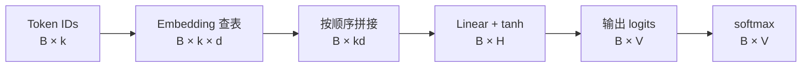
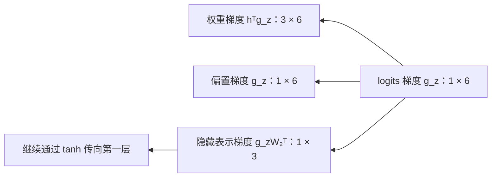

# 第二章：神经语言模型——从计数表到参数共享

| 小节 | 核心内容 |
| --- | --- |
| 2.1 | 从条件概率表到共享函数 |
| 2.2 | Token ID、embedding 与上下文表示 |
| 2.3 | MLP、softmax 与前向计算 |
| 2.4 | 交叉熵、梯度与参数更新 |
| 2.5 | 小型神经语言模型训练及计数基线对比 |
| 2.6 | RNN、LSTM 与序列状态 |

[实验 Notebook](../experiments/02-neural-lm/forward.ipynb) · [前向计算代码](../experiments/02-neural-lm/README.md)

## 2.1 用共享函数计算条件概率

第一章的计数模型通过 $C(h,w)$ 估计 $P(w\mid h)$。更长的上下文会产生更多稀疏表项。神经语言模型改用一个带参数的函数：

$$
P_\theta(w\mid h)=f_\theta(h)_w.
$$

不同上下文使用同一组参数 $\theta$。一个训练样本对参数的更新，能够影响其他上下文的预测，这就是参数共享。

Bengio 等人在 2003 年发表的 *A Neural Probabilistic Language Model* 是这条路线的重要代表：联合学习词的向量表示与下一词概率模型。本章先研究简化的固定窗口 MLP，不包含原论文中的直接线性连接。

| 模型 | 表示与计算方式 | 学习过程 |
| --- | --- | --- |
| n-gram 计数模型 | 查询上下文对应的计数，再平滑 | 累积计数 |
| 固定窗口神经语言模型 | 向量表示 → 共享网络 → 概率分布 | 优化交叉熵，更新参数 |

两者都使用固定长度历史，都可以通过链式法则为序列分配概率。这里改变的是条件概率的估计方式。

## 2.2 从 token 到上下文向量

### Token ID 是索引

设词表大小为 $V$，每个 token 对应一个整数 ID。ID 用于查表，其数值大小和差值不表示词义关系。

学习一个 embedding 矩阵：

$$
E\in\mathbb R^{V\times d}.
$$

第 $i$ 行 $E_{i,:}$ 就是 token $i$ 的 $d$ 维向量。若 $o_i$ 是行形式的 one-hot 向量，则：

$$
e_i=o_iE=E_{i,:}.
$$

实际实现直接索引矩阵行，不必构造长度为 $V$ 的 one-hot。embedding 通常随机初始化，并与其他参数一起训练；向量各维的含义不需要手工指定。

### 保留上下文顺序

历史窗口长度为 $k$。将历史 token 的 embedding 按顺序拼接：

$$
x=[E_{x_{t-k},:};\ldots;E_{x_{t-1},:}]\in\mathbb R^{1\times kd}.
$$

同一个 token 在不同位置使用同一行 $E$，但拼接位置不同。“我 喜欢”和“喜欢 我”因此得到不同的上下文向量。

### 示例：从“我 喜欢”到输入向量

固定窗口示例将“我 喜欢”切成两个 token，使用以下词表与 embedding。向量取自前向计算 Notebook 的固定参数；实际训练时，embedding 通常随机初始化后随训练更新。

| Token | ID | Embedding |
| --- | ---: | --- |
| 我 | 0 | $[1.0,0.0]$ |
| 你 | 1 | $[0.8,0.2]$ |
| 喜欢 | 2 | $[0.0,1.0]$ |
| 研究 | 3 | $[0.2,0.9]$ |
| 数学 | 4 | $[0.6,0.7]$ |
| 物理 | 5 | $[0.5,0.8]$ |

词表大小 $V=6$，向量维度 $d=2$，所以 $E$ 有 $6\times2=12$ 个可训练标量。两个位置查出 $E_{0,:}$ 和 $E_{2,:}$，按顺序拼接：

$$
\text{我 喜欢}\rightarrow[0,2]
\rightarrow\begin{bmatrix}1&0\\0&1\end{bmatrix}
\rightarrow x=[1,0,0,1].
$$

交换顺序得到“喜欢 我”，输入向量变为 $[0,1,1,0]$。若把两个向量相加，两种顺序都会得到 $[1,1]$；拼接保留了位置区别。

同一个“喜欢”在“我 喜欢”和“你 喜欢”中都查询 $E_{2,:}$，因此共享参数；它不是为每条上下文创建一个独立向量。这里查到的是不随上下文变化的 token embedding，上下文组合后的处理由后续网络完成。

加入 batch 维度后，张量形状依次为 $[B,k]\rightarrow[B,k,d]\rightarrow[B,kd]$。单个样本是 $[1,2]\rightarrow[1,2,2]\rightarrow[1,4]$。同时输入“我 喜欢”和“你 喜欢”时，最终矩阵是：

$$
X=\begin{bmatrix}1&0&0&1\\0.8&0.2&0&1\end{bmatrix}\in\mathbb R^{2\times4}.
$$

## 2.3 从向量到下一 token 的分布

用一层 MLP 计算隐藏表示，再输出每个 token 的分数：

$$
h=\tanh(xW_1+b_1),\qquad z=hW_2+b_2,
$$

其中 $W_1\in\mathbb R^{kd\times H}$，$W_2\in\mathbb R^{H\times V}$。$z$ 称为 logits，可以为任意实数。

softmax 将 logits 转为概率：

$$
q_j=\frac{\exp(z_j)}{\sum_{v=1}^V\exp(z_v)}.
$$

计算时减去最大 logit，保持结果不变并避免指数溢出：

$$
q_j=\frac{\exp(z_j-m)}{\sum_v\exp(z_v-m)},\qquad m=\max_v z_v.
$$

这里 $B$ 是 batch size。所有样本共用 $E,W_1,b_1,W_2,b_2$。

### 一个可逐项核对的前向计算

Notebook 使用 $V=6,k=2,d=2,H=3$，输出词表为“我、你、喜欢、研究、数学、物理”。示例参数满足：

$$
E_{\text{我}}=[1,0],\qquad E_{\text{喜欢}}=[0,1].
$$

输入“我 喜欢”时，拼接结果为：

$$
x=[1,0,0,1].
$$

第一层将四维输入映射到三个隐藏单元：

$$
W_1=\begin{bmatrix}
0.5&-0.2&0.1\\
0.1&0.4&-0.3\\
-0.2&0.3&0.5\\
0.6&0.1&0.2
\end{bmatrix},\qquad b_1=[0,0.1,-0.1].
$$

令 $a=xW_1+b_1$。每个隐藏单元取 $W_1$ 的一列与输入做点积，再加对应偏置：

$$
\begin{aligned}
a_1&=1(0.5)+0(0.1)+0(-0.2)+1(0.6)+0=1.1,\\
a_2&=1(-0.2)+0(0.4)+0(0.3)+1(0.1)+0.1=0,\\
a_3&=1(0.1)+0(-0.3)+0(0.5)+1(0.2)-0.1=0.2.
\end{aligned}
$$

逐元素应用 $\tanh$ 后得到：

$$
xW_1+b_1=[1.1,0,0.2],\qquad
h\approx[0.8005,0,0.1974].
$$

隐藏层的三个坐标是中间特征，不对应三个候选词。非线性使网络能够表达更丰富的输入关系：若移除 $\tanh$，则两个仿射变换可合并为 $z=x(W_1W_2)+(b_1W_2+b_2)$。

第二层使用：

$$
W_2=\begin{bmatrix}
-0.5&-0.4&0.1&0.2&0.8&0.7\\
0.2&0.1&-0.3&0.1&0.4&0.5\\
0&-0.1&0.2&0.3&0.6&0.8
\end{bmatrix},\qquad
b_2=[-0.3,-0.3,-0.2,-0.2,0.1,0.1].
$$

每一列对应一个输出 token。例如“数学”对应的分数为：

$$
z_{\text{数学}}=0.800499(0.8)+0(0.4)+0.197375(0.6)+0.1\approx0.858824.
$$

| Token | Logit $z_j$ | Softmax 概率 $q_j$ |
| --- | ---: | ---: |
| 我 | -0.700250 | 0.065385 |
| 你 | -0.639937 | 0.069450 |
| 喜欢 | -0.080475 | 0.121519 |
| 研究 | 0.019312 | 0.134271 |
| 数学 | 0.858824 | 0.310868 |
| 物理 | 0.818250 | 0.298507 |

此时 $\sum_v e^{z_v}\approx7.592878$，所以 $q_{\text{数学}}\approx2.360384/7.592878=0.310868$。若先减去最大分数，分母变为 $\sum_v e^{z_v-m}\approx3.216798$，“数学”的分子变为 1，所得概率相同。指数把实数分数变成正数，除以总和使概率归一化；softmax 保持分数的大小顺序。

整个过程的形状为 $[1,4]\rightarrow[1,3]\rightarrow[1,3]\rightarrow[1,6]\rightarrow[1,6]$，分别对应输入、第一层仿射结果、隐藏表示、logits 和概率。前向计算读取参数并产生预测，不更新参数。完整权重及每一步输出见 [forward.py](../experiments/02-neural-lm/forward.py)。改变上下文或“喜欢”的 embedding 坐标，可观察预测分布如何变化。

### 参数量与共享范围

这个模型的参数总量为：

$$
\underbrace{Vd}_{E}
+\underbrace{kdH+H}_{W_1,b_1}
+\underbrace{HV+V}_{W_2,b_2}.
$$

示例中为 $12+12+3+18+6=51$。增加训练样本不会增加参数数量；词表、窗口、向量维度和隐藏层宽度决定模型规模。

共享体现在两层：同一个 token 在所有上下文中共用 embedding；所有上下文共用网络权重。参数共享提供统计迁移的机制，是否改善泛化仍由验证集衡量。

## 2.4 交叉熵、梯度与参数更新

### 2.4.1 从交叉熵到 logits 的梯度

前向计算确定给定上下文的预测分布；训练需要知道参数怎样改变才能降低损失。先对单个预测位置求导，令目标 token 的索引为 $y$，模型输出为 $q=\operatorname{softmax}(z)$：

$$
\mathcal L=-\ln q_y
=-\ln\frac{e^{z_y}}{\sum_v e^{z_v}}
=-z_y+\ln\sum_v e^{z_v}.
$$

对任意 logit $z_j$ 求偏导：

$$
\frac{\partial\mathcal L}{\partial z_j}
=-\mathbf1\{j=y\}+\frac{e^{z_j}}{\sum_v e^{z_v}}
=q_j-\mathbf1\{j=y\}.
$$

记标签的 one-hot 向量为 $r$，便得到：

$$
\nabla_z\mathcal L=q-r.
$$

损失虽然只取真实 token 的概率，但该概率的 softmax 分母依赖全部 logits，因此所有输出分数都会收到梯度。目标 token 的梯度为 $q_y-1<0$，其他 token 的梯度为 $q_j>0$。直接对 logits 做梯度下降时，目标分数上升，其余分数下降；非目标 token 当前概率越大，对应的下降方向越强。

沿用固定参数模型，输入“我 喜欢”，训练目标为“数学”：

| Token | 预测概率 $q_j$ | 标签 $r_j$ | 梯度 $q_j-r_j$ |
| --- | ---: | ---: | ---: |
| 我 | 0.065385 | 0 | 0.065385 |
| 你 | 0.069450 | 0 | 0.069450 |
| 喜欢 | 0.121519 | 0 | 0.121519 |
| 研究 | 0.134271 | 0 | 0.134271 |
| 数学 | 0.310868 | 1 | -0.689132 |
| 物理 | 0.298507 | 0 | 0.298507 |

本样本损失为 $-\ln0.310868\approx1.168386$。仅在输出分数空间演示一步 $z'=z-0.1\nabla_z\mathcal L$，重新计算 softmax 后，“数学”的概率约为 0.329999，损失约为 1.108665。实际网络训练更新的是共享参数，而不是为每个样本独立保存和更新 logits；需要继续通过 $z=hW_2+b_2$ 将梯度传给参数。

one-hot 表示当前样本的观测标签，不意味着该上下文在真实语言中只能后接“数学”。多个样本的梯度会共同影响共享参数。对 $B$ 个样本取平均交叉熵时，每个样本的 logits 梯度还需除以 $B$。

还可核对梯度的一个性质：

$$
\sum_j\frac{\partial\mathcal L}{\partial z_j}
=\sum_jq_j-\sum_jr_j=0.
$$

它与 softmax 的平移不变性一致：给全部 logits 加上同一个常数，不改变概率分布与损失。

### 2.4.2 输出层的反向传播

反向传播不是把前向函数求逆，而是沿计算图反方向应用链式法则。先算靠近损失的中间变量梯度，再利用各运算的局部导数，将梯度传回参数。沿一条路径相乘；同一变量通过多条路径影响损失时，将各路径贡献相加。

例如，只跟踪第一个隐藏坐标到“数学”输出分数的权重 $w=(W_2)_{1,\text{数学}}$。对这个权重求偏导时，其他输入与参数保持固定，可写作 $z_{\text{数学}}=h_1w+c$，其中 $c$ 汇总其他隐藏坐标的贡献和偏置。因此 $\partial z_{\text{数学}}/\partial w=h_1$，$\partial\mathcal L/\partial w=(\partial\mathcal L/\partial z_{\text{数学}})h_1$。这也解释了为什么反向传播通常需要前向计算的中间值：它们参与局部导数的计算。

[输出层反向传播 Notebook](../experiments/02-neural-lm/backward.ipynb) 保存逐步计算、数值差分检查与一次输出层更新的执行结果。

对单样本，记 $g_z=\nabla_z\mathcal L=q-r\in\mathbb R^{1\times V}$。输出层为 $z=hW_2+b_2$，逐元素写为：

$$
z_j=\sum_{i=1}^{H}h_i(W_2)_{ij}+(b_2)_j.
$$

一个权重 $(W_2)_{ij}$ 只直接影响对应的 $z_j$，链式法则给出：

$$
\frac{\partial\mathcal L}{\partial(W_2)_{ij}}
=\frac{\partial\mathcal L}{\partial z_j}\frac{\partial z_j}{\partial(W_2)_{ij}}
=(g_z)_j h_i,
\qquad
\frac{\partial\mathcal L}{\partial(b_2)_j}=(g_z)_j.
$$

隐藏坐标 $h_i$ 则同时影响所有输出分数，需要累加所有路径：

$$
\frac{\partial\mathcal L}{\partial h_i}
=\sum_j\frac{\partial\mathcal L}{\partial z_j}\frac{\partial z_j}{\partial h_i}
=\sum_j(g_z)_j(W_2)_{ij}.
$$

因此，采用行向量约定时：

$$
g_{W_2}=h^\top g_z\in\mathbb R^{H\times V},\qquad
g_{b_2}=g_z\in\mathbb R^{1\times V},\qquad
g_h=g_zW_2^\top\in\mathbb R^{1\times H}.
$$

沿用“我 喜欢 → 数学”，有 $h\approx[0.800499,0,0.197375]$、$(g_z)_{\text{数学}}\approx-0.689132$。对应输出列的梯度为：

$$
(g_{W_2})_{:,\text{数学}}
\approx[-0.551649,0,-0.136018]^\top,
\qquad (g_{b_2})_{\text{数学}}\approx-0.689132.
$$

向隐藏层传播得到 $g_h\approx[-0.363817,-0.129406,-0.117033]$。$h$ 是中间结果，其梯度继续用于计算前面各层的参数梯度，而不是作为独立参数直接更新。

仅更新输出层，取学习率 $\eta=0.1$，令 $W_2'=W_2-\eta g_{W_2}$、$b_2'=b_2-\eta g_{b_2}$，保持 embedding 和第一层固定。重新前向计算后，目标概率由 0.310868 增至 0.343326，NLL 由 1.168386 降至 1.069076。这与直接调整 logits 的实验不同，因为这里更新的是生成分数的共享参数。

本次反向传播中的全部梯度均由同一次前向计算的参数与中间结果计算。尤其是 $g_h$ 必须使用更新前的 $W_2$，不能先更新权重再计算该梯度。Notebook 用 CPU float64、中心差分步长 $10^{-5}$ 核对全部输出层权重、偏置和隐藏坐标，最大绝对误差低于 $10^{-9}$。

## 参考资料

- [Bengio 等：A Neural Probabilistic Language Model（2003）](https://www.jmlr.org/papers/v3/bengio03a.html)
- [D2L：多层感知机](https://github.com/d2l-ai/d2l-en/blob/23d7a5aecceee57d1292c56e90cce307f183bb0a/chapter_multilayer-perceptrons/mlp.md)
- [D2L：Softmax 与交叉熵的导数](../refs/d2l-en/chapter_linear-classification/softmax-regression.md)：2.4.1 的损失展开与梯度推导。
- [D2L：词向量](https://github.com/d2l-ai/d2l-en/blob/23d7a5aecceee57d1292c56e90cce307f183bb0a/chapter_natural-language-processing-pretraining/word2vec.md)（本节先读向量表示部分）
- [CS336 Lecture 2：张量、梯度与训练](https://github.com/stanford-cs336/spring2025-lectures/blob/b98b08a98d9d47a69bbdcb4e96a58aa48ee4d13b/lecture_02.py)
