# 第二章：神经语言模型——从计数表到参数共享

| 小节 | 核心内容 |
| --- | --- |
| 2.1 | 从条件概率表到共享函数 |
| 2.2 | Token ID、embedding 与上下文表示 |
| 2.3 | MLP、softmax 与前向计算 |
| 2.4 | 交叉熵、梯度与参数更新 |
| 2.5 | 小型神经语言模型训练及计数基线对比 |
| 2.6 | RNN、LSTM 与序列状态 |

[实验 Notebook](../experiments/02-neural-lm/forward.ipynb) · [前向计算代码](../experiments/02-neural-lm/README.md)

## 2.1 用共享函数计算条件概率

第一章的计数模型通过 $C(h,w)$ 估计 $P(w\mid h)$。更长的上下文会产生更多稀疏表项。神经语言模型改用一个带参数的函数：

$$
P_\theta(w\mid h)=f_\theta(h)_w.
$$

不同上下文使用同一组参数 $\theta$。一个训练样本对参数的更新，能够影响其他上下文的预测，这就是参数共享。

Bengio 等人在 2003 年发表的 *A Neural Probabilistic Language Model* 是这条路线的重要代表：联合学习词的向量表示与下一词概率模型。本章先研究简化的固定窗口 MLP，不包含原论文中的直接线性连接。

| 模型 | 表示与计算方式 | 学习过程 |
| --- | --- | --- |
| n-gram 计数模型 | 查询上下文对应的计数，再平滑 | 累积计数 |
| 固定窗口神经语言模型 | 向量表示 → 共享网络 → 概率分布 | 优化交叉熵，更新参数 |

两者都使用固定长度历史，都可以通过链式法则为序列分配概率。这里改变的是条件概率的估计方式。

## 2.2 从 token 到上下文向量

### Token ID 是索引

设词表大小为 $V$，每个 token 对应一个整数 ID。ID 用于查表，其数值大小和差值不表示词义关系。

学习一个 embedding 矩阵：

$$
E\in\mathbb R^{V\times d}.
$$

第 $i$ 行 $E_{i,:}$ 就是 token $i$ 的 $d$ 维向量。若 $o_i$ 是行形式的 one-hot 向量，则：

$$
e_i=o_iE=E_{i,:}.
$$

实际实现直接索引矩阵行，不必构造长度为 $V$ 的 one-hot。embedding 通常随机初始化，并与其他参数一起训练；向量各维的含义不需要手工指定。

### 保留上下文顺序

历史窗口长度为 $k$。将历史 token 的 embedding 按顺序拼接：

$$
x=[E_{x_{t-k},:};\ldots;E_{x_{t-1},:}]\in\mathbb R^{1\times kd}.
$$

同一个 token 在不同位置使用同一行 $E$，但拼接位置不同。“我 喜欢”和“喜欢 我”因此得到不同的上下文向量。

### 示例：从“我 喜欢”到输入向量

固定窗口示例将“我 喜欢”切成两个 token，使用以下词表与 embedding。向量取自前向计算 Notebook 的固定参数；实际训练时，embedding 通常随机初始化后随训练更新。

| Token | ID | Embedding |
| --- | ---: | --- |
| 我 | 0 | $[1.0,0.0]$ |
| 你 | 1 | $[0.8,0.2]$ |
| 喜欢 | 2 | $[0.0,1.0]$ |
| 研究 | 3 | $[0.2,0.9]$ |
| 数学 | 4 | $[0.6,0.7]$ |
| 物理 | 5 | $[0.5,0.8]$ |

词表大小 $V=6$，向量维度 $d=2$，所以 $E$ 有 $6\times2=12$ 个可训练标量。两个位置查出 $E_{0,:}$ 和 $E_{2,:}$，按顺序拼接：

$$
\text{我 喜欢}\rightarrow[0,2]
\rightarrow\begin{bmatrix}1&0\\0&1\end{bmatrix}
\rightarrow x=[1,0,0,1].
$$

交换顺序得到“喜欢 我”，输入向量变为 $[0,1,1,0]$。若把两个向量相加，两种顺序都会得到 $[1,1]$；拼接保留了位置区别。

同一个“喜欢”在“我 喜欢”和“你 喜欢”中都查询 $E_{2,:}$，因此共享参数；它不是为每条上下文创建一个独立向量。这里查到的是不随上下文变化的 token embedding，上下文组合后的处理由后续网络完成。

加入 batch 维度后，张量形状依次为 $[B,k]\rightarrow[B,k,d]\rightarrow[B,kd]$。单个样本是 $[1,2]\rightarrow[1,2,2]\rightarrow[1,4]$。同时输入“我 喜欢”和“你 喜欢”时，最终矩阵是：

$$
X=\begin{bmatrix}1&0&0&1\\0.8&0.2&0&1\end{bmatrix}\in\mathbb R^{2\times4}.
$$

## 2.3 从向量到下一 token 的分布

用一层 MLP 计算隐藏表示，再输出每个 token 的分数：

$$
h=\tanh(xW_1+b_1),\qquad z=hW_2+b_2,
$$

其中 $W_1\in\mathbb R^{kd\times H}$，$W_2\in\mathbb R^{H\times V}$。$z$ 称为 logits，可以为任意实数。

softmax 将 logits 转为概率：

$$
q_j=\frac{\exp(z_j)}{\sum_{v=1}^V\exp(z_v)}.
$$

计算时减去最大 logit，保持结果不变并避免指数溢出：

$$
q_j=\frac{\exp(z_j-m)}{\sum_v\exp(z_v-m)},\qquad m=\max_v z_v.
$$

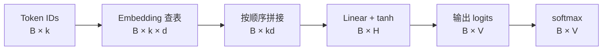

这里 $B$ 是 batch size。所有样本共用 $E,W_1,b_1,W_2,b_2$。

### 一个可逐项核对的前向计算

Notebook 使用 $V=6,k=2,d=2,H=3$，输出词表为“我、你、喜欢、研究、数学、物理”。示例参数满足：

$$
E_{\text{我}}=[1,0],\qquad E_{\text{喜欢}}=[0,1].
$$

输入“我 喜欢”时，拼接结果为：

$$
x=[1,0,0,1].
$$

第一层将四维输入映射到三个隐藏单元：

$$
W_1=\begin{bmatrix}
0.5&-0.2&0.1\\
0.1&0.4&-0.3\\
-0.2&0.3&0.5\\
0.6&0.1&0.2
\end{bmatrix},\qquad b_1=[0,0.1,-0.1].
$$

令 $a=xW_1+b_1$。每个隐藏单元取 $W_1$ 的一列与输入做点积，再加对应偏置：

$$
\begin{aligned}
a_1&=1(0.5)+0(0.1)+0(-0.2)+1(0.6)+0=1.1,\\
a_2&=1(-0.2)+0(0.4)+0(0.3)+1(0.1)+0.1=0,\\
a_3&=1(0.1)+0(-0.3)+0(0.5)+1(0.2)-0.1=0.2.
\end{aligned}
$$

逐元素应用 $\tanh$ 后得到：

$$
xW_1+b_1=[1.1,0,0.2],\qquad
h\approx[0.8005,0,0.1974].
$$

隐藏层的三个坐标是中间特征，不对应三个候选词。非线性使网络能够表达更丰富的输入关系：若移除 $\tanh$，则两个仿射变换可合并为 $z=x(W_1W_2)+(b_1W_2+b_2)$。

第二层使用：

$$
W_2=\begin{bmatrix}
-0.5&-0.4&0.1&0.2&0.8&0.7\\
0.2&0.1&-0.3&0.1&0.4&0.5\\
0&-0.1&0.2&0.3&0.6&0.8
\end{bmatrix},\qquad
b_2=[-0.3,-0.3,-0.2,-0.2,0.1,0.1].
$$

每一列对应一个输出 token。例如“数学”对应的分数为：

$$
z_{\text{数学}}=0.800499(0.8)+0(0.4)+0.197375(0.6)+0.1\approx0.858824.
$$

| Token | Logit $z_j$ | Softmax 概率 $q_j$ |
| --- | ---: | ---: |
| 我 | -0.700250 | 0.065385 |
| 你 | -0.639937 | 0.069450 |
| 喜欢 | -0.080475 | 0.121519 |
| 研究 | 0.019312 | 0.134271 |
| 数学 | 0.858824 | 0.310868 |
| 物理 | 0.818250 | 0.298507 |

此时 $\sum_v e^{z_v}\approx7.592878$，所以 $q_{\text{数学}}\approx2.360384/7.592878=0.310868$。若先减去最大分数，分母变为 $\sum_v e^{z_v-m}\approx3.216798$，“数学”的分子变为 1，所得概率相同。指数把实数分数变成正数，除以总和使概率归一化；softmax 保持分数的大小顺序。

整个过程的形状为 $[1,4]\rightarrow[1,3]\rightarrow[1,3]\rightarrow[1,6]\rightarrow[1,6]$，分别对应输入、第一层仿射结果、隐藏表示、logits 和概率。前向计算读取参数并产生预测，不更新参数。完整权重及每一步输出见 [forward.py](../experiments/02-neural-lm/forward.py)。改变上下文或“喜欢”的 embedding 坐标，可观察预测分布如何变化。

### 参数量与共享范围

这个模型的参数总量为：

$$
\underbrace{Vd}_{E}
+\underbrace{kdH+H}_{W_1,b_1}
+\underbrace{HV+V}_{W_2,b_2}.
$$

示例中为 $12+12+3+18+6=51$。增加训练样本不会增加参数数量；词表、窗口、向量维度和隐藏层宽度决定模型规模。

共享体现在两层：同一个 token 在所有上下文中共用 embedding；所有上下文共用网络权重。参数共享提供统计迁移的机制，是否改善泛化仍由验证集衡量。

## 2.4 交叉熵、梯度与参数更新

### 2.4.1 从交叉熵到 logits 的梯度

前向计算确定给定上下文的预测分布；训练需要知道参数怎样改变才能降低损失。先对单个预测位置求导，令目标 token 的索引为 $y$，模型输出为 $q=\operatorname{softmax}(z)$：

$$
\mathcal L=-\ln q_y
=-\ln\frac{e^{z_y}}{\sum_v e^{z_v}}
=-z_y+\ln\sum_v e^{z_v}.
$$

对任意 logit $z_j$ 求偏导：

$$
\frac{\partial\mathcal L}{\partial z_j}
=-\mathbf1\{j=y\}+\frac{e^{z_j}}{\sum_v e^{z_v}}
=q_j-\mathbf1\{j=y\}.
$$

记标签的 one-hot 向量为 $r$，便得到：

$$
\nabla_z\mathcal L=q-r.
$$

损失虽然只取真实 token 的概率，但该概率的 softmax 分母依赖全部 logits，因此所有输出分数都会收到梯度。目标 token 的梯度为 $q_y-1<0$，其他 token 的梯度为 $q_j>0$。直接对 logits 做梯度下降时，目标分数上升，其余分数下降；非目标 token 当前概率越大，对应的下降方向越强。

沿用固定参数模型，输入“我 喜欢”，训练目标为“数学”：

| Token | 预测概率 $q_j$ | 标签 $r_j$ | 梯度 $q_j-r_j$ |
| --- | ---: | ---: | ---: |
| 我 | 0.065385 | 0 | 0.065385 |
| 你 | 0.069450 | 0 | 0.069450 |
| 喜欢 | 0.121519 | 0 | 0.121519 |
| 研究 | 0.134271 | 0 | 0.134271 |
| 数学 | 0.310868 | 1 | -0.689132 |
| 物理 | 0.298507 | 0 | 0.298507 |

本样本损失为 $-\ln0.310868\approx1.168386$。仅在输出分数空间演示一步 $z'=z-0.1\nabla_z\mathcal L$，重新计算 softmax 后，“数学”的概率约为 0.329999，损失约为 1.108665。实际网络训练更新的是共享参数，而不是为每个样本独立保存和更新 logits；需要继续通过 $z=hW_2+b_2$ 将梯度传给参数。

one-hot 表示当前样本的观测标签，不意味着该上下文在真实语言中只能后接“数学”。多个样本的梯度会共同影响共享参数。对 $B$ 个样本取平均交叉熵时，每个样本的 logits 梯度还需除以 $B$。

还可核对梯度的一个性质：

$$
\sum_j\frac{\partial\mathcal L}{\partial z_j}
=\sum_jq_j-\sum_jr_j=0.
$$

它与 softmax 的平移不变性一致：给全部 logits 加上同一个常数，不改变概率分布与损失。

### 2.4.2 输出层的反向传播

反向传播不是把前向函数求逆，而是沿计算图反方向应用链式法则。先算靠近损失的中间变量梯度，再利用各运算的局部导数，将梯度传回参数。沿一条路径相乘；同一变量通过多条路径影响损失时，将各路径贡献相加。

例如，只跟踪第一个隐藏坐标到“数学”输出分数的权重 $w=(W_2)_{1,\text{数学}}$。对这个权重求偏导时，其他输入与参数保持固定，可写作 $z_{\text{数学}}=h_1w+c$，其中 $c$ 汇总其他隐藏坐标的贡献和偏置。因此 $\partial z_{\text{数学}}/\partial w=h_1$，$\partial\mathcal L/\partial w=(\partial\mathcal L/\partial z_{\text{数学}})h_1$。这也解释了为什么反向传播通常需要前向计算的中间值：它们参与局部导数的计算。

[输出层反向传播 Notebook](../experiments/02-neural-lm/backward.ipynb) 保存逐步计算、数值差分检查与一次输出层更新的执行结果。

对单样本，记 $g_z=\nabla_z\mathcal L=q-r\in\mathbb R^{1\times V}$。输出层为 $z=hW_2+b_2$，逐元素写为：

$$
z_j=\sum_{i=1}^{H}h_i(W_2)_{ij}+(b_2)_j.
$$

一个权重 $(W_2)_{ij}$ 只直接影响对应的 $z_j$，链式法则给出：

$$
\frac{\partial\mathcal L}{\partial(W_2)_{ij}}
=\frac{\partial\mathcal L}{\partial z_j}\frac{\partial z_j}{\partial(W_2)_{ij}}
=(g_z)_j h_i,
\qquad
\frac{\partial\mathcal L}{\partial(b_2)_j}=(g_z)_j.
$$

隐藏坐标 $h_i$ 则同时影响所有输出分数，需要累加所有路径：

$$
\frac{\partial\mathcal L}{\partial h_i}
=\sum_j\frac{\partial\mathcal L}{\partial z_j}\frac{\partial z_j}{\partial h_i}
=\sum_j(g_z)_j(W_2)_{ij}.
$$

这个求和可由局部变化直接理解。暂把 $h_i$ 作为当前层的自变量，固定权重、偏置及其他隐藏坐标，小幅改变 $\Delta h_i$，则每个分数都会变化 $\Delta z_j=(W_2)_{ij}\Delta h_i$。损失的一阶变化为：

$$
\Delta\mathcal L
\approx\sum_j(g_z)_j\Delta z_j
=\left[\sum_j(g_z)_j(W_2)_{ij}\right]\Delta h_i.
$$

因此，多条路径不是任选一条，而是全部累加。即使目标只有“数学”，其他分数仍通过 softmax 分母影响损失。

对第一个隐藏坐标，输出层第一行权重依次为 $[-0.5,-0.4,0.1,0.2,0.8,0.7]$，六条路径的梯度流向为：

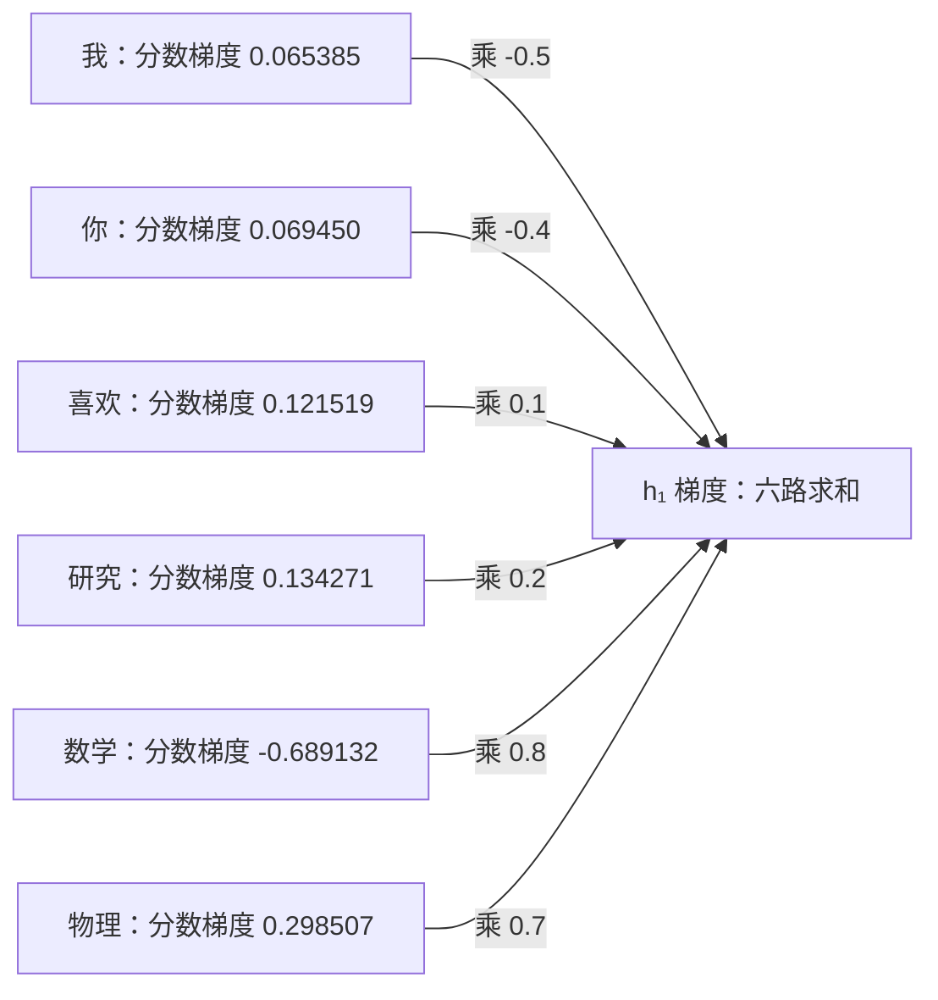

“数学”路径的贡献约为 $-0.689132\times0.8=-0.551305$；“物理”路径的贡献约为 $0.298507\times0.7=0.208955$。前者说明增大 $h_1$ 会通过提高目标分数降低损失，后者说明它也会通过提高竞争词分数增加损失。加上其他四条路径，得到 $\partial\mathcal L/\partial h_1\approx-0.363817$。

这里对隐藏坐标求导，局部导数是对应权重；对权重求导时，局部导数才是隐藏坐标。两者不能混淆。$g_h$ 描述中间表示的局部敏感度，之后继续传向生成该表示的更早层参数，不把 $h$ 当作独立参数更新。

因此，采用行向量约定时：

$$
g_{W_2}=h^\top g_z\in\mathbb R^{H\times V},\qquad
g_{b_2}=g_z\in\mathbb R^{1\times V},\qquad
g_h=g_zW_2^\top\in\mathbb R^{1\times H}.
$$

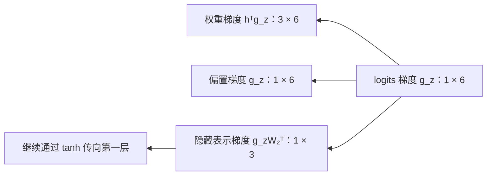

沿用“我 喜欢 → 数学”，有 $h\approx[0.800499,0,0.197375]$、$(g_z)_{\text{数学}}\approx-0.689132$。对应输出列的梯度为：

$$
(g_{W_2})_{:,\text{数学}}
\approx[-0.551649,0,-0.136018]^\top,
\qquad (g_{b_2})_{\text{数学}}\approx-0.689132.
$$

向隐藏层传播得到 $g_h\approx[-0.363817,-0.129406,-0.117033]$。$h$ 是中间结果，其梯度继续用于计算前面各层的参数梯度，而不是作为独立参数直接更新。

仅更新输出层，取学习率 $\eta=0.1$，令 $W_2'=W_2-\eta g_{W_2}$、$b_2'=b_2-\eta g_{b_2}$，保持 embedding 和第一层固定。重新前向计算后，目标概率由 0.310868 增至 0.343326，NLL 由 1.168386 降至 1.069076。这与直接调整 logits 的实验不同，因为这里更新的是生成分数的共享参数。

本次反向传播中的全部梯度均由同一次前向计算的参数与中间结果计算。尤其是 $g_h$ 必须使用更新前的 $W_2$，不能先更新权重再计算该梯度。Notebook 用 CPU float64、中心差分步长 $10^{-5}$ 核对全部输出层权重、偏置和隐藏坐标，最大绝对误差低于 $10^{-9}$。

### 2.4.3 穿过 tanh：局部斜率与梯度衰减

前向隐藏层由 $a=xW_1+b_1$、$h=\tanh(a)$ 构成。$a$ 是激活前的线性输出，$h$ 是激活后的隐藏表示。已知损失对 $h$ 的梯度后，需要继续求对 $a$ 的梯度，才能传回第一层参数。

对单个坐标：

$$
\tanh(a_i)=\frac{e^{a_i}-e^{-a_i}}{e^{a_i}+e^{-a_i}},\qquad
\frac{\partial h_i}{\partial a_i}
=1-\tanh^2(a_i)=1-h_i^2.
$$

链式法则给出：

$$
\boxed{(g_a)_i=(g_h)_i(1-h_i^2)}.
$$

每个 $h_i$ 仅由对应的 $a_i$ 计算，其他坐标的局部偏导为零。所有下游路径的梯度已汇总在 $(g_h)_i$ 中，因此此处进行逐元素相乘，而不是混合不同隐藏坐标：

$$
g_a=g_h\odot(1-h\odot h).
$$

沿用“我 喜欢 → 数学”，前向值与反向梯度为：

| 坐标 | $a_i$ | $h_i$ | $(g_h)_i$ | 局部斜率 $1-h_i^2$ | $(g_a)_i$ |
| --- | ---: | ---: | ---: | ---: | ---: |
| 1 | 1.1 | 0.800499 | -0.363817 | 0.359201 | -0.130684 |
| 2 | 0 | 0 | -0.129406 | 1 | -0.129406 |
| 3 | 0.2 | 0.197375 | -0.117033 | 0.961043 | -0.112474 |

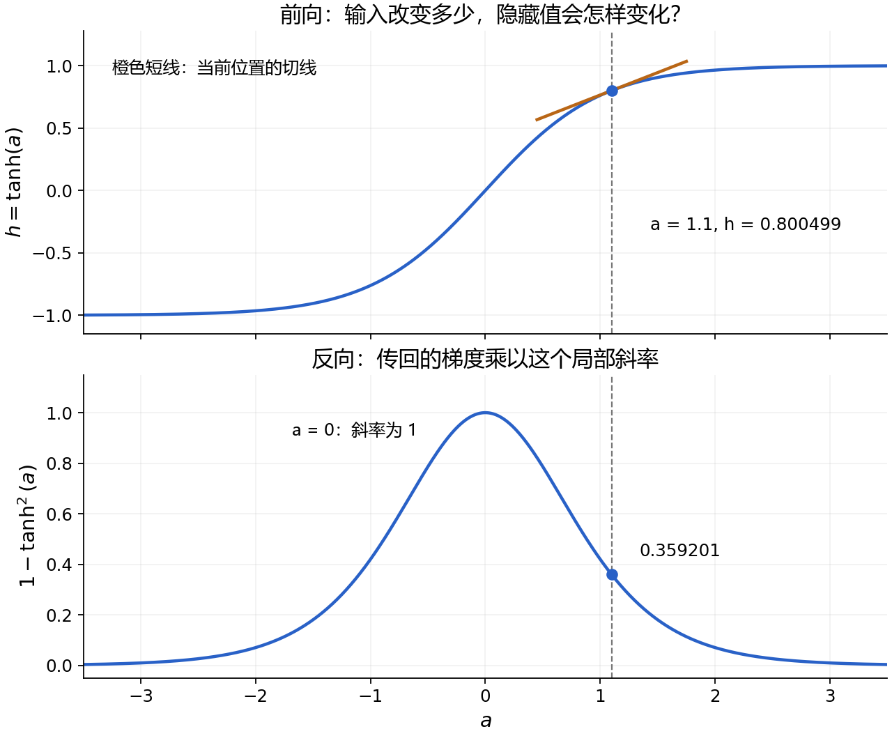

在 $a=0$ 处，输出虽然为零，但斜率为 1，梯度不会被 tanh 这一环节缩小。当 $|a|$ 很大，$h$ 接近 $\pm1$，曲线趋于平坦，局部斜率接近零；这种状态称为饱和。前向对输入扰动不敏感，对应反向梯度受到较强衰减。

对有限实数输入，tanh 导数位于 $(0,1]$，这一逐元素环节不会放大梯度绝对值，也不会反转非零梯度的符号；浮点计算中饱和时可能得到零导数。深层或跨时间反复相乘的小导数可能促成梯度消失，但完整网络的梯度还受到权重矩阵等其他环节影响，不能只由 tanh 判断。

$g_a$ 仍是中间变量的梯度；下一步通过 $a=xW_1+b_1$ 计算第一层权重、偏置及输入向量的梯度。

### 2.4.4 第一层线性变换的反向传播

得到 $g_a$ 后，继续通过 $a=xW_1+b_1$ 计算权重、偏置及输入的梯度。对单样本，$x\in\mathbb R^{1\times4}$、$W_1\in\mathbb R^{4\times3}$、$a\in\mathbb R^{1\times3}$。逐元素展开为：

$$
a_i=\sum_{j=1}^{4}x_j(W_1)_{ji}+(b_1)_i.
$$

固定其他自变量，对三个输入分别应用链式法则：

$$
\frac{\partial\mathcal L}{\partial(W_1)_{ji}}=x_j(g_a)_i,\qquad
\frac{\partial\mathcal L}{\partial(b_1)_i}=(g_a)_i,\qquad
\frac{\partial\mathcal L}{\partial x_j}=\sum_{i=1}^{3}(g_a)_i(W_1)_{ji}.
$$

前两者是参数梯度，第三者继续传向 embedding。采用行向量约定时：

$$
g_{W_1}=x^\top g_a,\qquad g_{b_1}=g_a,\qquad g_x=g_aW_1^\top.
$$

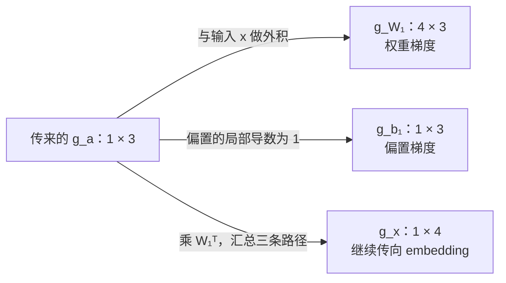

本例 $x=[1,0,0,1]$，因此：

$$
g_{W_1}\approx
\begin{bmatrix}
-0.130684&-0.129406&-0.112474\\
0&0&0\\
0&0&0\\
-0.130684&-0.129406&-0.112474
\end{bmatrix},
\qquad
g_{b_1}\approx[-0.130684,-0.129406,-0.112474].
$$

零输入坐标使该样本的对应权重行梯度为零，但并不要求输入坐标自身的梯度为零。后者取决于该坐标连接到各输出的权重及上游梯度。本例：

$$
g_x\approx[-0.050708,-0.031088,-0.068922,-0.113846].
$$

例如第一维通过三个激活前坐标影响损失：

$$
(g_x)_1
\approx(-0.130684)(0.5)+(-0.129406)(-0.2)+(-0.112474)(0.1)
\approx-0.050708.
$$

这些梯度必须由同一次前向计算产生的值求得，不能先更新 $W_1$ 再用更新后的权重计算 $g_x$。此处仍是单样本损失的梯度，不包含正则化项；多个样本的梯度将在训练时按损失定义汇总。

### 2.4.5 拼接与 embedding 查表的反向传播

输入词向量来自可训练参数表 $E\in\mathbb R^{6\times2}$。词表按“我、你、喜欢、研究、数学、物理”排列，token ID 从 0 开始。对上下文“我 喜欢”：

$$
e^{(1)}=E[0,:]=[1,0],\qquad e^{(2)}=E[2,:]=[0,1],\qquad
x=[e^{(1)},e^{(2)}]=[1,0,0,1].
$$

上标表示上下文位置，不表示不同的参数表。拼接只排列坐标，不混合数值，因此反向沿原边界拆分即可：

$$
g_{e^{(1)}}=[(g_x)_1,(g_x)_2]\approx[-0.050708,-0.031088],
$$

$$
g_{e^{(2)}}=[(g_x)_3,(g_x)_4]\approx[-0.068922,-0.113846].
$$

每个对应坐标的局部导数为 1，其他位置为 0。查表同样只是选取坐标：当位置 $p$ 的 token ID 为 $t_p$ 时，$e^{(p)}_k=E[t_p,k]$。链式法则给出：

$$
\boxed{\frac{\partial\mathcal L}{\partial E[t,k]}
=\sum_{p:t_p=t}\frac{\partial\mathcal L}{\partial e^{(p)}_k}}.
$$

先将 $g_E$ 置零，再把每个位置的向量梯度累加到其 token ID 对应的行，即 scatter-add。

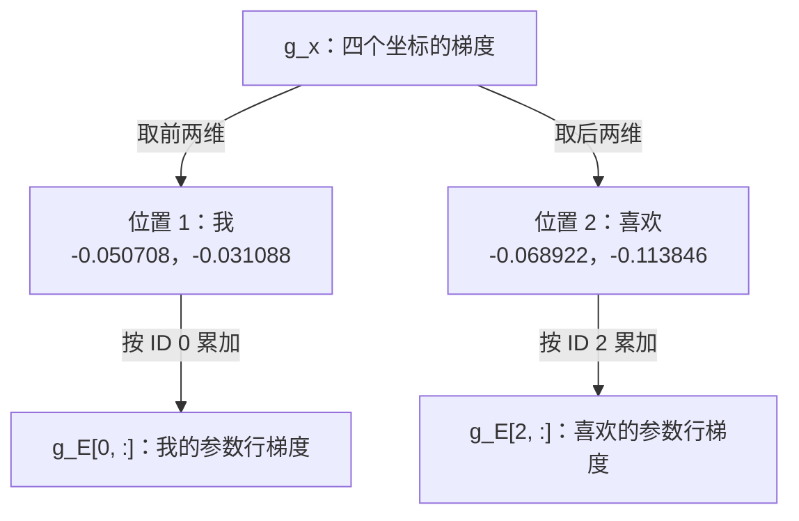

本例得到：

$$
g_E\approx\begin{bmatrix}
-0.050708&-0.031088\\
0&0\\
-0.068922&-0.113846\\
0&0\\
0&0\\
0&0
\end{bmatrix}.
$$

该结论针对单样本预测损失，不含正则化，且输入 embedding 与输出层参数未共享。目标“数学”虽影响所有输出分数的梯度，但其输入 embedding 行未参与本次前向，因此该行梯度为零；这不代表输出层中负责“数学”的参数梯度为零。

若同一个 token 出现在多个位置，例如“我 我”，各位置引用同一参数行。改变该行会同时影响多个位置，必须把所有路径的梯度相加，不能用后一个位置覆盖前一个。改变上下文后须重新前向、反向计算，不能沿用“我 喜欢”的数值。跨样本共享同样要求累加；batch 损失采用求和还是平均，决定其梯度对应求和还是平均。

普通 SGD 使用 $E'=E-\eta g_E$。取 $\eta=0.1$，本例两行更新为：

$$
E'[0,:]\approx[1.005071,0.003109],\qquad
E'[2,:]\approx[0.006892,1.011385].
$$

训练更新的是浮点词向量表，而非整数 token ID。$x$ 是中间结果，下一次前向从更新后的 $E$ 重新查表、拼接，不作为独立参数更新。词向量通过预测任务收到梯度，不需要预先为每个坐标指定语义。

### 2.4.6 从全部参数梯度到一次完整训练更新

把模型的可训练参数记为 $\theta=(E,W_1,b_1,W_2,b_2)$，总计 $12+12+3+18+6=51$ 个标量。一次标准 SGD 更新先在同一个参数点 $\theta$ 完成前向与反向，再执行 $\theta'=\theta-\eta\nabla_\theta\mathcal L(\theta)$。

单样本前向计算得到 $x,a,h,z,q$ 和交叉熵损失。反向计算按依赖顺序进行，$r$ 为目标 token 的 one-hot 向量：

$$
\begin{aligned}
g_z&=q-r,\\
g_{W_2}&=h^\top g_z,\qquad g_{b_2}=g_z,\qquad g_h=g_zW_2^\top,\\
g_a&=g_h\odot(1-h\odot h),\\
g_{W_1}&=x^\top g_a,\qquad g_{b_1}=g_a,\qquad g_x=g_aW_1^\top.
\end{aligned}
$$

随后将 $g_x$ 沿拼接边界拆分，并按 token ID 累加到 $g_E$。全部梯度都使用本次前向的参数和中间值；不能先更新 $W_2$，再用新 $W_2$ 和旧 $g_z$ 计算 $g_h$，否则不再是原参数点的完整梯度。

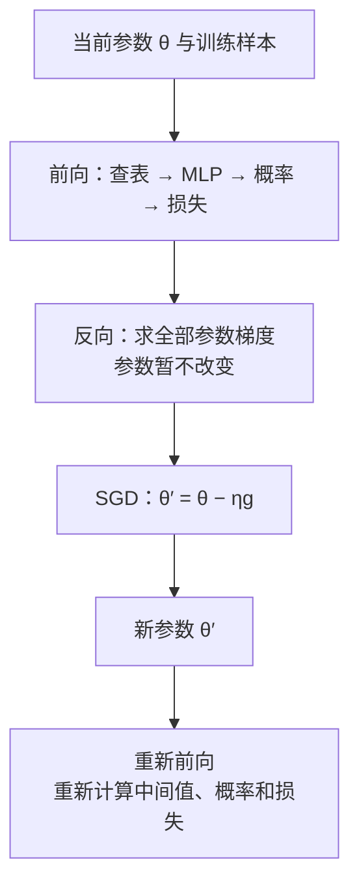

更新覆盖五组参数：

$$
E'=E-\eta g_E,\quad
W_1'=W_1-\eta g_{W_1},\quad
b_1'=b_1-\eta g_{b_1},\quad
W_2'=W_2-\eta g_{W_2},\quad
b_2'=b_2-\eta g_{b_2}.
$$

“同时更新”指使用同一个旧参数点算出的梯度，并不要求代码在同一时刻写入所有参数。只要梯度已经完整算好并保持不变，依次写入五组新参数即可。$x,a,h,z,q$ 是中间值，不作为独立参数执行 SGD；下一次前向从新参数重新生成它们。普通训练的下一步还需重新计算梯度，不能重复套用旧梯度。

对“我 喜欢 → 数学”，无正则化、无动量，取学习率 $\eta=0.1$，一次更新全部 51 个参数后：

$$
x'\approx[1.005071,0.003109,0.006892,1.011385],
$$

$$
a'\approx[1.147719,0.042470,0.239225],\qquad
h'\approx[0.816997,0.042445,0.234763].
$$

| 量 | 更新前 | 全参数更新后 |
| --- | ---: | ---: |
| 数学 logit | 0.858824 | 1.028609 |
| 物理 logit | 0.818250 | 0.830174 |
| 数学概率 | 0.310868 | 0.348955 |
| 物理概率 | 0.298507 | 0.286147 |
| 交叉熵损失 | 1.168386 | 1.052813 |

这些结果由 CPU NumPy float64 计算，使用未舍入梯度更新，表内显示六位小数；全部 51 个标量梯度经步长 $10^{-5}$ 的中心差分核对，最大绝对误差低于 $1.4\times10^{-11}$。这里是完整参数更新，不同于 2.4.2 仅更新输出层的结果。

概率取决于全部 logits 的相对关系，因此“物理”的 logit 增大与其概率下降并不矛盾。可训练参数也会共享影响多个分数，并不等价于把各 logit 当作独立参数更新。

将全部参数展平成向量，一阶近似给出：

$$
\mathcal L(\theta-\eta g)\approx\mathcal L(\theta)-\eta\lVert g\rVert_2^2,
\qquad g=\nabla_\theta\mathcal L(\theta).
$$

非零梯度下，足够小的正步长沿负梯度方向降低当前损失；有限学习率过大时，一阶近似不再可靠，不能保证下降。单个训练样本损失下降也不等于其他样本或验证集表现改善，需要后续用数据集目标与独立评估判断。

## 2.5 小型神经语言模型训练及计数基线对比

### 2.5.1 多个训练样本怎样共同决定更新方向

单样本反向传播计算该样本的损失梯度。对于包含 $N$ 个上下文—目标对的数据集 $\mathcal D=\{(c_n,y_n)\}_{n=1}^N$，每个样本预测一个 token，采用等权平均负对数似然：

$$
\ell_n(\theta)=-\ln P_\theta(y_n\mid c_n),\qquad
\mathcal J(\theta)=\frac1N\sum_{n=1}^N\ell_n(\theta).
$$

这里用 $c_n$ 表示上下文，避免与 MLP 隐藏向量 $h$ 混淆。求导的线性性给出：

$$
\boxed{\nabla_\theta\mathcal J(\theta)
=\frac1N\sum_{n=1}^N\nabla_\theta\ell_n(\theta)}.
$$

所有样本使用同一个参数点 $\theta$。逐样本计算梯度、累加后除以 $N$，与直接对平均损失求导等价；每算完一个样本就更新参数，则后续梯度来自不同参数点，一般不等于这次平均梯度更新。

考虑四个样本：三个“我 喜欢 → 数学”，一个“我 喜欢 → 物理”。在本章原始参数点，同一上下文得到相同的概率分布，其中 $q_{\text{数学}}\approx0.310868$、$q_{\text{物理}}\approx0.298507$。平均损失为：

$$
\mathcal J=-\frac34\ln q_{\text{数学}}-\frac14\ln q_{\text{物理}}
\approx1.178530.
$$

将这四个样本共用的 logits 记为 $z$。单样本未缩放的梯度为 $q-r_n$；三份数学目标与一份物理目标共同产生：

$$
\frac{\partial\mathcal J}{\partial z}
=\frac{3(q-r_{\text{数学}})+(q-r_{\text{物理}})}4
=q-\bar r,\qquad
\bar r=[0,0,0,0,0.75,0.25].
$$

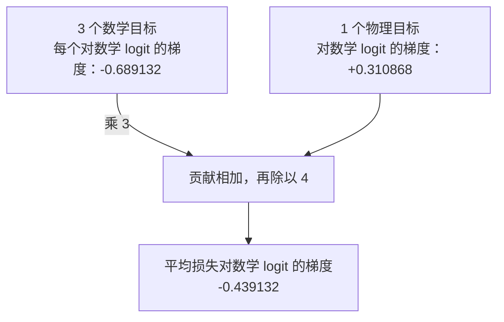

对数学、物理两个分数分别有：

$$
\frac{\partial\mathcal J}{\partial z_{\text{数学}}}
=0.310868-0.75=-0.439132,\qquad
\frac{\partial\mathcal J}{\partial z_{\text{物理}}}
=0.298507-0.25=0.048507.
$$

物理虽然在数据中出现，但当前概率已高于它在这四个样本中的目标频率。对其共同 logit 的平均梯度为正，意味着固定其他 logits 时，局部减小该 logit 能降低平均损失。这不保证共享模型参数更新后该 logit 必定下降。

上式针对相同上下文共用的 $z$。若实现中将四次预测保留为四行独立中间张量，则每行对平均损失的梯度为 $(q-r_n)/4$；反传至共享参数时累加这些贡献。不同上下文一般有不同的 $q_n$ 和中间结果，不能把所有目标频率直接当成每个上下文的目标分布；仍须分别反传，再在共享参数梯度上求和或平均。

计数模型直接从上下文的后继频率估计分布；神经模型通过交叉熵梯度吸收这些频率信息，并通过共享参数联系不同上下文。整体训练目标不是让每条样本的目标概率同时达到 1，而是降低数据集的平均预测损失。

平均损失与总损失在固定 $N$ 时相差常数倍，最优解相同，但梯度尺度不同。在同一参数点完整复制数据集，平均损失和平均梯度不变，总损失和总梯度则随复制倍数增长。该结论不等同于把数据重复训练若干轮。

### 2.5.2 Mini-batch：用一部分样本估计整体梯度

[交互演示：固定参数下比较不同 batch 的梯度](visuals/02-mini-batch-gradients.html)

全数据平均损失为 $\mathcal J(\theta)=N^{-1}\sum_n\ell_n(\theta)$。若每次更新都计算全部 $N$ 个样本的梯度，更新前需要完成的计算量随数据集增长。Mini-batch 在第 $t$ 步选取样本集合 $\mathcal B_t$，用其平均损失与梯度更新：

$$
\mathcal J_{\mathcal B_t}(\theta_t)
=\frac1{|\mathcal B_t|}\sum_{n\in\mathcal B_t}\ell_n(\theta_t),
\qquad
g_{\mathcal B_t}(\theta_t)
=\frac1{|\mathcal B_t|}\sum_{n\in\mathcal B_t}\nabla_\theta\ell_n(\theta_t),
$$

$$
\theta_{t+1}=\theta_t-\eta g_{\mathcal B_t}(\theta_t).
$$

批内样本共用同一参数点；下一批使用更新后的参数重新计算。Batch size 是一批的样本数，不是模型份数；参数始终共享。此处每批更新一次，不包含跨批梯度累积。

沿用三个数学目标、一个物理目标且上下文均为“我 喜欢”的四条样本，在原始参数点固定模型，比较批大小为 2 的不同选择：

| 样本选择 | 数学目标占比 | 对共同数学 logit 的梯度 | 对共同物理 logit 的梯度 |
| --- | ---: | ---: | ---: |
| 两条数学 | 1 | -0.689132 | 0.298507 |
| 一条数学、一条物理 | 0.5 | -0.189132 | -0.201493 |
| 全部四条 | 0.75 | -0.439132 | 0.048507 |

批内目标构成不同，梯度可以明显不同，甚至与全数据梯度符号相反。四选二的不重复组合共有六种，其中三种包含两条数学、三种包含一条数学和一条物理。固定参数、等概率选取这六种组合时，两种梯度各占一半；例如物理坐标的期望为：

$$
\tfrac12(0.298507)+\tfrac12(-0.201493)\approx0.048507.
$$

更一般地，固定参数 $\theta$，从全数据均匀抽取固定大小的子集，或者独立均匀有放回抽样，其样本平均梯度满足：

$$
\mathbb E_{\mathcal B}[g_{\mathcal B}(\theta)]
=\nabla_\theta\mathcal J(\theta).
$$

这称为无偏估计。它描述随机批选择的期望，而不是每个批的梯度都等于整体梯度，也不保证每步更新都降低全数据损失。若始终偏向某类样本且不修正权重，一般不能视为原等权目标的无偏估计。按随机排列逐批遍历时，后续批来自剩余样本，参数也持续变化，不应把固定参数的均匀抽样结论直接当成每一步的条件无偏保证。

实际训练可以先打乱样本顺序，再分批处理。一次排列为 $[1,2,3,4]$ 时：

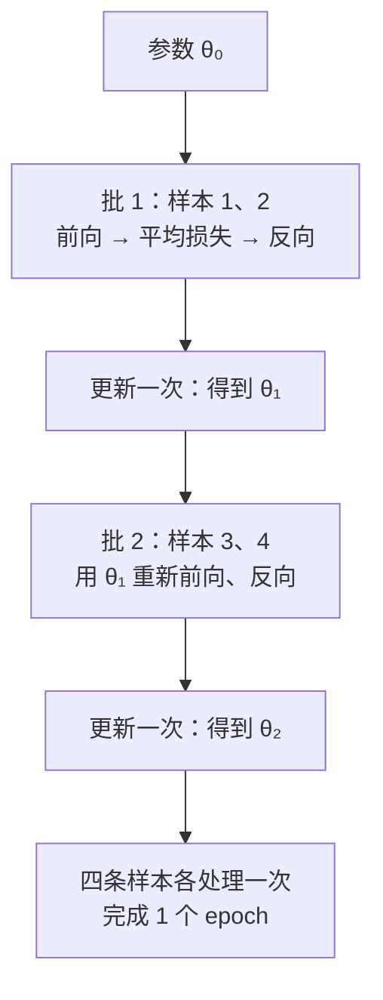

第二批此时不再位于上表的原始参数点，须重新计算梯度。因此分两批更新两次，一般不等于在原参数点计算全数据梯度后更新一次。

在每批更新一次的设定中，step 表示一次参数更新；epoch 表示完整遍历训练集一次。若不丢弃最后一个不足整批的批次，则每个 epoch 有 $\lceil N/B\rceil$ 个 step；最后一批平均损失应除以该批实际样本数。

较大的 batch 通常降低同一参数点处由均匀抽样引入的梯度波动，也能提供更多并行计算，但常规批量执行需要保存更多激活，显存成本上升；相同 epoch 的更新次数也会减少。Batch size 不改变模型参数个数，实际吞吐和训练效果需要结合硬件、学习率与更新次数衡量，不能只按“大”或“小”判断优劣。

### 2.5.3 批量前向：增加样本轴，共享同一套参数

批量计算将单样本行向量沿样本轴堆叠为矩阵，不先平均输入，也不为每条样本创建独立模型。以两个不同上下文—目标对“我 喜欢 → 数学”“你 研究 → 物理”为例，使用本章原始参数。输入 ID 为：

$$
T=\begin{bmatrix}0&2\\1&3\end{bmatrix}.
$$

查表后的张量形状为 $[B,C,D]=[2,2,2]$，三条轴分别对应样本、上下文位置、embedding 坐标。每条样本内部拼接两个词向量，得到：

$$
X=\begin{bmatrix}1&0&0&1\\0.8&0.2&0.2&0.9\end{bmatrix}
\in\mathbb R^{2\times4}.
$$

第一层前向为 $A=XW_1+\mathbf1_Bb_1$。其中 $\mathbf1_B$ 是 $B\times1$ 全一列向量，$b_1$ 按行向量表示；这相当于把同一个偏置加到每一行，即广播。矩阵乘法满足：

$$
XW_1=\begin{bmatrix}x^{(1)}W_1\\x^{(2)}W_1\end{bmatrix},
\qquad
(B\times4)(4\times3)=B\times3.
$$

求和发生在输入特征轴，不跨样本轴。每行使用相同 $W_1$，但保留自己的输入及中间结果。第二条样本的第一个激活前坐标为：

$$
A_{2,1}=0.8(0.5)+0.2(0.1)+0.2(-0.2)+0.9(0.6)+0=0.92.
$$

两条样本的结果为：

$$
A=\begin{bmatrix}1.1&0&0.2\\0.92&0.17&0.2\end{bmatrix},
\qquad
H=\tanh(A)\approx
\begin{bmatrix}0.800499&0&0.197375\\0.725897&0.168381&0.197375\end{bmatrix}.
$$

输出层 $Z=HW_2+\mathbf1_Bb_2$ 的形状为 $B\times6$。Softmax 对每条样本的词表轴独立归一化：

$$
Q_{n,j}=\frac{\exp(Z_{n,j})}{\sum_{k=1}^{6}\exp(Z_{n,k})},
\qquad
\sum_{j=1}^{6}Q_{n,j}=1.
$$

不能把整个 $B\times6$ 矩阵一起归一化，也不能沿样本轴归一化。所有行的概率总和为 $B$，并不应等于 1。实际数值计算可逐行减去该行最大 logit 再求指数，避免溢出而不改变分布。

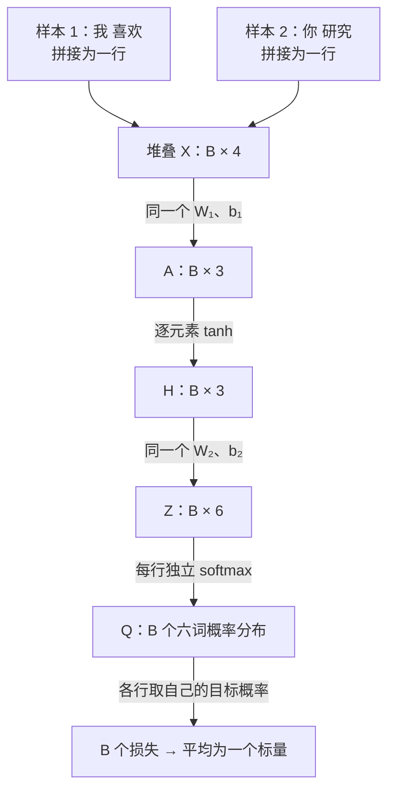

目标 ID 为 $[4,5]$；按矩阵从 1 开始的下标，分别读取 $Q_{1,5}$ 与 $Q_{2,6}$：

| 样本 | 目标 | 目标概率 | 单样本损失 |
| --- | --- | ---: | ---: |
| 我 喜欢 | 数学 | 0.310868 | 1.168386 |
| 你 研究 | 物理 | 0.304059 | 1.190532 |

$$
\mathcal J_{\mathcal B}
=\frac{-\ln Q_{1,5}-\ln Q_{2,6}}2
\approx1.179459.
$$

平均的是各样本的负对数概率，不是先平均输入或预测分布再计算一次损失。使用 CPU NumPy float64 核对，整批前向的查表、输入、激活、logits、概率及 log-probability 与逐样本前向后堆叠的结果在绝对误差 $10^{-14}$ 内一致。

本节 MLP 没有跨样本操作：固定参数时，一条样本的前向结果不依赖另一条样本的输入；训练更新共享参数后，其他样本的预测则可能改变。增加 $B$ 改变中间张量的行数，不改变 $E,W_1,b_1,W_2,b_2$ 的形状或 51 个标量参数的总数。

### 2.5.4 批量反向：平均一次，沿共享参数汇总

沿用两条样本“我 喜欢 → 数学”“你 研究 → 物理”及原始参数。批量平均损失为 $\mathcal J_{\mathcal B}=B^{-1}\sum_{n=1}^B\ell_n$；记 $G_Z=\partial\mathcal J_{\mathcal B}/\partial Z$，大写 $G$ 表示对批量中间矩阵的梯度，小写 $g$ 表示对共享参数的梯度。

平均操作的局部导数为 $\partial\mathcal J_{\mathcal B}/\partial\ell_n=1/B$，因此：

$$
(G_Z)_{n,j}=\frac1B(Q_{n,j}-R_{n,j}),
\qquad
\boxed{G_Z=\frac{Q-R}{B}}.
$$

其中 $R$ 每行是该样本目标的 one-hot 向量。$G_Z$ 保留 $B\times6$ 的形状，不能先把样本行求平均而丢掉各自的隐藏表示。对 $B=2$：

$$
G_Z\approx
\begin{bmatrix}
0.032693&0.034725&0.060759&0.067135&-0.344566&0.149254\\
0.034625&0.035895&0.056566&0.066360&0.154524&-0.347970
\end{bmatrix}.
$$

对共享输出权重，前向 $Z_{n,j}=\sum_iH_{n,i}(W_2)_{i,j}+(b_2)_j$ 给出：

$$
(g_{W_2})_{i,j}
=\sum_{n=1}^B H_{n,i}(G_Z)_{n,j},
\qquad
\boxed{g_{W_2}=H^\top G_Z}.
$$

矩阵乘法形状为 $(3\times B)(B\times6)=3\times6$；被求和的轴正是样本轴。将每行的 $1/B$ 展开可见，这等于各样本独立损失所产生的权重梯度取平均，不是遗漏了平均因子。

例如第一个隐藏坐标连接“数学”的共享权重：

$$
\begin{aligned}
(g_{W_2})_{1,5}
&=H_{1,1}(G_Z)_{1,5}+H_{2,1}(G_Z)_{2,5}\\
&\approx(0.800499)(-0.344566)+(0.725897)(0.154524)\\
&\approx-0.275825+0.112169=-0.163656.
\end{aligned}
$$

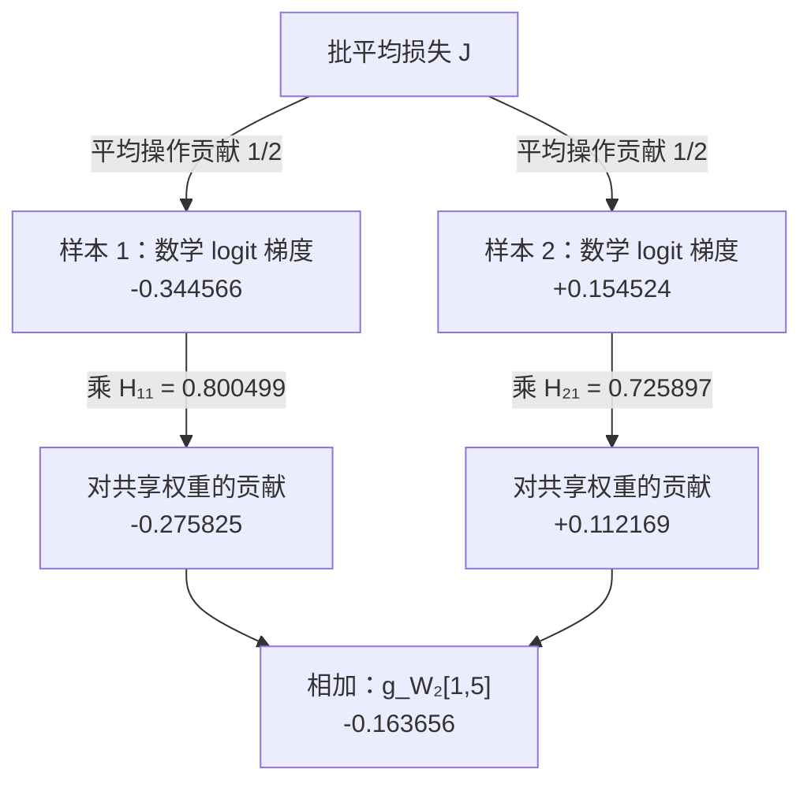

偏置在前向被广播到每条样本，改变同一个 $(b_2)_j$ 会影响所有 $Z_{n,j}$，局部导数均为 1。反向对样本轴求和：

$$
(g_{b_2})_j=\sum_{n=1}^B(G_Z)_{n,j},
\qquad
g_{b_2}=\mathbf1_B^\top G_Z.
$$

例如数学偏置梯度为 $-0.344566+0.154524\approx-0.190041$（使用未舍入值计算）。广播的反向是沿被广播的轴汇总。由于 $G_Z$ 已包含 $1/B$，计算权重或偏置梯度时不能再除一次 $B$。

与共享参数不同，各样本的隐藏表示是不同的中间变量。反向仍然保留样本轴：

$$
G_H=G_ZW_2^\top,\qquad
G_A=G_H\odot(1-H\odot H).
$$

继续通过第一层：

$$
g_{W_1}=X^\top G_A,\qquad
g_{b_1}=\mathbf1_B^\top G_A,\qquad
G_X=G_AW_1^\top.
$$

将每条样本的 $G_X$ 行拆回上下文位置后，对 embedding 表按 token ID 累加所有样本、所有位置的贡献。所有梯度继承了最开始的 $1/B$，不再重复平均。批内反向全过程使用同一次前向的参数，全部梯度求出后再进行一次参数更新。

本例使用 CPU NumPy float64 计算，五组参数共 51 个标量梯度均通过步长 $10^{-5}$ 的中心差分检查，最大绝对误差低于 $1.5\times10^{-11}$；批量参数梯度与两条样本分别求梯度后取平均的结果在绝对误差 $10^{-14}$ 内一致。

### 2.5.5 训练与评估：损失下降是否意味着泛化改善

训练损失衡量模型对用于更新参数的数据的拟合程度；泛化关注未参与参数拟合的数据。训练损失下降，并不自动保证未见数据的平均负对数似然下降。

三种数据划分承担不同职责：

| 划分 | 主要用途 | 是否用其损失反传更新模型参数 |
| --- | --- | --- |
| 训练集 | 计算梯度、拟合参数 | 是 |
| 验证集 | 选择超参数、检查点与停止时机 | 否 |
| 测试集 | 模型与方案确定后，进行最终评估 | 否 |

验证集虽然不直接参与梯度更新，但会通过模型选择影响最终结果；测试集不应被反复用于挑选模型。文本数据通常先按独立文档或序列等合适单位划分，再在各划分内部构造上下文窗口，防止相邻重叠窗口被随机分到训练与评估集合。还需检查跨划分重复或近重复文档。由当前语料构建词表时，只使用训练划分，固定未知词规则；预先给定的词表则在各划分保持一致。

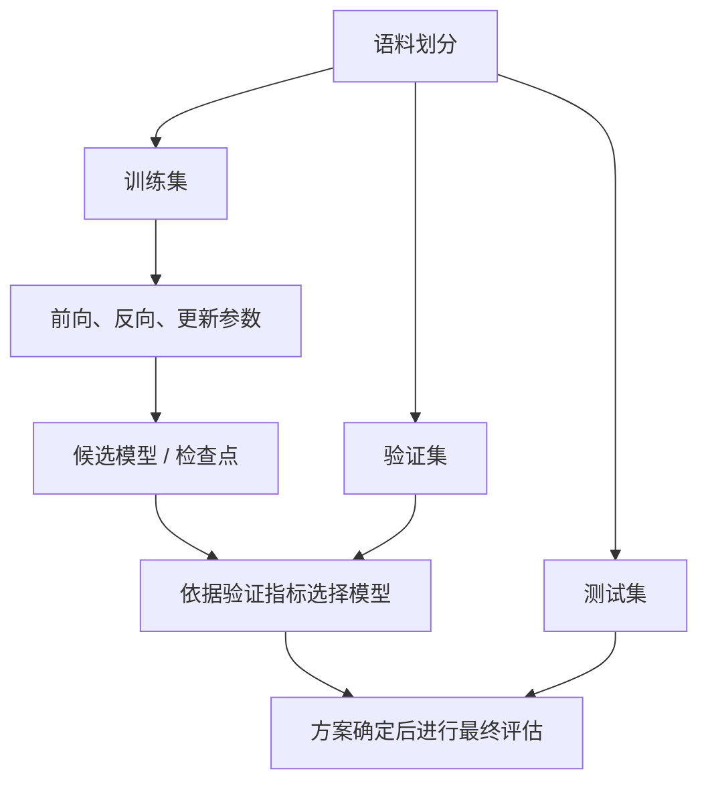

为观察训练与验证目标的差别，比较两个候选概率分布。对同一上下文“我 喜欢”，训练样本含三个数学目标、一个物理目标；独立留出的验证样本含两个数学目标、两个物理目标。两种候选分布对其余四个词都分配 0.025：

| 候选分布 | 数学概率 | 物理概率 | 训练平均 NLL | 验证平均 NLL |
| --- | ---: | ---: | ---: | ---: |
| A | 0.5 | 0.4 | 0.748933 | 0.804719 |
| B | 0.7 | 0.2 | 0.669866 | 0.983056 |

其中：

$$
\mathcal J_{\mathrm{train}}=-\tfrac34\ln q_{\text{数学}}-\tfrac14\ln q_{\text{物理}},
\qquad
\mathcal J_{\mathrm{val}}=-\tfrac12\ln q_{\text{数学}}-\tfrac12\ln q_{\text{物理}}.
$$

从 A 到 B，更偏向训练集中较常见的数学目标，训练损失下降，但物理概率降低使验证损失上升。该例只展示两个目标可能有分歧；有限样本波动或分布差异也可能导致这种现象，不能由极小样本直接断言模型存在稳定的泛化退化。

真实训练中，若训练损失持续下降而完整验证集损失持续上升，这是需要关注的过拟合信号。可根据验证指标选择此前保存的检查点，或使用事先设定的早停规则。不要因一个 batch 的随机波动就做结论，也不要根据测试结果重新挑选训练轮次。

验证时固定一个检查点的参数，逐批前向计算损失，不进行反向传播或参数更新。设验证批 $k$ 有 $m_k$ 个有效预测目标，批内平均损失为 $\bar\ell_k$，则完整验证集指标为：

$$
\boxed{
\mathcal J_{\mathrm{val}}
=\frac{\sum_k m_k\bar\ell_k}{\sum_k m_k}
}.
$$

此处每个样本预测一个 token，因此 $m_k$ 是样本数。最后一批大小可能不同，不能无条件平均各批均值。若后续每条序列预测多个 token 且存在 padding 或 mask，分母应为实际计入损失的 token 数。评估分批只是计算组织方式，不应改变同一固定模型的整体平均指标。训练期间参数不断变化时记录的各批损失，不等于某一个固定检查点在完整训练集上的损失。

### 2.5.6 计数基线与神经模型的公平比较

基线是用于判断新方法是否带来改进的参照方法。固定窗口 MLP 与计数模型都输出条件分布，因此可以在相同上下文、词表和评估目标上，使用同一个平均负对数似然比较。复杂模型不自动优于简单模型；比较需要把方法差异与数据、信息量和资源差异分开。

对上下文“我 喜欢”，计数模型利用上下文与目标的出现次数估计概率，并通过平滑或递归插值借用短上下文统计。MLP 则查找词向量、拼接，再经过共享网络得到分布：

$$
q_\theta(\cdot\mid h)
=\operatorname{softmax}\left(
\tanh\left([E_{h_1};E_{h_2}]W_1+b_1\right)W_2+b_2
\right).
$$

这里拼接结果按行向量使用，与前文约定一致。

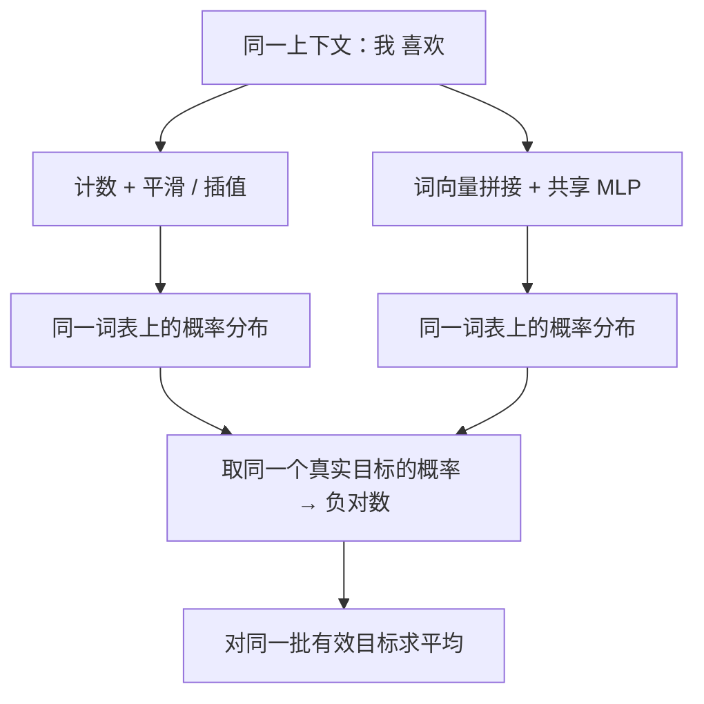

若“你 喜欢”这个完整上下文未出现在训练中，计数模型仍可通过低阶统计给出分布；神经模型在输入 token 均可表示时，也可以组合“你”“喜欢”的向量并使用共享网络。共享表示提供跨上下文迁移的可能，但既不保证学到语义相似性，也不保证未见组合上的预测正确。能输出合法概率与能准确泛化是不同条件。

隔离模型机制差异时，应控制：

| 条件 | 比较约定 |
| --- | --- |
| 数据与划分 | 同一训练语料、验证集和测试集，避免跨划分泄漏 |
| 分词与词表 | 相同 token 单位、词表与未知词映射 |
| 可见上下文 | 相同长度及边界处理，避免一方额外看到信息 |
| 评估目标 | 相同有效位置、结束符及掩码规则，不跳过难预测目标 |
| 模型选择 | 各自使用验证集调参，明确搜索范围与预算，测试集只作最终评估 |

相同上下文长度不代表全部资源成本相同。计数模型不通过 SGD 拟合，不能机械要求双方有相同 SGD step 数。若研究固定资源预算下的质量，应另外约束训练时间或内存等资源；若研究架构本身，应控制输入信息并报告容量与成本差异。不同分词下的平均每 token NLL 也不能直接当成同一尺度比较。

例如，假设两个候选模型对两条验证样本真实目标的概率如下；这些概率只用于演示评分，不是模型训练的实测结果：

| 样本 | 计数模型的目标概率 | 神经模型的目标概率 |
| --- | ---: | ---: |
| 我 喜欢 → 数学 | 0.8 | 0.5 |
| 你 喜欢 → 物理 | 0.05 | 0.4 |

对应平均损失：

$$
\mathcal J_{\mathrm{count}}=-\frac{\ln0.8+\ln0.05}{2}\approx1.609438,
\qquad
\mathcal J_{\mathrm{neural}}=-\frac{\ln0.5+\ln0.4}{2}\approx0.804719.
$$

计数模型在第一条样本上更好，但在第二条样本上给真实目标的概率很低，产生较大惩罚。整体比较依赖所有目标的负对数概率，不能只展示有利样本，也不能先把目标概率平均后取负对数。该示例不证明神经模型在一般情况下优于计数模型。

预测质量与系统成本需要分别报告。验证或测试 NLL 衡量概率分配；训练时间、推理吞吐和内存占用衡量不同资源维度。性能测量还需明确硬件、batch size、精度、计时范围和实现。更低的 NLL 不意味着更快或更省内存，参数数量也不能代替实际内存测量。

## 2.6 RNN、LSTM 与序列状态

### 2.6.1 从固定窗口到递归状态

固定窗口 MLP 把最近 $k$ 个词向量拼接，再预测下一词。对词向量维度 $d$、隐藏维度 $m$，其输入维度为 $kd$，第一层权重形状为 $kd\times m$。扩大窗口会增加该矩阵的参数量；超过窗口的历史则没有进入当前预测的计算路径。在固定参数和相同边界处理下，具有相同最近 $k$ 个 token 的序列得到相同输出分布。

RNN 使用固定维度的隐藏状态逐步汇总历史。记第 $t$ 个输入 token 的词向量为 $e_t$，读完该 token 后的状态为 $h_t$；对单条序列使用行向量约定：

$$
e_t=E_{w_t},\qquad
\boxed{h_t=\tanh(e_tW_x+h_{t-1}W_h+b_h)}.
$$

$h_0$ 在此设为零。若词向量维度为 $d$、状态维度为 $m$，则 $W_x\in\mathbb R^{d\times m}$，$W_h\in\mathbb R^{m\times m}$，$b_h\in\mathbb R^{1\times m}$。$e_tW_x$ 提供当前 token 的贡献，$h_{t-1}W_h$ 提供历史状态的贡献。所有时间步共享同一组权重与偏置，状态则随输入和时间步变化。

读完“我 喜欢”时，计算依赖为：

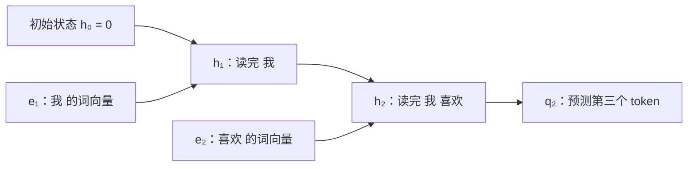

各状态节点表示使用同一状态更新函数的一次计算，不是不同参数的网络。$h_t$ 是由输入和参数计算出的中间值，不是每个时间步新增的独立可训练参数。

输出层仍可使用线性映射与 softmax：

$$
q_t=\operatorname{softmax}(h_tW_o+b_o).
$$

这里 $q_t$ 预测 $w_{t+1}$，表示模型对 $P(w_{t+1}\mid w_1,\ldots,w_t)$ 的估计。“数学”若为第三个 token，是 $q_2$ 的监督目标，不是计算 $h_2$ 时的输入。

用一个单隐藏坐标的 RNN 展开两步。沿用两个二维词向量，但另设状态更新参数，不使用前文 MLP 的权重：

$$
e_1=E_{\text{我}}=[1,0],\quad
e_2=E_{\text{喜欢}}=[0,1],\quad
W_x=\begin{bmatrix}0.5\\0.2\end{bmatrix},\quad
W_h=[0.8],\quad b_h=0,\quad h_0=0.
$$

第一步：

$$
h_1=\tanh([1,0]W_x+0\times0.8)=\tanh(0.5)\approx0.462117.
$$

第二步：

$$
h_2=\tanh([0,1]W_x+0.8h_1)
=\tanh(0.2+0.369694)
\approx0.515134.
$$

“我”对第二步状态的影响通过 $h_1W_h$ 传入，而非重新与“喜欢”一起拼接。状态 0.515134 是一个中间激活，不是下一词概率；生成分布仍需输出层。这些状态更新数值使用 Python float 运算核对。

RNN 的参数形状与序列步数 $T$ 无关；延长序列增加的是共享函数的执行次数，而非独立参数集合。更长序列通常需要更多计算；普通展开反向传播还需要保存随步数增加的中间激活。仅逐步前向推理时，则可以用新状态替换旧状态，继续处理下一个 token。

递归状态提供了更早 token 影响后续预测的计算路径，但固定维度的状态并非完整文本的无损存储，更不保证有效记住任意久远的信息。状态重置还会截断此前的历史；这里讨论的是从初始状态开始连续处理同一条序列的情形。

### 2.6.2 从逐步输出到序列损失

对序列“我 喜欢 数学”，先不加入开始符或结束符，并将“我”作为给定前缀。输入与目标错开一个位置：

| 时间步 | 当前输入 | 状态包含的前缀 | 预测目标 |
| --- | --- | --- | --- |
| 1 | 我 | 我 | 喜欢 |
| 2 | 喜欢 | 我 喜欢 | 数学 |

输入序列为“我、喜欢”，目标序列为“喜欢、数学”。读完当前 token 后输出下一个 token 的分布，而不是重建当前输入；由于没有为“数学”指定后续目标，此例只有两个有效预测位置。

沿用 2.6.1 的单隐藏坐标状态 $h_1\approx0.462117$、$h_2\approx0.515134$，词表顺序仍为“我、你、喜欢、研究、数学、物理”，补充一组输出参数：

$$
W_o=
\begin{bmatrix}-0.5&-0.4&0.1&0.2&0.8&0.7\end{bmatrix},
\qquad b_o=\mathbf0.
$$

在一般隐藏维度 $m$、词表大小 $V$ 下，$W_o$ 的形状为 $m\times V$；本例为 $1\times6$。两步共享同一输出层：

$$
z_t=h_tW_o+b_o,\qquad
q_{t,j}=\frac{\exp(z_{t,j})}{\sum_{v=1}^V\exp(z_{t,v})}.
$$

数值结果为：

| token | $z_1$ | $q_1$ | $z_2$ | $q_2$ |
| --- | ---: | ---: | ---: | ---: |
| 我 | -0.231059 | 0.120288 | -0.257567 | 0.115496 |
| 你 | -0.184847 | 0.125977 | -0.206054 | 0.121601 |
| 喜欢 | 0.046212 | 0.158723 | 0.051513 | 0.157325 |
| 研究 | 0.092423 | 0.166230 | 0.103027 | 0.165642 |
| 数学 | 0.369694 | 0.219344 | 0.412107 | 0.225633 |
| 物理 | 0.323482 | 0.209438 | 0.360594 | 0.214304 |

每个时间步独立在词表轴上归一化；将两步结果堆叠会得到 $2\times6$ 的矩阵，但时间步并非两条独立样本，$h_2$ 依赖 $h_1$。

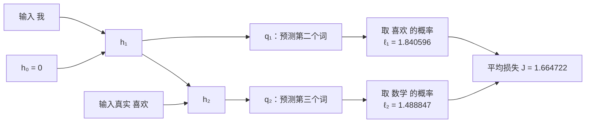

各步使用自己的真实下一词计算交叉熵：

$$
\ell_1=-\ln q_{1,\text{喜欢}}\approx1.840596,\qquad
\ell_2=-\ln q_{2,\text{数学}}\approx1.488847.
$$

本例有两个有效目标，因此：

$$
\boxed{\mathcal J=\frac{\ell_1+\ell_2}{2}\approx1.664722}.
$$

这也等于给定“我”之后，后两个词的条件联合概率的负对数除以 2：

$$
P_\theta(\text{喜欢},\text{数学}\mid\text{我})
=q_{1,\text{喜欢}}q_{2,\text{数学}}
\approx0.0358130.
$$

该乘积不包含第一个词的概率，不能称为整句的无条件概率。一般情况下，对有效目标集合 $\mathcal I$，使用 $|\mathcal I|^{-1}\sum_{t\in\mathcal I}-\ln q_{t,w_{t+1}}$；开始符、结束符、截断与 padding 规则会影响实际计入的目标集合。

标准自回归最大似然训练使用真实前缀，通常称为 teacher forcing。即使本例第一步概率最大的 token 是“数学”，第二步仍输入数据中的“喜欢”，而不是将第一步的 argmax 或采样词作为输入。这样计算的第二项才是 $-\ln P_\theta(\text{数学}\mid\text{我 喜欢})$。用预测词替换真实前缀会改变所评估的条件概率。

“喜欢”在第一步是尚未输入的目标，在第二步成为已知历史；“数学”在第二步仍是目标。这种时间错位不构成答案泄漏。自由生成时则没有已知的真实续写，需要将选出的 token 作为下一步输入。训练中只需提取真实目标的概率来计算损失，不需要先通过 argmax 做离散预测。

以上输出与损失使用 CPU NumPy float64 核对；每步概率和为 1，逐步 NLL 的平均与条件概率乘积的负对数除以 2 一致。这是给定参数的前向计算，不是训练完成后的性能结果。

## 参考资料

- [Bengio 等：A Neural Probabilistic Language Model（2003）](https://www.jmlr.org/papers/v3/bengio03a.html)
- [D2L：多层感知机](https://github.com/d2l-ai/d2l-en/blob/23d7a5aecceee57d1292c56e90cce307f183bb0a/chapter_multilayer-perceptrons/mlp.md)
- [D2L：Softmax 与交叉熵的导数](../refs/d2l-en/chapter_linear-classification/softmax-regression.md)：2.4.1 的损失展开与梯度推导。
- [D2L：循环神经网络](../refs/d2l-en/chapter_recurrent-neural-networks/rnn.md)：隐藏状态、递归更新与跨时间步参数共享。
- [D2L：词向量](https://github.com/d2l-ai/d2l-en/blob/23d7a5aecceee57d1292c56e90cce307f183bb0a/chapter_natural-language-processing-pretraining/word2vec.md)（本节先读向量表示部分）
- [CS336 Lecture 2：张量、梯度与训练](https://github.com/stanford-cs336/spring2025-lectures/blob/b98b08a98d9d47a69bbdcb4e96a58aa48ee4d13b/lecture_02.py)
