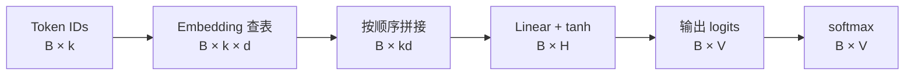

# 第二章：神经语言模型——从计数表到参数共享

| 小节 | 核心内容 |
| --- | --- |
| 2.1 | 从条件概率表到共享函数 |
| 2.2 | Token ID、embedding 与上下文表示 |
| 2.3 | MLP、softmax 与前向计算 |
| 2.4 | 交叉熵、梯度与参数更新 |
| 2.5 | 小型神经语言模型训练及计数基线对比 |
| 2.6 | RNN、LSTM 与序列状态 |

[实验 Notebook](../experiments/02-neural-lm/forward.ipynb) · [前向计算代码](../experiments/02-neural-lm/README.md)

## 2.1 用共享函数计算条件概率

第一章的计数模型通过 $C(h,w)$ 估计 $P(w\mid h)$。更长的上下文会产生更多稀疏表项。神经语言模型改用一个带参数的函数：

$$
P_\theta(w\mid h)=f_\theta(h)_w.
$$

不同上下文使用同一组参数 $\theta$。一个训练样本对参数的更新，能够影响其他上下文的预测，这就是参数共享。

Bengio 等人在 2003 年发表的 *A Neural Probabilistic Language Model* 是这条路线的重要代表：联合学习词的向量表示与下一词概率模型。本章先研究简化的固定窗口 MLP，不包含原论文中的直接线性连接。

| 模型 | 表示与计算方式 | 学习过程 |
| --- | --- | --- |
| n-gram 计数模型 | 查询上下文对应的计数，再平滑 | 累积计数 |
| 固定窗口神经语言模型 | 向量表示 → 共享网络 → 概率分布 | 优化交叉熵，更新参数 |

两者都使用固定长度历史，都可以通过链式法则为序列分配概率。这里改变的是条件概率的估计方式。

## 2.2 从 token 到上下文向量

### Token ID 是索引

设词表大小为 $V$，每个 token 对应一个整数 ID。ID 用于查表，其数值大小和差值不表示词义关系。

学习一个 embedding 矩阵：

$$
E\in\mathbb R^{V\times d}.
$$

第 $i$ 行 $E_{i,:}$ 就是 token $i$ 的 $d$ 维向量。若 $o_i$ 是行形式的 one-hot 向量，则：

$$
e_i=o_iE=E_{i,:}.
$$

实际实现直接索引矩阵行，不必构造长度为 $V$ 的 one-hot。embedding 通常随机初始化，并与其他参数一起训练；向量各维的含义不需要手工指定。

### 保留上下文顺序

历史窗口长度为 $k$。将历史 token 的 embedding 按顺序拼接：

$$
x=[E_{x_{t-k},:};\ldots;E_{x_{t-1},:}]\in\mathbb R^{1\times kd}.
$$

同一个 token 在不同位置使用同一行 $E$，但拼接位置不同。“我 喜欢”和“喜欢 我”因此得到不同的上下文向量。

## 2.3 从向量到下一 token 的分布

用一层 MLP 计算隐藏表示，再输出每个 token 的分数：

$$
h=\tanh(xW_1+b_1),\qquad z=hW_2+b_2,
$$

其中 $W_1\in\mathbb R^{kd\times H}$，$W_2\in\mathbb R^{H\times V}$。$z$ 称为 logits，可以为任意实数。

softmax 将 logits 转为概率：

$$
q_j=\frac{\exp(z_j)}{\sum_{v=1}^V\exp(z_v)}.
$$

计算时减去最大 logit，保持结果不变并避免指数溢出：

$$
q_j=\frac{\exp(z_j-m)}{\sum_v\exp(z_v-m)},\qquad m=\max_v z_v.
$$

这里 $B$ 是 batch size。所有样本共用 $E,W_1,b_1,W_2,b_2$。

### 一个可逐项核对的前向计算

Notebook 使用 $V=6,k=2,d=2,H=3$，输出词表为“我、你、喜欢、研究、数学、物理”。示例参数满足：

$$
E_{\text{我}}=[1,0],\qquad E_{\text{喜欢}}=[0,1].
$$

输入“我 喜欢”时，拼接结果为：

$$
x=[1,0,0,1].
$$

使用代码中的固定权重，依次得到：

$$
xW_1+b_1=[1.1,0,0.2],\qquad
h\approx[0.8005,0,0.1974].
$$

完整权重及每一步输出见 [forward.py](../experiments/02-neural-lm/forward.py)。改变上下文或“喜欢”的 embedding 坐标，可观察预测分布如何变化。

### 参数量与共享范围

这个模型的参数总量为：

$$
\underbrace{Vd}_{E}
+\underbrace{kdH+H}_{W_1,b_1}
+\underbrace{HV+V}_{W_2,b_2}.
$$

示例中为 $12+12+3+18+6=51$。增加训练样本不会增加参数数量；词表、窗口、向量维度和隐藏层宽度决定模型规模。

共享体现在两层：同一个 token 在所有上下文中共用 embedding；所有上下文共用网络权重。参数共享提供统计迁移的机制，是否改善泛化仍由验证集衡量。

下一步使用第一章的目标 $\mathcal L=-\ln q_y$，推导这些参数怎样通过反向传播更新。

## 参考资料

- [Bengio 等：A Neural Probabilistic Language Model（2003）](https://www.jmlr.org/papers/v3/bengio03a.html)
- [D2L：多层感知机](https://github.com/d2l-ai/d2l-en/blob/23d7a5aecceee57d1292c56e90cce307f183bb0a/chapter_multilayer-perceptrons/mlp.md)
- [D2L：词向量](https://github.com/d2l-ai/d2l-en/blob/23d7a5aecceee57d1292c56e90cce307f183bb0a/chapter_natural-language-processing-pretraining/word2vec.md)（本节先读向量表示部分）
- [CS336 Lecture 2：张量、梯度与训练](https://github.com/stanford-cs336/spring2025-lectures/blob/b98b08a98d9d47a69bbdcb4e96a58aa48ee4d13b/lecture_02.py)
