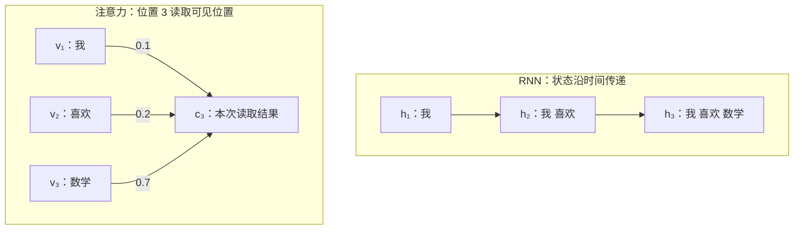
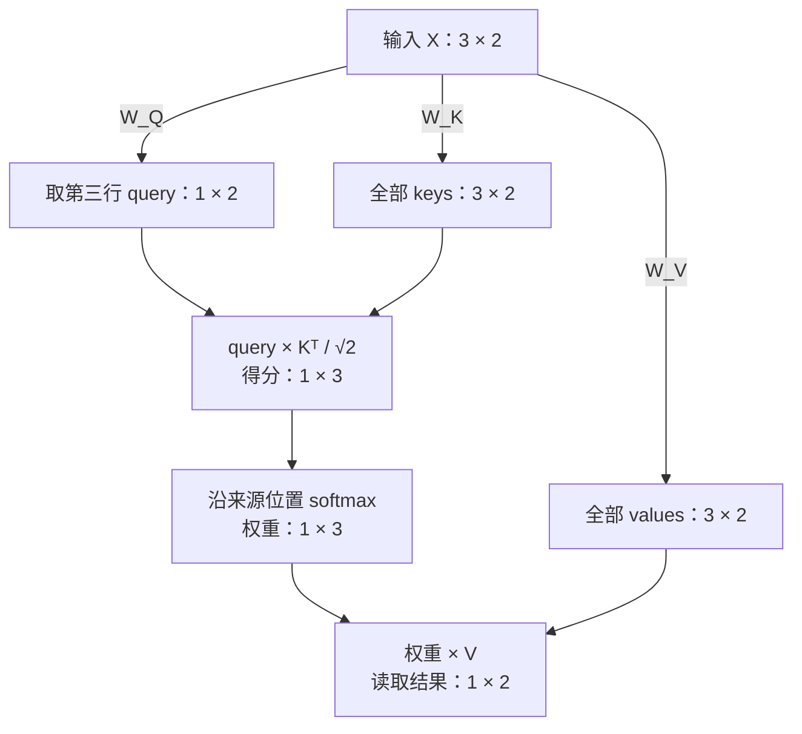
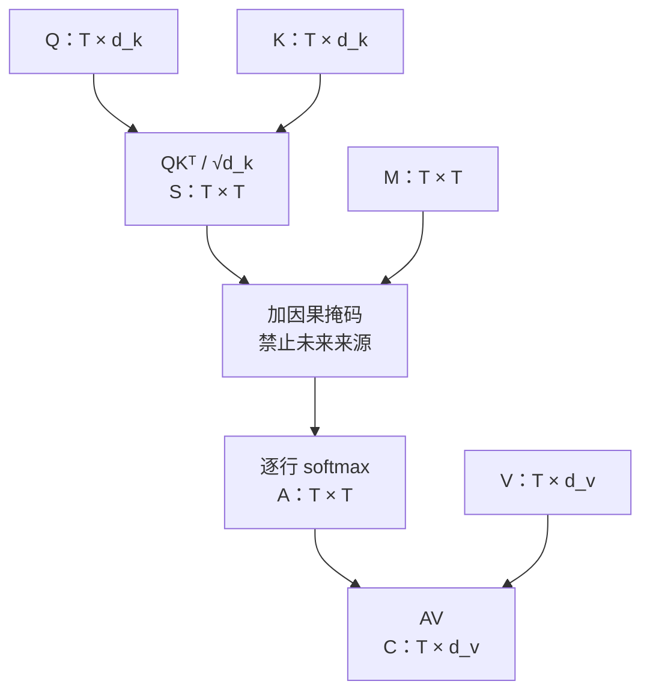
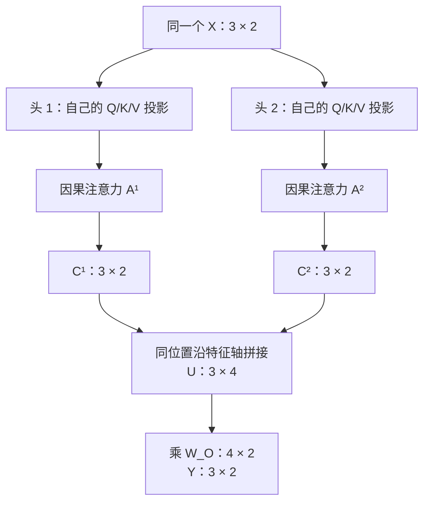
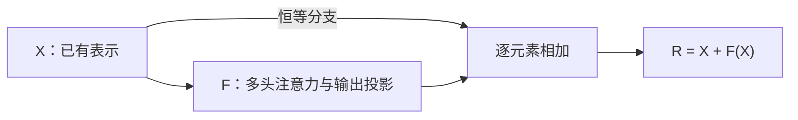
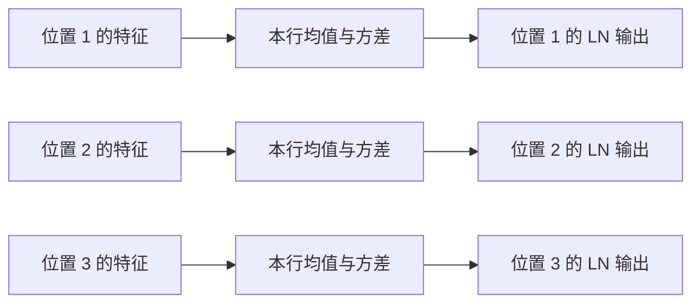
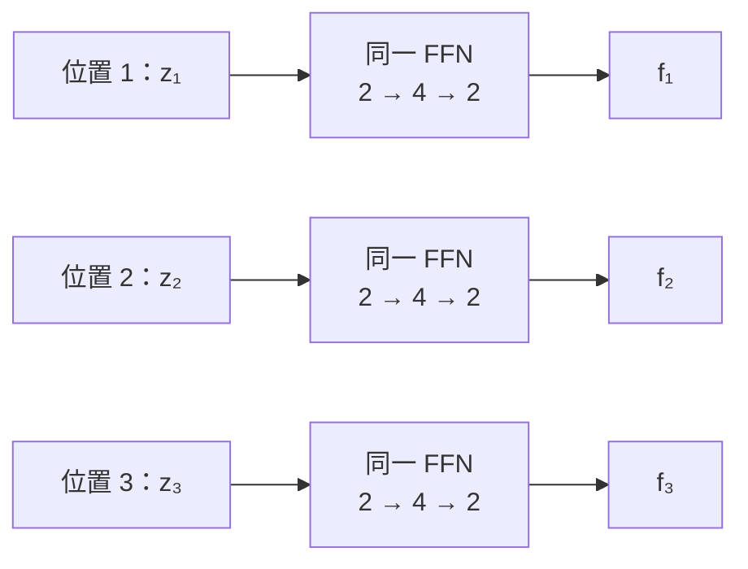
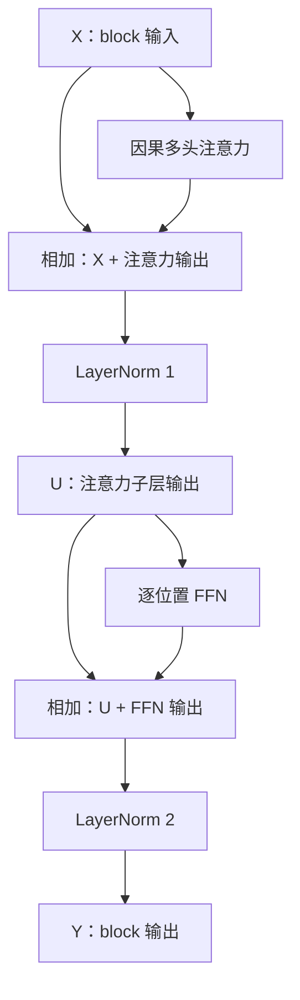
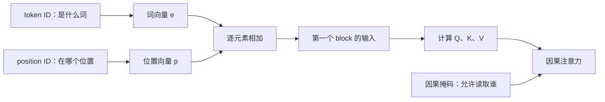

# 第三章：Transformer——从注意力到语言模型

## 3.1 为什么从循环状态走向注意力

神经语言模型的任务仍然是估计下一 token 的条件分布。Transformer 改变的是序列内部交换和处理信息的方式，而不是取消自回归目标、交叉熵或参数共享。本章以因果 decoder-only 语言模型为主线。

### 循环状态的两类限制

普通 RNN 用固定维度状态递归汇总历史：

$$
h_t=f_\theta(e_t,h_{t-1}).
$$

若当前预测只读取 $h_t$，此前信息就必须经由状态更新链传到当前位置。这不意味着固定维度状态完全不能记住早期内容，而是不同历史细节需要共同保留在同一个有限维、有限精度的表示中；其后是否需要这些细节，还可能随着预测位置变化。

早期状态影响远处损失也要经过较长的状态链。反向传播中的局部导数连乘可能衰减或放大，增加学习长期依赖的困难，但不是所有 RNN、所有输入都必然发生梯度消失。LSTM 等门控结构改善信息保留，并不取消标准循环层的逐步状态依赖。

第二类限制是计算依赖：$h_t$ 需要 $h_{t-1}$，即使训练文本已经完整给定，同一层的状态也不能像独立样本一样直接并行算出。矩阵内部和不同序列之间仍有并行空间，不能据此说 RNN 完全无法利用 GPU。

### 从单个摘要到按需读取多个表示

注意力不要求当前读取只依赖一个最终摘要，而是保留多个位置的表示，根据当前位置的需求分配权重，再汇总需要的信息。早期序列到序列注意力已经可以与 RNN 配合使用；Transformer 进一步用自注意力处理位置间的信息交互，而非依靠循环状态逐 token 传递。因此，注意力并不等于 Transformer，使用注意力也不自动消除所有串行依赖。

以下对比的是 RNN 的状态链与一个注意力层中位置 3 的加权读取。注意力侧的 $v_j$ 来自该层输入表示的变换，不是必须按顺序新算出的本层输出：

注意力输出 $c_3$ 仍然是固定维度的汇总，但可读取的多个位置表示没有被这一结果替代。不同位置可以从同一组来源计算不同的加权结果，无需把所有未来需求都提前塞进唯一的历史摘要。

对于因果语言模型，读完位置 $i$ 后预测位置 $i+1$，允许读取的位置为 $j\le i$。单头加权读取可写成：

$$
c_i=\sum_{j=1}^{i}\alpha_{i,j}v_j,\qquad
\alpha_{i,j}\ge0,\qquad
\sum_{j=1}^{i}\alpha_{i,j}=1.
$$

第一个下标 $i$ 表示读取位置，第二个下标 $j$ 表示被读取的来源位置。$v_j$ 是携带内容的 value 向量；权重 $\alpha_{i,j}$ 根据当前输入和学到的参数计算，不是训练后对所有文本固定不变的一组常数。自注意力中的读取请求与被读取内容来自同一条序列的表示。

### “我 喜欢 数学”的一次加权读取

为了只观察汇总步骤，暂令 value 等于已有词向量：

$$
v_1=[1,0],\qquad v_2=[0,1],\qquad v_3=[0.6,0.7].
$$

假设位置 3 的读取权重为：

$$
[\alpha_{3,1},\alpha_{3,2},\alpha_{3,3}]=[0.1,0.2,0.7].
$$

则：

$$
\begin{aligned}
c_3
&=0.1[1,0]+0.2[0,1]+0.7[0.6,0.7]\\
&=[0.1,0]+[0,0.2]+[0.42,0.49]\\
&=\boxed{[0.52,0.69]}.
\end{aligned}
$$

该例展示给定权重后的读取操作，不包含完整的 Q/K/V 投影、位置处理或 Transformer block。权重的生成由后续的查询、键与匹配打分机制给出。

这里的 $0.7$ 是对第三个输入位置的读取权重，不是“下一个词为数学”的概率。注意力权重归一化的轴是可见来源位置；下一词概率归一化的轴是输出词表。相同 token 若出现两次，会对应两个来源位置。$c_3$ 是中间表示，后续还需经过模型其余计算和词表输出层才能得到预测分布。

### 并行机会与因果边界

当某层的所有输入表示已知时，自注意力中不同位置的输出可以从这些输入表示同时计算，不需要先获得该层前一个位置的输出。这减少了 RNN 式的序列内串行依赖；层与层之间仍有依赖。

训练文本已知并不授权模型读取未来答案。因果掩码限制位置 $i$ 只能使用 $j\le i$ 的来源；既可按矩阵批量计算多个位置，又能保持每个预测只依赖其真实前缀。反之，自回归自由生成时后续 token 尚未确定，通常仍需逐 token 生成，不能从“训练位置可并行”推出“整段未知续写可一次并行生成”。

注意力提供更直接的位置间通路，不保证自动理解所有长距离关系或无损保留历史。保留更多位置表示和计算位置间匹配也有存储、计算成本；较强的并行机会并不意味着任何规模和实现下都更快或更省内存。

## 3.2 Q、K、V：从输入表示到一次单头读取

标准缩放点积注意力将匹配与内容汇总分开：query 表达读取请求，key 参与来源匹配，value 是被加权组合的内容。三者是向量计算中的角色，不是固定的人类语义标签，也不是三张独立 token 词表。

对同一个输入表示矩阵 $X$，单头自注意力使用三个跨位置共享的可训练矩阵：

$$
Q=XW_Q,\qquad K=XW_K,\qquad V=XW_V.
$$

若 $X\in\mathbb R^{T\times d_{\mathrm{model}}}$，则 $W_Q,W_K\in\mathbb R^{d_{\mathrm{model}}\times d_k}$、$W_V\in\mathbb R^{d_{\mathrm{model}}\times d_v}$。输出 $Q,K$ 的形状均为 $T\times d_k$，$V$ 为 $T\times d_v$。点积要求 query 与 key 同维，value 的维度可以不同。$W_Q,W_K,W_V$ 是参数；$Q,K,V$ 是由输入和参数计算的中间值。

本节用粗体小写 $\mathbf q_i$ 表示 query 向量，与第二章表示词表概率的 $q_t$ 区分。只展开位置 3 的读取，故三个来源都可见；其他位置的因果限制在整矩阵计算中另行处理。

### 三个线性投影

沿用“我 喜欢 数学”的输入表示，不在此例加入偏置或位置信息：

$$
X=\begin{bmatrix}1&0\\0&1\\0.6&0.7\end{bmatrix},\qquad
W_Q=\begin{bmatrix}1&0\\1&1\end{bmatrix},\quad
W_K=\begin{bmatrix}1&1\\0&1\end{bmatrix},\quad
W_V=\begin{bmatrix}1&0\\0&2\end{bmatrix}.
$$

例如第三行：

$$
\mathbf q_3=[0.6,0.7]W_Q=[1.3,0.7],\quad
\mathbf k_3=[0.6,0.7]W_K=[0.6,1.3],\quad
\mathbf v_3=[0.6,0.7]W_V=[0.6,1.4].
$$

所有行的结果为：

| 位置 | token | query | key | value |
| --- | --- | --- | --- | --- |
| 1 | 我 | $[1,0]$ | $[1,1]$ | $[1,0]$ |
| 2 | 喜欢 | $[1,1]$ | $[0,1]$ | $[0,2]$ |
| 3 | 数学 | $[1.3,0.7]$ | $[0.6,1.3]$ | $[0.6,1.4]$ |

与 3.1 中暂令 value 等于输入不同，这里显式使用 $W_V$，所以 value 已经改变。

### Query 与所有可见 key 打分

当前位置的 query 与各来源 key 作点积：

$$
[\mathbf q_3\mathbf k_1^\top,\mathbf q_3\mathbf k_2^\top,
\mathbf q_3\mathbf k_3^\top]
=[2,\ 0.7,\ 1.69].
$$

缩放点积得分为：

$$
s_{3,j}=\frac{\mathbf q_3\mathbf k_j^\top}{\sqrt{d_k}},\qquad
\mathbf s_3\approx[1.414214,\ 0.494975,\ 1.195010].
$$

本例 $d_k=2$；分母取 query/key 的坐标维度，而不是序列长度、词表大小或 value 维度。若 query/key 的各分量独立、均值为零、方差为 1，则点积方差为 $d_k$；除以 $\sqrt{d_k}$ 可使该假设下的方差回到 1，缓解维度增大带来的 softmax 输入尺度增长。这不是保证训练后任意输入的得分方差都为 1。

### Softmax 生成位置权重

对同一个 query，在可见来源位置轴上归一化：

$$
\alpha_{3,j}
=\frac{\exp(s_{3,j})}{\sum_{r=1}^{3}\exp(s_{3,r})},
\qquad
\boldsymbol\alpha_3
\approx[0.454137,\ 0.181120,\ 0.364744].
$$

其和为 1（显示值存在舍入误差）。第三个位置也可以给第一个位置最大的权重；自注意力的“自”指读取请求和来源来自同一序列，不是只读取自己。得分与权重表达模型计算出的匹配关系，不能直接当作人类语义关系的证明。

### 对 value 加权

$$
\begin{aligned}
\mathbf c_3
&=\boldsymbol\alpha_3V\\
&\approx0.454137[1,0]+0.181120[0,2]+0.364744[0.6,1.4]\\
&\approx\boxed{[0.672983,\ 0.872881]}.
\end{aligned}
$$

形状为 $(1\times3)(3\times2)=1\times2$。本次读取结果的宽度由 $d_v$ 决定，而不是由可见位置数决定。该结果还不是词表概率，也不是包含输出投影、残差、归一化和 FFN 的完整 Transformer block 输出。

在固定 $X,W_Q,W_K$ 的这次前向计算中，改变 $W_V$ 不改变匹配得分与注意力权重，但可能改变读取结果；这种依赖关系区分不代表训练时三个投影互不相关，损失仍通过整个计算图影响相关参数。

本节使用 CPU NumPy float64 核对三个矩阵投影、第三行得分、概率归一化及加权结果；矩阵乘法汇总与逐项加权求和一致。只验证给定参数的单头前向，不代表训练或完整 Transformer 实验。

## 3.3 全位置矩阵计算与因果掩码

单个位置的输出 $\mathbf c_i\in\mathbb R^{1\times d_v}$ 是一行。将长度为 $T$ 的序列全部位置堆叠，得到 $C\in\mathbb R^{T\times d_v}$：

$$
C=\begin{bmatrix}\mathbf c_1\\\mathbf c_2\\\vdots\\\mathbf c_T\end{bmatrix}.
$$

因此 $T=3,d_v=4$ 时，$\mathbf c_3$ 的形状为 $1\times4$，$C$ 才是 $3\times4$。增加位置数改变行数，增加 value 维度改变输出列数。

### 一次计算全部 query-key 配对

沿用 3.2 的投影结果：

$$
Q=\begin{bmatrix}1&0\\1&1\\1.3&0.7\end{bmatrix},\qquad
K=\begin{bmatrix}1&1\\0&1\\0.6&1.3\end{bmatrix},\qquad
V=\begin{bmatrix}1&0\\0&2\\0.6&1.4\end{bmatrix}.
$$

全位置得分矩阵：

$$
S=\frac{QK^\top}{\sqrt{d_k}},\qquad
S_{i,j}=\frac{\mathbf q_i\mathbf k_j^\top}{\sqrt{d_k}}.
$$

$S$ 的行 $i$ 表示发起读取的 query 位置，列 $j$ 表示被读取的 key 位置。形状 $(T\times d_k)(d_k\times T)=T\times T$，不是特征间的配对矩阵，也不是词表概率。

本例 $d_k=2$：

$$
QK^\top=\begin{bmatrix}1&0&0.6\\2&1&1.9\\2&0.7&1.69\end{bmatrix},
\qquad
S\approx\begin{bmatrix}
0.707107&0&0.424264\\
1.414214&0.707107&1.343503\\
1.414214&0.494975&1.195010
\end{bmatrix}.
$$

第三行就是上一节单独计算的结果。第一、二行还包含未来来源的得分，不能直接用于因果语言模型的权重归一化。

### 在 softmax 前排除未来位置

位置 $i$ 的表示用于预测 $i+1$ 位置的 token，因此允许读取 $j\le i$，禁止 $j>i$。定义加性掩码：

$$
M_{i,j}=
\begin{cases}
0,&j\le i,\\
-\infty,&j>i,
\end{cases}
\qquad
M=\begin{bmatrix}
0&-\infty&-\infty\\
0&0&-\infty\\
0&0&0
\end{bmatrix}.
$$

于是：

$$
\widetilde S=S+M\approx\begin{bmatrix}
0.707107&-\infty&-\infty\\
1.414214&0.707107&-\infty\\
1.414214&0.494975&1.195010
\end{bmatrix}.
$$

允许自身位置不构成答案泄漏：当前位置 token 是输入，下一个 token 才是监督目标。计算出最后位置的表示，也不意味着一定存在对应的训练标签；例如只有三个词且不加入结束符时，仅有两个下一词目标。

掩码中的 $0$ 表示给允许位置加零、保留其原得分；并非将允许得分改为零。禁止位置使用 $-\infty$，因为 $\exp(-\infty)=0$。若把禁止得分设置为 $0$，其指数仍为 $1$，不会消除读取权重。

### 每行独立归一化

记 $A$ 为注意力权重矩阵：

$$
A=\operatorname{softmax}_{\mathrm{row}}(\widetilde S),\qquad
A_{i,j}=
\begin{cases}
\displaystyle\frac{\exp(S_{i,j})}{\sum_{r=1}^{i}\exp(S_{i,r})},&j\le i,\\
0,&j>i.
\end{cases}
$$

softmax 沿来源列轴进行，每一行对应一个 query 的完整权重分布。不同 query 不共用一个归一化分母，也不要求列和为 1。结果：

$$
A\approx\begin{bmatrix}
1&0&0\\
0.669762&0.330238&0\\
0.454137&0.181120&0.364744
\end{bmatrix}.
$$

第一行只有一个可见来源，因此权重必为 1。第二行只在前两列之间分配权重；第三行全部可见，与 3.2 一致。显示数值经过舍入，实际行和为 1。

不能简单先对所有列做 softmax，再将未来权重清零：这样通常行和不再为 1，而且保留位置的权重仍通过原分母依赖未来得分。正确归一化必须排除未来项；标准做法是在 softmax 前应用掩码。

### 用同一次矩阵乘法汇总所有位置

$$
\boxed{C=AV},\qquad
(T\times T)(T\times d_v)=T\times d_v.
$$

每行仍然是熟悉的加权读取：

$$
\mathbf c_i=\sum_{j=1}^{i}A_{i,j}\mathbf v_j.
$$

本例：

$$
C\approx\begin{bmatrix}
1&0\\
0.669762&0.660477\\
0.672983&0.872881
\end{bmatrix}.
$$

其中 $\mathbf c_1=\mathbf v_1$，$\mathbf c_2=0.669762[1,0]+0.330238[0,2]$；第三行与上一节相同。$C$ 是单头读取结果，不是词表概率或完整 block 输出。

单序列、单头因果注意力可概括为：

$$
\boxed{
C=\operatorname{softmax}_{\mathrm{row}}
\left(\frac{QK^\top}{\sqrt{d_k}}+M\right)V
}.
$$

矩阵化同时计算各 query 的配对和读取，掩码限制每行能使用的信息；两者相容。本节先讨论数学上的稠密矩阵表达，不要求实际实现必须物化所有矩阵。

使用 CPU NumPy float64 核对：权重行和为 1，严格上三角权重为 0；整矩阵第 $i$ 行输出与只输入前 $i$ 个位置、读取最后一行的结果在绝对误差 $10^{-14}$ 内一致。固定参数，将第三个输入从 $[0.6,0.7]$ 改成 $[2,-1]$，前两行输出保持不变，第三行发生变化；不使用掩码时，同样修改会影响前两行。这验证了该示例的前向因果隔离，不是完整 Transformer 训练测试。

## 3.4 多头注意力：分别读取，再拼接与投影

单头在每个 query 位置只生成一套来源权重，该头的所有 value 坐标共用这套权重。多头注意力为同一输入提供多套可学习投影，允许不同头产生不同的匹配与读取结果；不同头不保证形成固定的语法或语义分工。

设头数为 $H$，各头宽度相同。第 $r$ 个头计算：

$$
Q^{(r)}=XW_Q^{(r)},\quad K^{(r)}=XW_K^{(r)},\quad V^{(r)}=XW_V^{(r)},
$$

$$
A^{(r)}=\operatorname{softmax}_{\mathrm{row}}\left(
\frac{Q^{(r)}K^{(r)\top}}{\sqrt{d_k}}+M\right),\qquad
C^{(r)}=A^{(r)}V^{(r)}.
$$

每个头读取相同的全部输入位置和特征，使用自己的投影参数与注意力分布，并遵守同一个因果掩码。不是把不同 token 分给不同头，也不是把头依次串联成不同层。投影参数在同一头的各位置间共享。

### 两个头的数值例子

保留前两节的 $X$ 及其三套投影作为头 1，因此：

$$
\mathbf c_3^{(1)}\approx[0.672983,\ 0.872881].
$$

头 2 取 $W_Q^{(2)}=W_K^{(2)}=W_V^{(2)}=I_2$，故 $Q^{(2)}=K^{(2)}=V^{(2)}=X$。第三个 query 的未缩放得分为 $[0.6,0.7,0.85]$，逐项除以 $\sqrt2$ 后做 softmax：

$$
\boldsymbol\alpha_3^{(2)}\approx[0.306125,\ 0.328555,\ 0.365319],
$$

$$
\mathbf c_3^{(2)}
=0.306125[1,0]+0.328555[0,1]+0.365319[0.6,0.7]
\approx[0.525317,\ 0.584279].
$$

两个头各自形成读取结果，再沿特征轴拼接同一个位置：

$$
\mathbf u_3=
[\mathbf c_3^{(1)}\Vert\mathbf c_3^{(2)}]
\approx[0.672983,\ 0.872881,\ 0.525317,\ 0.584279].
$$

对于所有位置，$U=\operatorname{Concat}(C^{(1)},C^{(2)})\in\mathbb R^{3\times4}$；拼接不增加 token 数量，也不把两头直接平均。

使用可学习输出投影 $Y=UW_O$ 将拼接结果组合回模型宽度。本例取：

$$
W_O=\begin{bmatrix}
1&0\\0&1\\0.5&0\\0&0.5
\end{bmatrix},\qquad
\mathbf y_3=\mathbf u_3W_O
=\mathbf c_3^{(1)}+0.5\mathbf c_3^{(2)}
\approx[0.935641,\ 1.165020].
$$

一般的 $W_O$ 可以跨头、跨坐标组合，而不局限于本例的同坐标加权。它在每个位置使用同一套参数，不再混合不同位置。该输出仍是中间表示，不是词表概率，也未包括残差、归一化和 FFN。

### 一般形状与常见配置

对于单条序列：

| 对象 | 形状 |
| --- | --- |
| 输入 $X$ | $T\times d_{\mathrm{model}}$ |
| 单头 $W_Q^{(r)},W_K^{(r)}$ | $d_{\mathrm{model}}\times d_k$ |
| 单头 $W_V^{(r)}$ | $d_{\mathrm{model}}\times d_v$ |
| 单头 $A^{(r)}$ | $T\times T$ |
| 单头 $C^{(r)}$ | $T\times d_v$ |
| 拼接结果 $U$ | $T\times(Hd_v)$ |
| 输出投影 $W_O$ | $(Hd_v)\times d_{\mathrm{model}}$ |
| 输出 $Y$ | $T\times d_{\mathrm{model}}$ |

常见标准 MHA 选择 $d_k=d_v=d_{\mathrm{model}}/H$。例如模型宽度 8、2 个头时，每头宽度 4，拼接恢复为 8。本节二维输入、两头各二维是为了沿用已有数值，拼接宽度为 4，再投影回 2；它不采用上述常见等宽配置。

在固定模型宽度、采用上述常见配置、不计偏置且每头有独立 Q/K/V 的标准 MHA 中，三套输入投影与输出投影合计参数量为：

$$
3H d_{\mathrm{model}}\frac{d_{\mathrm{model}}}{H}
+d_{\mathrm{model}}^2=4d_{\mathrm{model}}^2.
$$

因此增加头数并缩小每头宽度，不会按头数成倍增加这些投影参数。注意力权重图仍有 $H$ 份；参数量不变不代表运行时间或中间存储不变。

CPU NumPy float64 核对了两头的完整因果前向、权重归一化、特征轴拼接及输出投影；$UW_O=C^{(1)}+0.5C^{(2)}$ 在浮点容差内一致。未进行训练实验。

## 3.5 残差、归一化与前馈网络

### 3.5.1 残差连接：在已有表示上增加分支输出

将多头注意力及其输出投影整体记为 $F(X)$。暂时单独考察残差加法，不加入归一化和 dropout：

$$
R=X+F(X),\qquad X,F(X),R\in\mathbb R^{T\times d_{\mathrm{model}}}.
$$

这是同位置、同坐标的逐元素相加，不是拼接。恒等分支直接传递输入；注意力分支根据上下文产生可学习的修正。若希望整个映射为 $G(X)$，残差分支可学习 $G(X)-X$，因此称为残差；它不是交叉熵误差，也不是参数梯度。

沿用 3.4，第三个位置的输入为 $[0.6,0.7]$，注意力输出为 $[0.935641,1.165020]$，因此：

$$
\mathbf r_3=[0.6,0.7]+[0.935641,1.165020]
\approx[1.535641,1.865020].
$$

分支输出可以为负，大小也不要求很小。这里只改变前向表示，不更新参数；推理阶段也会执行残差加法。输入与分支输出必须形状匹配，这也是将多头拼接结果投影回模型宽度的重要原因。

若 $F(X)=0$，加法节点的输出就是 $X$，从而允许分支不改变已有表示。这个结论只针对所示残差加法，不表示后续归一化也是恒等映射。直接传递输入也不保证最终可以无损恢复它，例如分支可能抵消输入。

反向传播沿两条路径回到输入。用标量 $r=x+f(x)$ 表示局部机制：

$$
\frac{\partial\mathcal L}{\partial x}
=\frac{\partial\mathcal L}{\partial r}
+\frac{\partial\mathcal L}{\partial r}f'(x).
$$

当上游梯度为 $0.5$、$f'(x)=0.02$ 时，恒等分支贡献 $0.5$，变换分支贡献 $0.01$，合计 $0.51$。如果只有变换分支，上述局部链式因子将给出 $0.01$；这里固定上游梯度进行机制比较，不声称两种完整网络具有相同损失或上游梯度。

对完整序列，将输入与输出展平成列向量后，对应关系为 $g_x=g_r+J_F^\top g_r$。其中 $J_F$ 包含注意力跨位置与跨坐标的依赖；实际不能把完整注意力的 Jacobian 当成逐元素导数。

恒等分支增加了一条不必穿过 $F$ 的梯度路径，常有助于深层优化，但两条贡献仍可能抵消，不能据此保证总梯度非零或彻底消除梯度消失、爆炸。若 $F$ 因果，恒等分支只复制对应位置，残差加法也保持因果性。

归一化在分支内或加法之后的位置会影响完整 block 的表达与梯度路径；需在归一化小节分别讨论。

### 3.5.2 LayerNorm：每个位置内部的特征归一化

层叠的残差与变换可能改变中间表示的尺度。LayerNorm 对每个 token 的特征向量独立计算均值和方差，再使用可学习的缩放与平移。它调节分支接收的表示尺度，不保证残差流有界或训练必然稳定。

对于 $\mathbf r\in\mathbb R^d$：

$$
\mu=\frac1d\sum_{j=1}^d r_j,\quad
\sigma^2=\frac1d\sum_{j=1}^d(r_j-\mu)^2,
$$

$$
\hat r_j=\frac{r_j-\mu}{\sqrt{\sigma^2+\epsilon}},\qquad
\operatorname{LN}(\mathbf r)_j=\gamma_j\hat r_j+\beta_j.
$$

方差使用分母 $d$，不是 $d-1$。$\epsilon>0$ 避免零方差时除零；$\gamma,\beta\in\mathbb R^d$ 是参数，$\mu,\sigma^2$ 是当前输入计算出的中间量。标准 LayerNorm 不需要跨 batch 的运行均值或方差，训练与推理都根据当前 token 计算统计量。

沿用上一节第三个位置的残差结果，并取 $\epsilon=10^{-5}$：

$$
\mathbf r_3\approx[1.535641,1.865020],\quad
\mu\approx1.700331,\quad
\sigma^2\approx0.027123.
$$

中心化后约为 $[-0.164690,0.164690]$，除以 $\sqrt{\sigma^2+\epsilon}\approx0.164720$ 得：

$$
\hat{\mathbf r}_3\approx[-0.999816,0.999816].
$$

若 $\gamma=[1,1],\beta=[0,0]$，输出就是上述标准化结果；若 $\gamma=[2,0.5],\beta=[0.1,-0.2]$，则输出约为 $[-1.899631,0.299908]$。计算使用保留八位小数的输入，并非用展示的六位中间量反复计算。

标准化中间量均值为零、方差为 $\sigma^2/(\sigma^2+\epsilon)$；只有忽略 $\epsilon$ 且方差非零时，方差才为 1。仿射变换后的最终输出不保证零均值或单位方差；输出不是概率分布。二维例子的中心化坐标互为相反数，因而接近 $[-1,1]$，更高维不具有这种固定形式。

对于 $B\times T\times d_{\mathrm{model}}$ 的输入，标准 Transformer LayerNorm 只归一化最后的特征轴：共有 $BT$ 组统计量，每组使用 $d_{\mathrm{model}}$ 个数。每个 LayerNorm 模块自己的 $\gamma,\beta$ 在样本与位置间共享，不同模块通常不共享参数。统计量独立不意味着同一 token 内部坐标独立，因为每个坐标都影响均值和方差。固定模块参数时，仅改变其他 token 的 LayerNorm 输入，不改变当前 token 的输出；这一结论不包括上游注意力已经造成的跨位置影响。

归一化的放置改变残差结构。省略 dropout，记 $F$ 为注意力分支：

| 结构 | 公式 | 当 $F$ 输出零时 |
| --- | --- | --- |
| Post-LN | $Z=\operatorname{LN}(X+F(X))$ | $Z=\operatorname{LN}(X)$ |
| Pre-LN | $R=X+F(\operatorname{LN}(X))$ | $R=X$ |

前面的数值例子展示 Post-LN 中的加法后归一化。Pre-LN 中注意力读入的数值已改变，不能直接复用此前 $F(X)$ 的数值作为 $F(\operatorname{LN}(X))$。

Pre-LN 保留从输入到加法输出的恒等路径，归一化位于变换分支内；Post-LN 的加法输出还要经过归一化，其梯度也要经过 LayerNorm，不能把加法节点的直通性质当作整个模块的性质。两者中的逐 token LayerNorm 都不直接读取未来位置。RMSNorm 等变体留待后续现代架构讨论。

### 3.5.3 逐位置 FFN：共享 MLP 对特征做非线性变换

注意力跨位置汇总信息；逐位置前馈网络（positionwise FFN）对每个位置已有的表示应用同一个 MLP。FFN 不直接混合不同 token，但其输入已经可以包含注意力读入的上下文。一个模块的参数在所有样本、位置之间共享，不同 Transformer 层通常使用不同的 FFN 参数。

对行向量 $\mathbf z_i\in\mathbb R^{1\times d_{\mathrm{model}}}$，基本两层 FFN 为：

$$
\mathbf a_i=\mathbf z_iW_{\mathrm{up}}+\mathbf b_{\mathrm{up}},\quad
\mathbf h_i=\phi(\mathbf a_i),\quad
\mathbf f_i=\mathbf h_iW_{\mathrm{down}}+\mathbf b_{\mathrm{down}}.
$$

其中 $W_{\mathrm{up}}\in\mathbb R^{d_{\mathrm{model}}\times d_{\mathrm{ff}}}$、$\mathbf b_{\mathrm{up}}\in\mathbb R^{d_{\mathrm{ff}}}$、$W_{\mathrm{down}}\in\mathbb R^{d_{\mathrm{ff}}\times d_{\mathrm{model}}}$、$\mathbf b_{\mathrm{down}}\in\mathbb R^{d_{\mathrm{model}}}$。$d_{\mathrm{ff}}$ 是 FFN 隐藏宽度，与 token 数、头数和词表大小不同；通常取大于模型宽度，但不是数学必需条件。本节采用 $\phi(u)=\max(0,u)$，即逐元素 ReLU。

沿用 3.5.2 的 Post-LN 中间结果，选择 $\gamma=[1,1],\beta=[0,0]$，第三个位置输入为 $\mathbf z_3\approx[-0.999816,0.999816]$。设置模型宽度 2、FFN 隐藏宽度 4：

$$
W_{\mathrm{up}}=
\begin{bmatrix}1&-1&1&0\\0&1&1&1\end{bmatrix},
\qquad
\mathbf b_{\mathrm{up}}=[0.1,0,0.2,-0.5].
$$

得到：

$$
\mathbf a_3\approx[-0.899816,1.999631,0.2,0.499816],
\quad
\mathbf h_3\approx[0,1.999631,0.2,0.499816].
$$

再设置：

$$
W_{\mathrm{down}}=
\begin{bmatrix}
0.5&0\\0.2&-0.1\\-0.5&0.5\\0.1&0.3
\end{bmatrix},
\qquad \mathbf b_{\mathrm{down}}=[0,0.1],
$$

得到 FFN 分支输出：

$$
\mathbf f_3\approx[0.349908,0.149982].
$$

本例计算从上一节保留八位小数的残差输入重新计算 LayerNorm，使用未舍入的标准化结果继续前向。$\mathbf f_3$ 是中间特征修正，不是词表概率，也尚未进行 FFN 外侧的残差与归一化。

图中三次调用共享一套权重与偏置，位置之间没有 FFN 内部的数据传递。扩张的是特征数，不是位置数。输入若为 $B\times T\times d_{\mathrm{model}}$，隐藏张量为 $B\times T\times d_{\mathrm{ff}}$，输出恢复为 $B\times T\times d_{\mathrm{model}}$。实现时可将前两轴展平为 $BT$ 行，一起进行矩阵乘法；参数和语义不变。

去掉激活后：

$$
(\mathbf zW_{\mathrm{up}}+\mathbf b_{\mathrm{up}})W_{\mathrm{down}}+\mathbf b_{\mathrm{down}}
=
\mathbf z(W_{\mathrm{up}}W_{\mathrm{down}})
+\mathbf b_{\mathrm{up}}W_{\mathrm{down}}+\mathbf b_{\mathrm{down}},
$$

仍是一个仿射变换。激活使 FFN 不再能一般地合并成单个仿射层。这个论断针对 FFN，注意力的 softmax 自身已经是非线性的，不能据此声称 Transformer 仅靠 FFN 才有非线性。

含两项偏置的基本 FFN 参数量为 $2d_{\mathrm{model}}d_{\mathrm{ff}}+d_{\mathrm{ff}}+d_{\mathrm{model}}$，本例为 22，不随样本数或序列长度增加。共享参数训练时汇总各位置的梯度；固定参数的逐行独立性不意味着更新参数后其他行预测不受影响。该逐位置分支不会额外读取未来 token。

CPU NumPy float64 核对了数值前向、整矩阵与逐行调用的一致性、只修改第三行输入时前两行输出不变，以及去掉激活后的仿射合并等式。未进行训练实验。

### 3.5.4 组合完整的因果 Transformer block

本节组合 decoder-only 路线中的因果自注意力与 FFN，不含 encoder-decoder cross-attention。D2L 的原始 encoder-decoder 解码器还包含交叉注意力，不应将两种结构混为一谈。为突出数据流，省略 dropout；位置机制和词表输出头另行讨论。

Post-LN block 包含两个子层，每个子层各有一条残差连接与一个 LayerNorm：

$$
U=\operatorname{LN}_1\left(X+\operatorname{MHA}_{\mathrm{causal}}(X)\right),
$$

$$
Y=\operatorname{LN}_2\left(U+\operatorname{FFN}(U)\right).
$$

第二条残差使用 FFN 子层的输入 $U$，不是整个 block 的原始输入 $X$。两者形状相同，误用 $X$ 可能不会引发形状错误，却会改变计算图。$\operatorname{LN}_1$ 与 $\operatorname{LN}_2$ 通常有各自的 gamma/beta；参数形状相同不意味着共享参数。

沿用 3.4–3.5.3 的全部投影与 FFN 参数，两组 LayerNorm 均取 gamma=[1,1]、beta=[0,0]、epsilon=$10^{-5}$，第三个位置计算如下：

| 阶段 | 第三个位置的值 |
| --- | --- |
| 输入 $X$ | $[0.6,0.7]$ |
| 因果多头注意力输出 | $[0.935641,1.165020]$ |
| 第一次残差相加 | $[1.535641,1.865020]$ |
| 第一次归一化，得到 $U$ | $[-0.999816,0.999816]$ |
| FFN 分支输出 | $[0.349908,0.149982]$ |
| 第二次残差相加 | $[-0.649908,1.149797]$ |
| 第二次归一化，得到 $Y$ | $[-0.999994,0.999994]$ |

本次从初始 $X$ 重算完整序列前向，使用未舍入中间量。二维、单位缩放、零偏移的 LayerNorm 使多组输入接近 $[-1,1]$，不能由此认定 FFN 无作用，也不能将此现象推广到高维模型。该结果是隐藏表示，不是词表概率。

Pre-LN 的两个子层则是：

$$
U=X+\operatorname{MHA}_{\mathrm{causal}}\left(\operatorname{LN}_1(X)\right),
$$

$$
Y=U+\operatorname{FFN}\left(\operatorname{LN}_2(U)\right).
$$

这里两次归一化都只放在对应变换分支内，直通分支分别传递 $X$ 和 $U$。两种完整 block 不等价，不能移用 Post-LN 的数值结果作为 Pre-LN 结果；某些 Pre-LN 整体模型还会在最后一个 block 后设置最终归一化。

若输入形状为 $B\times T\times d_{\mathrm{model}}$，每个子层输出和整个 block 输出都保持此形状；FFN 只在内部分支扩张特征维度。多个 block 按 $X^{(\ell+1)}=\operatorname{Block}_{\ell}(X^{(\ell)})$ 堆叠，不同层通常使用不同参数。下一层根据上一层输出重新计算 Q/K/V；注意力头是同层并行分支，block 是跨层串行组合。

在固定参数下，若每层注意力都满足因果掩码，LayerNorm、FFN 与残差均只处理对应位置，则任意深度的位置 $i$ 只依赖原始输入的前 $i$ 个位置。增加深度不会让未来信息绕过掩码。训练时层间仍有依赖，但同一层的所有已知位置可以矩阵化计算。

CPU NumPy float64 核对了三个位置的完整 Post-LN 前向及子模块组合。固定参数，将第三个输入从 [0.6,0.7] 改为 [2,-1] 后，前两行 block 输出在绝对容差 $10^{-14}$ 内不变。此为前向验证，尚非完整语言模型训练实验。

## 3.6 位置信息

### 3.6.1 从内容匹配到绝对位置向量

输入矩阵的行号是存储与索引信息，不会自动作为数值特征参与共享的线性投影。若第一层输入仅为 token embedding，$q_i=e_{w_i}W_Q$、$k_j=e_{w_j}W_K$，未显式输入位置坐标。因果掩码限制可见来源，但并不直接在匹配得分中编码相距多少个位置。

考虑单头第一层的第三个 query，输入从“我 喜欢 数学”改为“喜欢 我 数学”。保持第三个 token、模型参数和三角掩码不变。第三个位置仍可读取全部三个来源；前两个 key/value 成对交换，得分及 softmax 权重也随之交换。因此：

$$
\alpha_{3,1}v_1+\alpha_{3,2}v_2+\alpha_{3,3}v_3
=
\alpha_{3,2}v_2+\alpha_{3,1}v_1+\alpha_{3,3}v_3.
$$

沿用 3.2 的单头参数，交换前后第三行输出均为 $[0.672983,0.872881]$。这是第一层指定 query 的结论，不代表所有位置输出不变，也不代表多层因果模型完全无法利用顺序。因果掩码使各位置可见前缀不同，先前位置的表示可能随排列而改变，并被后续层读取。

一种直接提供位置坐标的方法，是在进入第一个 block 前相加：

$$
\boxed{x_i^{(0)}=e_{w_i}+p_i},
\qquad e_{w_i},p_i,x_i^{(0)}\in\mathbb R^{d_{\mathrm{model}}}.
$$

token embedding 按词表 ID 查表，位置向量按位置 ID 获取；相加保持形状不变。以下使用从 1 开始的位置编号，给定：

$$
p_1=[0,0],\quad p_2=[0.2,-0.1],\quad p_3=[-0.1,0.2].
$$

| 位置 | token embedding | 位置向量 | 相加后的输入 |
| --- | --- | --- | --- |
| 1：“我” | $[1,0]$ | $[0,0]$ | $[1,0]$ |
| 2：“喜欢” | $[0,1]$ | $[0.2,-0.1]$ | $[0.2,0.9]$ |
| 3：“数学” | $[0.6,0.7]$ | $[-0.1,0.2]$ | $[0.5,0.9]$ |

这组位置向量是示例参数值，未声称由训练得到。三条二维输入相加后仍为 $3\times2$，不是 $3\times4$。同一 token 在不同位置共享词向量，但可因 $p_i$ 不同而具有不同的初始输入表示。

以相加后的 $x_i^{(0)}$ 计算 Q/K/V，例如 $q_i=(e_{w_i}+p_i)W_Q$，位置可以同时影响匹配与 value 内容。在这个基本加性方案中，位置向量在初始输入处加入，后续 block 处理上一层的表示；并非每一层都重新加入同一个 $p_i$。

交换前两个 token 时，位置向量仍附属于原位置，而不是跟随 token 搬动。因此新输入为：

$$
X_{\mathrm{swap}}^{(0)}
=\begin{bmatrix}
0&1\\1.2&-0.1\\0.5&0.9
\end{bmatrix},
$$

它不再只是原始相加输入矩阵的前两行交换。沿用同一头的投影和掩码：

| 输入顺序 | 不加位置向量的第三行输出 | 加位置向量的第三行输出 |
| --- | --- | --- |
| 我、喜欢、数学 | $[0.672983,0.872881]$ | $[0.656536,1.006706]$ |
| 喜欢、我、数学 | $[0.672983,0.872881]$ | $[0.794486,0.772799]$ |

位置向量使匹配能够依赖内容与位置的组合，不保证所有参数与所有输入下交换顺序都必然产生不同输出。

可学习绝对位置嵌入将位置向量存为 $L_{\max}\times d_{\mathrm{model}}$ 的参数表，同一位置 ID 的向量跨 token 身份和样本共享。仅按原表查找时，超出表范围的位置没有对应行；扩展表也不自动保证未训练位置的效果。另一类方案用固定规则产生位置向量，正弦/余弦编码留待下一小节。

位置编码提供位置相关特征，因果掩码限制信息访问，两者不能相互替代。加入位置向量后仍需屏蔽未来 token。

CPU NumPy float64 核对了上述两种顺序、有无加性位置向量的四组第一层单头前向。不加位置向量的两组第三行在绝对容差 $10^{-14}$ 内一致；加位置向量后本例的第三行输出不同。未开展训练实验，未把单层结果外推为多层模型结论。

## 参考资料

- [D2L：Bahdanau 注意力](../refs/d2l-en/chapter_attention-mechanisms-and-transformers/bahdanau-attention.md)：固定状态瓶颈与根据预测需求读取编码器位置。
- [D2L：自注意力与位置编码](../refs/d2l-en/chapter_attention-mechanisms-and-transformers/self-attention-and-positional-encoding.md)：同一序列内部的信息汇总。
- [D2L：注意力评分函数](../refs/d2l-en/chapter_attention-mechanisms-and-transformers/attention-scoring-functions.md)：缩放点积与 softmax 权重。
- [D2L：多头注意力](../refs/d2l-en/chapter_attention-mechanisms-and-transformers/multihead-attention.md)：多套投影、拼接与输出投影。
- [D2L：Transformer](../refs/d2l-en/chapter_attention-mechanisms-and-transformers/transformer.md)：残差连接、层归一化与前馈网络；其 AddNorm 示例采用加法后归一化。
