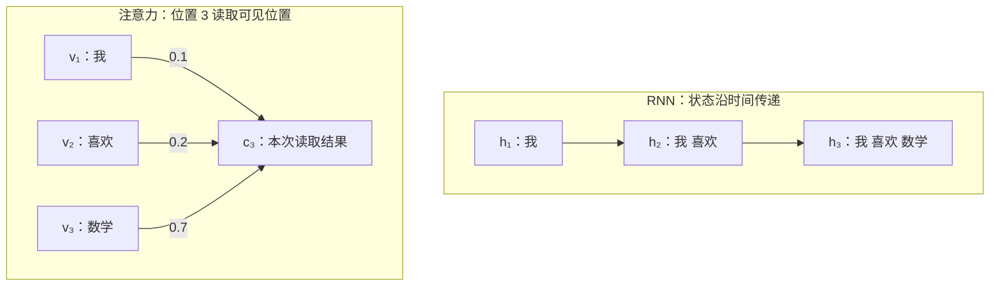
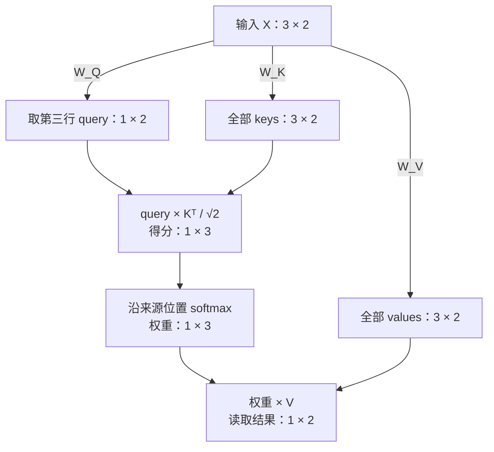

# 第三章：Transformer——从注意力到语言模型

## 3.1 为什么从循环状态走向注意力

神经语言模型的任务仍然是估计下一 token 的条件分布。Transformer 改变的是序列内部交换和处理信息的方式，而不是取消自回归目标、交叉熵或参数共享。本章以因果 decoder-only 语言模型为主线。

### 循环状态的两类限制

普通 RNN 用固定维度状态递归汇总历史：

$$
h_t=f_\theta(e_t,h_{t-1}).
$$

若当前预测只读取 $h_t$，此前信息就必须经由状态更新链传到当前位置。这不意味着固定维度状态完全不能记住早期内容，而是不同历史细节需要共同保留在同一个有限维、有限精度的表示中；其后是否需要这些细节，还可能随着预测位置变化。

早期状态影响远处损失也要经过较长的状态链。反向传播中的局部导数连乘可能衰减或放大，增加学习长期依赖的困难，但不是所有 RNN、所有输入都必然发生梯度消失。LSTM 等门控结构改善信息保留，并不取消标准循环层的逐步状态依赖。

第二类限制是计算依赖：$h_t$ 需要 $h_{t-1}$，即使训练文本已经完整给定，同一层的状态也不能像独立样本一样直接并行算出。矩阵内部和不同序列之间仍有并行空间，不能据此说 RNN 完全无法利用 GPU。

### 从单个摘要到按需读取多个表示

注意力不要求当前读取只依赖一个最终摘要，而是保留多个位置的表示，根据当前位置的需求分配权重，再汇总需要的信息。早期序列到序列注意力已经可以与 RNN 配合使用；Transformer 进一步用自注意力处理位置间的信息交互，而非依靠循环状态逐 token 传递。因此，注意力并不等于 Transformer，使用注意力也不自动消除所有串行依赖。

以下对比的是 RNN 的状态链与一个注意力层中位置 3 的加权读取。注意力侧的 $v_j$ 来自该层输入表示的变换，不是必须按顺序新算出的本层输出：

注意力输出 $c_3$ 仍然是固定维度的汇总，但可读取的多个位置表示没有被这一结果替代。不同位置可以从同一组来源计算不同的加权结果，无需把所有未来需求都提前塞进唯一的历史摘要。

对于因果语言模型，读完位置 $i$ 后预测位置 $i+1$，允许读取的位置为 $j\le i$。单头加权读取可写成：

$$
c_i=\sum_{j=1}^{i}\alpha_{i,j}v_j,\qquad
\alpha_{i,j}\ge0,\qquad
\sum_{j=1}^{i}\alpha_{i,j}=1.
$$

第一个下标 $i$ 表示读取位置，第二个下标 $j$ 表示被读取的来源位置。$v_j$ 是携带内容的 value 向量；权重 $\alpha_{i,j}$ 根据当前输入和学到的参数计算，不是训练后对所有文本固定不变的一组常数。自注意力中的读取请求与被读取内容来自同一条序列的表示。

### “我 喜欢 数学”的一次加权读取

为了只观察汇总步骤，暂令 value 等于已有词向量：

$$
v_1=[1,0],\qquad v_2=[0,1],\qquad v_3=[0.6,0.7].
$$

假设位置 3 的读取权重为：

$$
[\alpha_{3,1},\alpha_{3,2},\alpha_{3,3}]=[0.1,0.2,0.7].
$$

则：

$$
\begin{aligned}
c_3
&=0.1[1,0]+0.2[0,1]+0.7[0.6,0.7]\\
&=[0.1,0]+[0,0.2]+[0.42,0.49]\\
&=\boxed{[0.52,0.69]}.
\end{aligned}
$$

该例展示给定权重后的读取操作，不包含完整的 Q/K/V 投影、位置处理或 Transformer block。权重的生成由后续的查询、键与匹配打分机制给出。

这里的 $0.7$ 是对第三个输入位置的读取权重，不是“下一个词为数学”的概率。注意力权重归一化的轴是可见来源位置；下一词概率归一化的轴是输出词表。相同 token 若出现两次，会对应两个来源位置。$c_3$ 是中间表示，后续还需经过模型其余计算和词表输出层才能得到预测分布。

### 并行机会与因果边界

当某层的所有输入表示已知时，自注意力中不同位置的输出可以从这些输入表示同时计算，不需要先获得该层前一个位置的输出。这减少了 RNN 式的序列内串行依赖；层与层之间仍有依赖。

训练文本已知并不授权模型读取未来答案。因果掩码限制位置 $i$ 只能使用 $j\le i$ 的来源；既可按矩阵批量计算多个位置，又能保持每个预测只依赖其真实前缀。反之，自回归自由生成时后续 token 尚未确定，通常仍需逐 token 生成，不能从“训练位置可并行”推出“整段未知续写可一次并行生成”。

注意力提供更直接的位置间通路，不保证自动理解所有长距离关系或无损保留历史。保留更多位置表示和计算位置间匹配也有存储、计算成本；较强的并行机会并不意味着任何规模和实现下都更快或更省内存。

## 3.2 Q、K、V：从输入表示到一次单头读取

标准缩放点积注意力将匹配与内容汇总分开：query 表达读取请求，key 参与来源匹配，value 是被加权组合的内容。三者是向量计算中的角色，不是固定的人类语义标签，也不是三张独立 token 词表。

对同一个输入表示矩阵 $X$，单头自注意力使用三个跨位置共享的可训练矩阵：

$$
Q=XW_Q,\qquad K=XW_K,\qquad V=XW_V.
$$

若 $X\in\mathbb R^{T\times d_{\mathrm{model}}}$，则 $W_Q,W_K\in\mathbb R^{d_{\mathrm{model}}\times d_k}$、$W_V\in\mathbb R^{d_{\mathrm{model}}\times d_v}$。输出 $Q,K$ 的形状均为 $T\times d_k$，$V$ 为 $T\times d_v$。点积要求 query 与 key 同维，value 的维度可以不同。$W_Q,W_K,W_V$ 是参数；$Q,K,V$ 是由输入和参数计算的中间值。

本节用粗体小写 $\mathbf q_i$ 表示 query 向量，与第二章表示词表概率的 $q_t$ 区分。只展开位置 3 的读取，故三个来源都可见；其他位置的因果限制在整矩阵计算中另行处理。

### 三个线性投影

沿用“我 喜欢 数学”的输入表示，不在此例加入偏置或位置信息：

$$
X=\begin{bmatrix}1&0\\0&1\\0.6&0.7\end{bmatrix},\qquad
W_Q=\begin{bmatrix}1&0\\1&1\end{bmatrix},\quad
W_K=\begin{bmatrix}1&1\\0&1\end{bmatrix},\quad
W_V=\begin{bmatrix}1&0\\0&2\end{bmatrix}.
$$

例如第三行：

$$
\mathbf q_3=[0.6,0.7]W_Q=[1.3,0.7],\quad
\mathbf k_3=[0.6,0.7]W_K=[0.6,1.3],\quad
\mathbf v_3=[0.6,0.7]W_V=[0.6,1.4].
$$

所有行的结果为：

| 位置 | token | query | key | value |
| --- | --- | --- | --- | --- |
| 1 | 我 | $[1,0]$ | $[1,1]$ | $[1,0]$ |
| 2 | 喜欢 | $[1,1]$ | $[0,1]$ | $[0,2]$ |
| 3 | 数学 | $[1.3,0.7]$ | $[0.6,1.3]$ | $[0.6,1.4]$ |

与 3.1 中暂令 value 等于输入不同，这里显式使用 $W_V$，所以 value 已经改变。

### Query 与所有可见 key 打分

当前位置的 query 与各来源 key 作点积：

$$
[\mathbf q_3\mathbf k_1^\top,\mathbf q_3\mathbf k_2^\top,
\mathbf q_3\mathbf k_3^\top]
=[2,\ 0.7,\ 1.69].
$$

缩放点积得分为：

$$
s_{3,j}=\frac{\mathbf q_3\mathbf k_j^\top}{\sqrt{d_k}},\qquad
\mathbf s_3\approx[1.414214,\ 0.494975,\ 1.195010].
$$

本例 $d_k=2$；分母取 query/key 的坐标维度，而不是序列长度、词表大小或 value 维度。若 query/key 的各分量独立、均值为零、方差为 1，则点积方差为 $d_k$；除以 $\sqrt{d_k}$ 可使该假设下的方差回到 1，缓解维度增大带来的 softmax 输入尺度增长。这不是保证训练后任意输入的得分方差都为 1。

### Softmax 生成位置权重

对同一个 query，在可见来源位置轴上归一化：

$$
\alpha_{3,j}
=\frac{\exp(s_{3,j})}{\sum_{r=1}^{3}\exp(s_{3,r})},
\qquad
\boldsymbol\alpha_3
\approx[0.454137,\ 0.181120,\ 0.364744].
$$

其和为 1（显示值存在舍入误差）。第三个位置也可以给第一个位置最大的权重；自注意力的“自”指读取请求和来源来自同一序列，不是只读取自己。得分与权重表达模型计算出的匹配关系，不能直接当作人类语义关系的证明。

### 对 value 加权

$$
\begin{aligned}
\mathbf c_3
&=\boldsymbol\alpha_3V\\
&\approx0.454137[1,0]+0.181120[0,2]+0.364744[0.6,1.4]\\
&\approx\boxed{[0.672983,\ 0.872881]}.
\end{aligned}
$$

形状为 $(1\times3)(3\times2)=1\times2$。本次读取结果的宽度由 $d_v$ 决定，而不是由可见位置数决定。该结果还不是词表概率，也不是包含输出投影、残差、归一化和 FFN 的完整 Transformer block 输出。

在固定 $X,W_Q,W_K$ 的这次前向计算中，改变 $W_V$ 不改变匹配得分与注意力权重，但可能改变读取结果；这种依赖关系区分不代表训练时三个投影互不相关，损失仍通过整个计算图影响相关参数。

本节使用 CPU NumPy float64 核对三个矩阵投影、第三行得分、概率归一化及加权结果；矩阵乘法汇总与逐项加权求和一致。只验证给定参数的单头前向，不代表训练或完整 Transformer 实验。

## 参考资料

- [D2L：Bahdanau 注意力](../refs/d2l-en/chapter_attention-mechanisms-and-transformers/bahdanau-attention.md)：固定状态瓶颈与根据预测需求读取编码器位置。
- [D2L：自注意力与位置编码](../refs/d2l-en/chapter_attention-mechanisms-and-transformers/self-attention-and-positional-encoding.md)：同一序列内部的信息汇总。
- [D2L：注意力评分函数](../refs/d2l-en/chapter_attention-mechanisms-and-transformers/attention-scoring-functions.md)：缩放点积与 softmax 权重。
