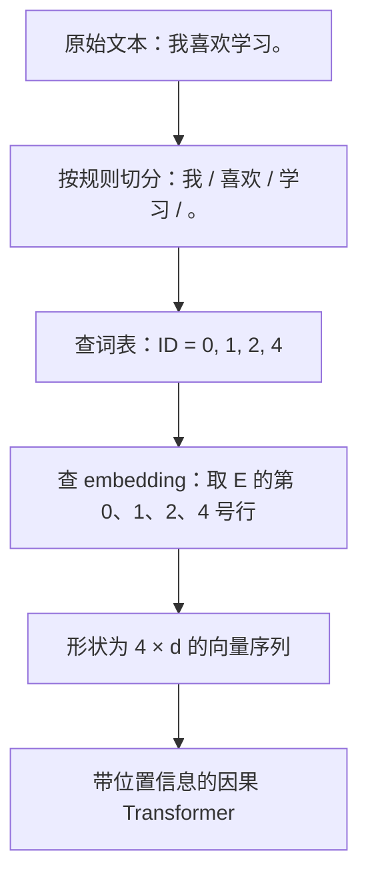
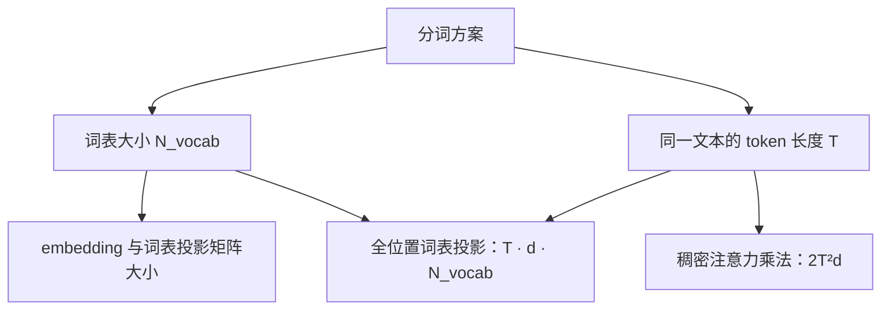
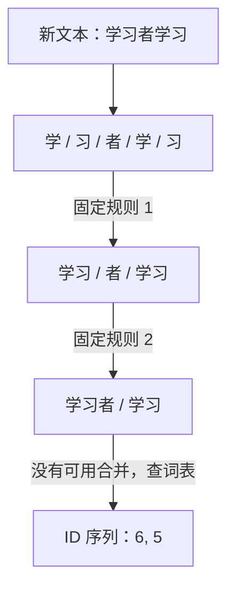

# 第四章：预训练与评估

预训练将原始语料转为训练样本，以自回归目标学习模型参数，并通过独立数据上的评估检验预测能力。数据表示、样本构造、优化与评估共同决定训练过程的含义和成本。

## 4.1 分词、词表与文本表示

### 4.1.1 从原始文本到 token ID

原始文本需要经过分词与编号，才能成为语言模型的离散输入。一个 token 可以对应完整词、字符、词片段或字节片段；具体边界取决于 tokenizer 的规则。[CS336 Lecture 1：Tokenization](https://github.com/stanford-cs336/spring2025-lectures/blob/b98b08a98d9d47a69bbdcb4e96a58aa48ee4d13b/lecture_01.py)

例如“我喜欢学习。”可以切为“我 / 喜欢 / 学习 / 。”，长度为 4；也可以按本例的单个汉字与标点切为“我 / 喜 / 欢 / 学 / 习 / 。”，长度为 6。两种方案需要各自的词表和规则。模型中的序列长度 $T$ 指分词后的 token 数量，不能直接用字符数或自然语言单词数代替。

采用第一种切分方式，设词表为：

| Token | ID |
| --- | ---: |
| 我 | 0 |
| 喜欢 | 1 |
| 学习 | 2 |
| 物理 | 3 |
| 。 | 4 |
| 数学 | 5 |

则“我喜欢学习。”编码为 $[0,1,2,4]$。词表大小为 6，本句长度为 4；未出现在本句中的 token 仍然属于词表。ID 只是标识和索引，编号的数值大小与差值不表示语义大小或语义距离。

令 embedding 宽度为 $d$，则表 $E\in\mathbb R^{6\times d}$，查表结果为

$$
X_{\mathrm{emb}}=
\begin{bmatrix}
E[0,:]\\
E[1,:]\\
E[2,:]\\
E[4,:]
\end{bmatrix}
\in\mathbb R^{4\times d}.
$$

整数 ID 用于选取行，不作为连续数值参与大小比较。词表编号与 embedding 向量是不同对象；在通常先确定 tokenizer、再预训练语言模型的流程中，规则和编号固定，而 embedding 作为模型参数接受梯度更新。

输出也遵循同一套编号。若 $W_{\mathrm{vocab}}\in\mathbb R^{d\times6}$，每个位置的第 $j$ 项 logit 对应下一个 token 的 ID 为 $j$。例如选出 ID 3，按此词表解释为“物理”。生成的 ID 序列经 tokenizer 解码得到文本。

输入 embedding 行、输出词表投影列以及 tokenizer 的编号约定需要保持一致。只交换 tokenizer 中“学习”和“数学”的编号而保持权重不变，会使“学习”输入读取原先“数学”的 embedding 行，输出含义也随之错位。词表大小相同不保证 tokenizer 与模型兼容。

本节已对给定切分下的 ID 映射、文本拼接还原与 embedding 索引形状作 CPU NumPy 核对；未训练分词器或完整语言模型。

### 4.1.2 分词粒度：词表大小与序列长度的取舍

整词、字符与字节方案采用不同的基础单位。“学习”若作为一个完整 token，长度为 1；按本例的单个汉字切分，长度为 2；按 UTF-8 字节切分，则为 $[229,173,166,228,185,160]$，长度为 6。本例每个汉字占三个字节。Python UTF-8 编解码已核对字节值、长度与完整文本还原。

严格整词词表可能遇到未收录的新词、名字或拼写变体。若用同一特殊 token 〈unk〉替代多个未知词，就会丢失它们的具体内容；增加完整词的覆盖范围会扩大词表，而稀有词的训练数据仍可能不足。字符方案可用已收录字符组合表示未见词，例如字符词表已有“学”“习”“者”时，可表示“学习者”，但可编码不等于模型理解该组合。仅按语料中已出现字符建表，也不能保证覆盖后续所有生僻字符。

纯字节方案保留全部 256 种字节值，可以表示任何有效 UTF-8 文本的字节序列，无需因新词或新字符增加基础 token，控制用特殊 token 另计。其序列可能更长；完整字节序列可以还原文本，单个字节 token 未必能独立显示为一个完整字符。[CS336 Lecture 1：字符、字节与词分词](https://github.com/stanford-cs336/spring2025-lectures/blob/b98b08a98d9d47a69bbdcb4e96a58aa48ee4d13b/lecture_01.py)

设词表大小为 $N_{\mathrm{vocab}}$、分词长度为 $T$、模型宽度为 $d$。标准稠密计算中的相关成本为：

| 部分 | 主要成本 |
| --- | --- |
| 输入 embedding 表 | $N_{\mathrm{vocab}}d$ 个参数 |
| 输出词表投影矩阵 | $dN_{\mathrm{vocab}}$ 个参数 |
| 全部位置的词表投影 | $TdN_{\mathrm{vocab}}$ MACs |
| 单层注意力打分与 V 加权合计 | $2T^2d$ MACs |

若输入与输出权重共享，不应重复计入独立参数。运算量仅统计表中对应矩阵乘法，不是完整模型成本或实测耗时。

较小词表可能减小 embedding 和输出头，却因更长的序列增加注意力成本。收录更多常见长片段可能缩短序列，但也会扩大词表。对固定 token 上下文窗口，切分得更碎意味着同一段文本占用更多位置。不能仅据词表大小判断整体成本。

子词分词采用较长的常见片段，同时保留较小的组合单位。例如某套规则可将“学习者”表示为“学习 / 者”。这些片段不要求符合语言学上的词根或词缀；BPE 从小单位出发，根据语料中的相邻组合构造更长 token。此处说明折中动机，尚未训练分词器。

### 4.1.3 BPE：相邻对统计与合并

BPE（Byte Pair Encoding）最初是压缩方法，后被用于子词分词。其基本过程是统计语料中当前相邻 token 对的频次，选择最高频对构造新 token，替换后继续更新统计。分词版本可以从字符或字节等单位出发。[Sennrich 等，2016，§3.2](https://aclanthology.org/P16-1162.pdf)

以下例子从字符出发，每条文本为独立片段，不跨片段边界统计或合并，也不额外添加边界 token。各轮最高频对唯一，无需处理并列；一般实现应固定并列选择规则。

| 文本 | 语料频次 | 初始序列 |
| --- | ---: | --- |
| 学习 | 5 | 学 / 习 |
| 学习者 | 4 | 学 / 习 / 者 |
| 学习班 | 2 | 学 / 习 / 班 |
| 学生 | 3 | 学 / 生 |

初始词表为“学、习、者、班、生”五项。令 $f(x)$ 为片段 $x$ 的语料频次，$n_{a,b}(x)$ 为其当前 token 序列中相邻对 $(a,b)$ 的出现次数，则

$$
C(a,b)=\sum_x f(x)n_{a,b}(x).
$$

第一轮计数：

| 相邻对 | 加权次数 |
| --- | ---: |
| 学 / 习 | $5+4+2=11$ |
| 习 / 者 | 4 |
| 习 / 班 | 2 |
| 学 / 生 | 3 |

“学 / 习”出现在三种不同片段中，但语料加权次数为 11，不能只按片段种类计为 3。选择该最高频对并记录规则 $(学,习)\to 学习$。替换所有片段中的匹配后，得到：

| 文本 | 第一轮后 | 第二轮后 |
| --- | --- | --- |
| 学习 | 学习 | 学习 |
| 学习者 | 学习 / 者 | 学习者 |
| 学习班 | 学习 / 班 | 学习 / 班 |
| 学生 | 学 / 生 | 学 / 生 |

第一轮之后的相邻对为“学习 / 者”4 次、“学习 / 班”2 次、“学 / 生”3 次。第二轮选择 $(学习,者)\to 学习者$。原来的“习 / 者”不再是当前相邻 token 对，因为“习”已经位于“学习”内部。不能沿用初始字符串的字符对统计；新产生的长 token 可以参加后续合并。

本例保留已有词表项，依次新增“学习”“学习者”，词表大小从 5 增至 6、7。整份语料按频次计算，初始 token 总数为 $5\times2+4\times3+2\times3+3\times2=34$。本例匹配不重叠，第一轮 11 次替换后为 23，第二轮 4 次替换后为 19。词表项数与文本序列中的 token 个数是不同的量。

BPE 训练在此学习的是词表及有顺序的合并规则，依靠计数与替换完成，不涉及神经网络反向传播，也不规定合并 token 的 embedding 必须等于原向量之和。语言模型中的向量参数由后续模型训练学习。训练可按合并次数、目标词表大小等条件停止；规则固定后才用于新文本编码。

上述两轮的加权计数、替换结果、token 总数和保留原文的性质已用 CPU Python 核对。这里只进行了小语料的机制验证，未训练真实语料分词器或完整语言模型。

### 4.1.4 用固定的 BPE 规则编码新文本

BPE 训练统计语料中的相邻对频次，并据此学习词表及合并规则；编码新文本时使用已经固定的规则，不重新统计输入来训练词表。[Sennrich 等，2016，§3.2](https://aclanthology.org/P16-1162.pdf)

沿用前节语料，第三轮最高频对为“学 / 生”（3 次），高于“学习 / 班”（2 次）。假设完成第三轮便停止，冻结如下规则与编号：

| 合并优先级 | 规则 |
| ---: | --- |
| 1 | 学 + 习 → 学习 |
| 2 | 学习 + 者 → 学习者 |
| 3 | 学 + 生 → 学生 |

| Token | ID |
| --- | ---: |
| 学 | 0 |
| 习 | 1 |
| 者 | 2 |
| 班 | 3 |
| 生 | 4 |
| 学习 | 5 |
| 学习者 | 6 |
| 学生 | 7 |

本例从字符出发，将新输入“学习者学习”视为一个可在内部合并的片段：

$$
[学,习,者,学,习]
\longrightarrow [学习,者,学习]
\longrightarrow [学习者,学习]
\longrightarrow [6,5].
$$

第一条规则在两处匹配，第二条规则随后匹配前两个 token；第三条无匹配，最终没有可用合并，停止并查表得到 ID。新输入的整体组合不需要作为一个完整 token 出现在训练语料中；该过程不新增 token，也不更新模型参数。

“学习班”只能得到“学习 / 班”，对应 $[5,3]$，因为固定规则中没有“学习 + 班 → 学习班”。即使该片段在新输入中重复出现很多次，普通编码也不会临时新增合并规则。训练与编码的区别在于：前者学习规则，后者应用规则。

一般编码按训练得到的优先级选择当前可合并的相邻对，更新序列后继续。不能用当前输入频率替代合并顺序，也不是临时选择最长字符串。完整 tokenizer 的复现还依赖词表、ID、合并顺序、预处理与片段边界规则。

在本例直接拼接字符片段的设置中，解码先由 ID 找回 token，再拼接为文本，例如 $[6,5]\to[学习者,学习]\to$“学习者学习”。合并改变 token 边界而保留字符内容。此字符版本仍要求输入字符被基础词表覆盖，未收录字符需要另外处理。

固定规则的编码、ID 映射、重复输入不增加词表以及文本往返已用 CPU Python 核对；未开展真实语料 tokenizer 训练或完整模型实验。

### 4.1.5 字节级 BPE 如何覆盖未见字符

字符级 BPE 需要先有对应的基础字符。字节级 BPE 先把文本编码成 UTF-8，以全部 256 种单字节值为基础 token，再按训练得到的规则合并。因此没有整字词表项也能编码；即使没有合并可用，该字的每个字节仍可表示。

设单字节 ID 等于字节值，唯一合并规则把十六进制字节对 `E7 8C` 合为 ID 256。“猫”占 3 个 UTF-8 字节，合并后占 2 个模型输入位置：

解码时查回两个字节片段，依次拼接为 `E7 8C AB`，再按 UTF-8 解码。token 边界可以位于字符内部，分别解码两个片段会遇到不完整字符。只要预处理保留原文，合并只改变边界，不改变还原出的字节序列。字节覆盖保证可表示，并不保证序列短，也不说明语言模型理解了该字。

### 4.1.6 用特殊 token 标记文档边界

假设第一篇文档是“我喜欢猫”，第二篇是“学生学习”。如果直接拼接，“猫”和“学生”就成了相邻的 token，序列里没有记录这里换了一篇文档。我们可以在词表里预留一个专用 ID，写作 `<eos>`，让数据处理程序在每篇文档末尾插入它。它占一个 token 位置。

训练时，把整条序列错开一位，得到下面的输入和目标。这个例子保留所有相邻位置的预测损失。

| 位置 | 0 | 1 | 2 | 3 | 4 | 5 |
|---|---|---|---|---|---|---|
| 输入 X | 我 | 喜欢 | 猫 | `<eos>` | 学生 | 学习 |
| 目标 Y | 喜欢 | 猫 | `<eos>` | 学生 | 学习 | `<eos>` |

读到位置 2 的“猫”时，目标是 `<eos>`，模型由此学习预测文档结束。到了位置 3，同一个 `<eos>` 又成了**输入**；因为这里保留了跨文档的预测损失，它的目标就是下一篇开头的“学生”。

**标记边界不会自动隔离注意力。** 位置 4 的“学生”使用普通因果掩码时，可以读取位置 0–4，包括上一篇里的“猫”。如果希望两篇文档的注意力完全隔离，就要在“只能看当前位置及之前”以外再加一个条件：query 和 key 必须属于同一篇文档。

### 4.1.7 用损失掩码跳过跨文档预测

将“今天下雨”和“明天放晴”拼成一条训练序列，若希望模型学会预测**一篇文档在哪里结束**，但不要求它根据上一篇的结尾猜下一篇如何开头。则要保留“下雨 → `<eos>`”，跳过“`<eos>` → 明天”。两项虽然都涉及同一个 `<eos>`，却是两个不同位置的预测。

在已经对齐的输入和目标下面，加一行**损失掩码**。1 表示把该列的预测损失计入平均，0 表示跳过：

| 位置 | 0 | 1 | 2 | 3 | 4 |
|---|---|---|---|---|---|
| 输入 | 今天 | 下雨 | `<eos>` | 明天 | 放晴 |
| 目标 | 下雨 | `<eos>` | 明天 | 放晴 | `<eos>` |
| 损失掩码 | 1 | 1 | **0** | 1 | 1 |

如果第 $i$ 列的交叉熵是 $\ell_i$，那么平均损失是 $(\ell_0+\ell_1+\ell_3+\ell_4)/4$。分母是 **4 个有效目标**。位置 2 的损失被跳过，“明天”仍然是位置 3 的输入，模型仍然要用它预测“放晴”。

**两种掩码控制不同的事：**注意力掩码决定“做预测时可以读哪些位置”；损失掩码决定“哪些预测计入训练目标”。如果只想跳过跨文档预测，改损失掩码就够了。如果还希望“明天”在预测“放晴”时读不到上一篇，就要同时限制注意力。

### 4.1.8 不同长度的序列怎样组成一个 batch

把两篇文档放在 batch 的**两行**里，每行是一条独立序列。A 是 `[我, 喜欢, 猫, <eos>]`，B 是 `[下雨, <eos>]`。为了组成矩形张量，先在 B 的右边补两个 `<pad>`，再对每行取 `X = tokens[:-1]`、`Y = tokens[1:]`：

| 序列 | 输入 X | 目标 Y | 损失掩码 |
|---|---|---|---|
| A | 我，喜欢，猫 | 喜欢，猫，`<eos>` | `[1, 1, 1]` |
| B | 下雨，`<eos>`，`<pad>` | `<eos>`，`<pad>`，`<pad>` | `[1, 0, 0]` |

看 B 的中间一列：输入 `<eos>` 是真实 token，但它的目标 `<pad>` 是为了凑齐长度才填的。**判断这一列是否计入损失，要看有没有真实的下一 token。** 所以保留“下雨 → `<eos>`”，忽略“`<eos>` → `<pad>`”。

此时 X 和 Y 的形状都是 $[2,3]$，共有 6 个位置，却只有 $3+1=4$ 个有效目标。若要计算**每个有效 token 的平均损失**，就把这 4 项相加后除以 4。先算每行均值再把两行各按一半加权，会让短文档里唯一一次预测占整个 batch 的一半。

### 4.1.9 固定长度训练块与序列打包（packing）

序列打包可以**让两篇短文档共用一行，同时保留各自的预测目标。**

设 A = `[我, 喜欢, 猫, <eos>]` 和 B = `[下雨, <eos>]`。为方便比较，两种摆法都固定每行有 **5 个预测位置**。构造下一 token 目标时，先排 6 个 token，再取前 5 个作输入、后 5 个作目标。下表展示的是**错位前**的排列，短横线表示 `<pad>`：

| 摆法 | 0 | 1 | 2 | 3 | 4 | 5 |
|---|---|---|---|---|---|---|
| 单独放 A | 我 | 喜欢 | 猫 | `<eos>` | — | — |
| 单独放 B | 下雨 | `<eos>` | — | — | — | — |
| 打包 A 和 B | 我 | 喜欢 | 猫 | `<eos>` | 下雨 | `<eos>` |

**看打包行的五对相邻 token。** 前三对是 A 的预测：“我 → 喜欢”“喜欢 → 猫”“猫 → `<eos>`”；最后一对是 B 的预测：“下雨 → `<eos>`”。中间多出来的一对是“`<eos>` → 下雨”，它跨了文档边界。要保留和分开训练时相同的四个目标，就把这一项的损失屏蔽，得到 `[1,1,1,0,1]`。如果还要让 B 在预测时只能读取自己的前缀，注意力也要按文档隔离。

现在可以分清两种“填满”：打包行里 **6 个 token 都是真实的**，但 **5 个预测位置中只有 4 个计入损失**。同样四个有效目标，分开补齐占两行，有效预测位置占比是 $4/10=40\%$；打包后占一行，占比是 $4/5=80\%$。这个比例描述位置利用率，不能直接当成实测加速比。

### 4.1.10 长文档切块：保留切口处的预测目标

上一篇和下一篇之间的预测可以有意跳过。现在换成**同一篇长文档**：切口两侧的 token 原本相邻，我们希望保留这一次预测。

假设文档是 `[今天, 我, 去, 公园, 看, 猫, <eos>]`，每个块最多有 **3 个输入位置**。先把全文错开一位得到输入和目标，再把两行在同一处切开：

| | 块 1 | 块 2 |
|---|---|---|
| 输入 X | 今天，我，去 | 公园，看，猫 |
| 目标 Y | 我，去，公园 | 看，猫，`<eos>` |

观察“公园”的两个角色：它是块 1 的**最后一个目标**，也是块 2 的**第一个输入**。所以“去 → 公园”没有漏掉，“公园 → 看”也只算一次。如果从原始 token 取窗口，这等价于每次取 4 个 token、起点前进 3 格：两个原始窗口共用“公园”，但它们负责的三对预测没有重叠。

**保留目标不等于保留全部上下文。** 假设两个块独立前向、不传递历史状态。块 1 预测“公园”时可以看到“今天，我，去”；块 2 预测“看”时却只能看到“公园”。同一篇文档并没有在这里结束，所以也不应仅仅因为切块就插入 `<eos>`。

### 4.1.11 滑动窗口：用重叠换取上下文，怎样计算损失？

假设一篇文档是 `[甲,乙,丙,丁,戊,己,庚,辛]`，每块最多有 **4 个输入位置**。如果输入块不重叠，第二块从“戊”开始：预测“己”时只看得到“戊”。如果让第二块提前从“丙”开始，同样预测“己”，现在就能看到“丙、丁、戊”。多出来的两个位置是真实的前文，代价是要再计算一次。

这里有两个可以分别选择的量：**窗口长度** $T$ 是每块最多有多少个输入位置；**步长** $S$ 是下一块的起点往后移几格。取 $T=4,S=2$，相邻满块的输入会重叠 $T-S=2$ 个位置。我们再定一条损失规则：**一个原文目标位置第一次出现时计算损失，以后再出现只作上下文，不重复计分。**

| 块（输入起点从 0 编号） | 输入 X | 目标 Y | 损失掩码 |
|---|---|---|---|
| 1（起点 0） | 甲，乙，丙，丁 | 乙，丙，丁，戊 | `[1,1,1,1]` |
| 2（起点 2） | 丙，丁，戊，己 | 丁，戊，己，庚 | `[0,0,1,1]` |
| 3（起点 4） | 戊，己，庚，辛 | 己，庚，辛，`<pad>` | `[0,0,1,0]` |

**看第二块的“己”。** 输入“戊”的位置负责预测它，这项损失要算。前面的“丙、丁”虽然各自位置的损失被屏蔽，“戊”仍能通过因果注意力读取它们。因此，损失掩码为 0 的位置也能帮助模型预测后面的 token。判断是否重复看的是**原文位置**：如果两个不同位置恰好都是同一个字，它们仍然是两个目标。

**再看最后一块的三个 0。** 前两个 0 表示“己、庚已经计过分”，最后一个 0 表示“辛后面没有给定下一个 token”。这里的 `<pad>` 只用来填齐目标数组，不是要模型预测的文档结尾。读到这里，七个原文目标都已覆盖，可以停止滑动。按有效目标取平均，分母是 $4+2+1=7$，恰好对应八个 token 之间的七对相邻关系。

也可以选择让每个窗口里的所有真实目标都计分。这个例子就会有 $4+4+3=11$ 项损失：例如“丁 → 戊”算了两次，而且两次能看到的前文还不同。这是另一种训练目标。**窗口决定模型看到什么，损失规则决定哪些预测占多大权重。**

## 4.2 预训练语料的划分与评估

### 4.2.1 先划分文档，再构造样本：验证损失在衡量什么？

假设我们要检验模型对**未参与训练的新文档**的预测能力。沿用上一节的长文档和 $T=4,S=2$。如果先切窗，再把一个窗口随机分到训练集、另一个分到验证集，可能得到：

| 用途 | 输入 X | 目标 Y |
|---|---|---|
| 训练 | 甲，乙，丙，丁 | 乙，丙，丁，戊 |
| 验证 | 丙，丁，戊，己 | 丁，戊，己，庚 |

**先看“丁 → 戊”。** 如果每个真实目标都计分，这对相邻位置既用于训练，也用于验证。训练时模型根据“甲、乙、丙、丁”预测“戊”；验证时根据“丙、丁”预测“戊”。它们不是完全相同的条件预测，却来自同一篇原文的同一个目标位置。模型即使没有学会泛化到新文档，也可能因为熟悉这段文本而得到较低的验证损失。

**再看“戊 → 己”。** 假设我们很仔细，在验证窗口使用 `[0,0,1,1]`，只考“己、庚”两个尚未计分的目标。这样确实消除了重复计分，但训练集已经包含这篇文档的开头。因此，这个例子更接近“见过文档开头后，能否预测它的后文”。这是有意义的评估，只是它回答不了原先那个关于**新文档**的问题。判断数据有没有泄漏，关键要看准备声称模型能泛化到什么对象。

如果评估目标是新文档，可以按下面的顺序准备数据：

1. **先按文档划分。** 为每篇原始文档保留 ID，整篇进入训练集或验证集。若文档 B 是 A 的转载，两个 ID 也不能保证独立；可以只保留一份，或把同一内容的版本归为一组，整组划入同一集合。不同文章偶尔共用“今天下雨”这样的短语，不等于泄漏。
2. **再在各集合内部构造样本。** 用同一套固定 tokenizer 编码，各自切窗、打包、生成掩码。训练块只能取训练文档，验证块只能取验证文档。在训练集内部打乱窗口顺序不会破坏这个边界。
3. **按有效验证目标汇总损失。** 例如两篇验证文档分别有 2 个和 6 个有效目标，平均交叉熵分别为 1.0 和 2.0。若关心每个 token 的预测质量，整体验证损失为 $(2×1.0+6×2.0)/8=1.75$。若先算每篇均值再平均，则是 1.5，每篇文档的权重相同。两种算法回答不同的问题；无论选哪种，加权都不能补救训练与验证之间的内容泄漏。

## 参考资料

- [D2L：文本预处理](../refs/d2l-en/chapter_recurrent-neural-networks/text-sequence.md)：token、词表与索引映射。
- [CS336 Lecture 1](https://github.com/stanford-cs336/spring2025-lectures/blob/b98b08a98d9d47a69bbdcb4e96a58aa48ee4d13b/lecture_01.py)：字符串编码、ID 序列与解码，以及字符、字节、词和 BPE 分词。
