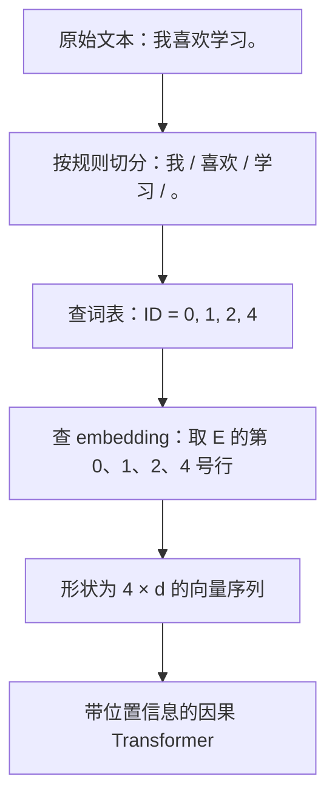
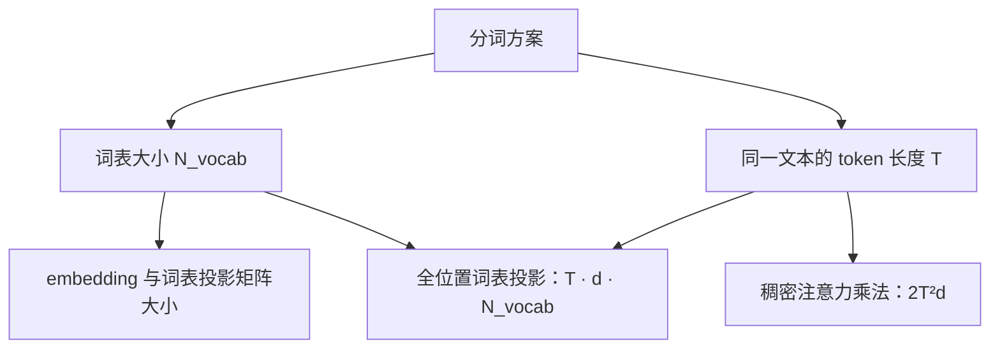

# 第四章：预训练与评估

预训练将原始语料转为训练样本，以自回归目标学习模型参数，并通过独立数据上的评估检验预测能力。数据表示、样本构造、优化与评估共同决定训练过程的含义和成本。

## 4.1 分词、词表与文本表示

### 4.1.1 从原始文本到 token ID

原始文本需要经过分词与编号，才能成为语言模型的离散输入。一个 token 可以对应完整词、字符、词片段或字节片段；具体边界取决于 tokenizer 的规则。[CS336 Lecture 1：Tokenization](https://github.com/stanford-cs336/spring2025-lectures/blob/b98b08a98d9d47a69bbdcb4e96a58aa48ee4d13b/lecture_01.py)

例如“我喜欢学习。”可以切为“我 / 喜欢 / 学习 / 。”，长度为 4；也可以按本例的单个汉字与标点切为“我 / 喜 / 欢 / 学 / 习 / 。”，长度为 6。两种方案需要各自的词表和规则。模型中的序列长度 $T$ 指分词后的 token 数量，不能直接用字符数或自然语言单词数代替。

采用第一种切分方式，设词表为：

| Token | ID |
| --- | ---: |
| 我 | 0 |
| 喜欢 | 1 |
| 学习 | 2 |
| 物理 | 3 |
| 。 | 4 |
| 数学 | 5 |

则“我喜欢学习。”编码为 $[0,1,2,4]$。词表大小为 6，本句长度为 4；未出现在本句中的 token 仍然属于词表。ID 只是标识和索引，编号的数值大小与差值不表示语义大小或语义距离。

令 embedding 宽度为 $d$，则表 $E\in\mathbb R^{6\times d}$，查表结果为

$$
X_{\mathrm{emb}}=
\begin{bmatrix}
E[0,:]\\
E[1,:]\\
E[2,:]\\
E[4,:]
\end{bmatrix}
\in\mathbb R^{4\times d}.
$$

整数 ID 用于选取行，不作为连续数值参与大小比较。词表编号与 embedding 向量是不同对象；在通常先确定 tokenizer、再预训练语言模型的流程中，规则和编号固定，而 embedding 作为模型参数接受梯度更新。

输出也遵循同一套编号。若 $W_{\mathrm{vocab}}\in\mathbb R^{d\times6}$，每个位置的第 $j$ 项 logit 对应下一个 token 的 ID 为 $j$。例如选出 ID 3，按此词表解释为“物理”。生成的 ID 序列经 tokenizer 解码得到文本。

输入 embedding 行、输出词表投影列以及 tokenizer 的编号约定需要保持一致。只交换 tokenizer 中“学习”和“数学”的编号而保持权重不变，会使“学习”输入读取原先“数学”的 embedding 行，输出含义也随之错位。词表大小相同不保证 tokenizer 与模型兼容。

本节已对给定切分下的 ID 映射、文本拼接还原与 embedding 索引形状作 CPU NumPy 核对；未训练分词器或完整语言模型。

### 4.1.2 分词粒度：词表大小与序列长度的取舍

整词、字符与字节方案采用不同的基础单位。“学习”若作为一个完整 token，长度为 1；按本例的单个汉字切分，长度为 2；按 UTF-8 字节切分，则为 $[229,173,166,228,185,160]$，长度为 6。本例每个汉字占三个字节。Python UTF-8 编解码已核对字节值、长度与完整文本还原。

严格整词词表可能遇到未收录的新词、名字或拼写变体。若用同一特殊 token 〈unk〉替代多个未知词，就会丢失它们的具体内容；增加完整词的覆盖范围会扩大词表，而稀有词的训练数据仍可能不足。字符方案可用已收录字符组合表示未见词，例如字符词表已有“学”“习”“者”时，可表示“学习者”，但可编码不等于模型理解该组合。仅按语料中已出现字符建表，也不能保证覆盖后续所有生僻字符。

纯字节方案保留全部 256 种字节值，可以表示任何有效 UTF-8 文本的字节序列，无需因新词或新字符增加基础 token，控制用特殊 token 另计。其序列可能更长；完整字节序列可以还原文本，单个字节 token 未必能独立显示为一个完整字符。[CS336 Lecture 1：字符、字节与词分词](https://github.com/stanford-cs336/spring2025-lectures/blob/b98b08a98d9d47a69bbdcb4e96a58aa48ee4d13b/lecture_01.py)

设词表大小为 $N_{\mathrm{vocab}}$、分词长度为 $T$、模型宽度为 $d$。标准稠密计算中的相关成本为：

| 部分 | 主要成本 |
| --- | --- |
| 输入 embedding 表 | $N_{\mathrm{vocab}}d$ 个参数 |
| 输出词表投影矩阵 | $dN_{\mathrm{vocab}}$ 个参数 |
| 全部位置的词表投影 | $TdN_{\mathrm{vocab}}$ MACs |
| 单层注意力打分与 V 加权合计 | $2T^2d$ MACs |

若输入与输出权重共享，不应重复计入独立参数。运算量仅统计表中对应矩阵乘法，不是完整模型成本或实测耗时。

较小词表可能减小 embedding 和输出头，却因更长的序列增加注意力成本。收录更多常见长片段可能缩短序列，但也会扩大词表。对固定 token 上下文窗口，切分得更碎意味着同一段文本占用更多位置。不能仅据词表大小判断整体成本。

子词分词采用较长的常见片段，同时保留较小的组合单位。例如某套规则可将“学习者”表示为“学习 / 者”。这些片段不要求符合语言学上的词根或词缀；BPE 从小单位出发，根据语料中的相邻组合构造更长 token。此处说明折中动机，尚未训练分词器。

## 参考资料

- [D2L：文本预处理](../refs/d2l-en/chapter_recurrent-neural-networks/text-sequence.md)：token、词表与索引映射。
- [CS336 Lecture 1](https://github.com/stanford-cs336/spring2025-lectures/blob/b98b08a98d9d47a69bbdcb4e96a58aa48ee4d13b/lecture_01.py)：字符串编码、ID 序列与解码，以及字符、字节、词和 BPE 分词。
