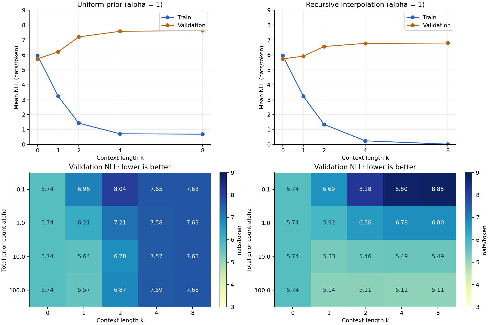
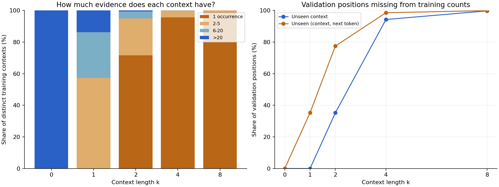
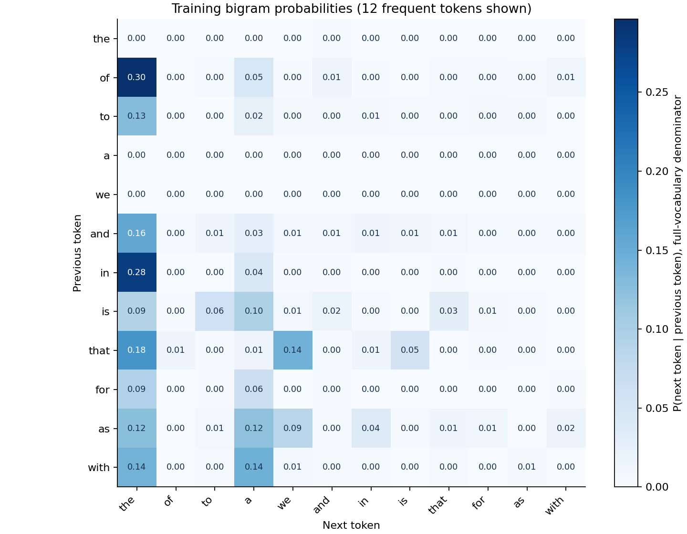

# 第一章实验：上下文长度、平滑与泛化

语料来自本地 D2L 英文讲义；按 Markdown 文档划分，固定种子 42。

## 实验设置

| 集合 | 文档数 | 计分 token 数（含 EOS） | UNK 比例 |
| --- | ---: | ---: | ---: |
| train | 36 | 37496 | 3.80% |
| validation | 8 | 9081 | 11.07% |
| test | 8 | 8187 | 9.98% |
| topic_shift | 6 | 6917 | 15.74% |

词表大小：2077。仅保留训练中出现至少 2 次的词；其他词映射为 UNK。
每篇取清理后的前 1,200 个英文词，保留至少 200 词的文档；去掉代码、公式、图片和练习。
每个文档重置 BOS，上下文最长为 8；计分覆盖全部词和一个 EOS。
语料属于同一本教材，结果反映教材内部的文档泛化。topic_shift 是额外的计算性能主题讲义。

## 平滑方式

两种方法都使用 `(count + alpha * prior) / (context_count + alpha)`，alpha 是虚拟计数总量。
均匀先验使用 `prior = 1 / V`；递归插值使用短一阶的预测，最底层同样使用均匀先验。

## 训练与验证

以下固定 alpha = 1；图中同时列出全部 alpha 的验证损失。

| 方法 | 上下文 k | 训练 NLL | 验证 NLL | 验证未见上下文 |
| --- | ---: | ---: | ---: | ---: |
| 均匀先验 | 0 | 5.948 | 5.735 | 0.0% |
| 均匀先验 | 1 | 3.229 | 6.207 | 0.0% |
| 均匀先验 | 2 | 1.428 | 7.210 | 35.2% |
| 均匀先验 | 4 | 0.714 | 7.582 | 94.2% |
| 均匀先验 | 8 | 0.690 | 7.632 | 99.7% |
| 递归插值 | 0 | 5.948 | 5.735 | 0.0% |
| 递归插值 | 1 | 3.225 | 5.916 | 0.0% |
| 递归插值 | 2 | 1.346 | 6.562 | 35.2% |
| 递归插值 | 4 | 0.242 | 6.775 | 94.2% |
| 递归插值 | 8 | 0.019 | 6.797 | 99.7% |

## 验证集选择与最终评估

本次网格中，验证集选中：**递归插值，k = 4，alpha = 100**。

验证 NLL：**5.106**；选定后测试 NLL：**5.036**。
计算性能主题 NLL：**5.158**。测试集与主题迁移集均不参与参数选择。

作为参照，alpha = 1 的 unigram 验证 NLL 为 5.735。
UNK 将多个稀有词合并为一个预测目标；这些损失不等于完整原始词表上的损失。

## 计数表规模

| 最大上下文 k | 本阶不同上下文 | 本阶非零转移项 | 递归模型累计转移项 |
| --- | ---: | ---: | ---: |
| 0 | 1 | 2077 | 2077 |
| 1 | 2077 | 18169 | 20246 |
| 2 | 18140 | 30866 | 51112 |
| 4 | 35100 | 36324 | 122571 |
| 8 | 36953 | 37052 | 270215 |

热力图只显示 12 个常见词，分母仍包含完整词表，因此可见行的概率之和可以小于 1。

## 复现

主要入口：[实验 Notebook](../ngram.ipynb)；运行方式见 [实验说明](../README.md)。
完整数值见 [results.json](results.json)，语料文件及校验和见 [manifest.json](manifest.json)。

数据来源：[Dive into Deep Learning](https://github.com/d2l-ai/d2l-en)，作者 Aston Zhang、Zachary C. Lipton、Mu Li、Alexander J. Smola 及贡献者。
固定版本：`23d7a5aecceee57d1292c56e90cce307f183bb0a`；原文许可：[CC BY-SA 4.0](https://creativecommons.org/licenses/by-sa/4.0/)。
